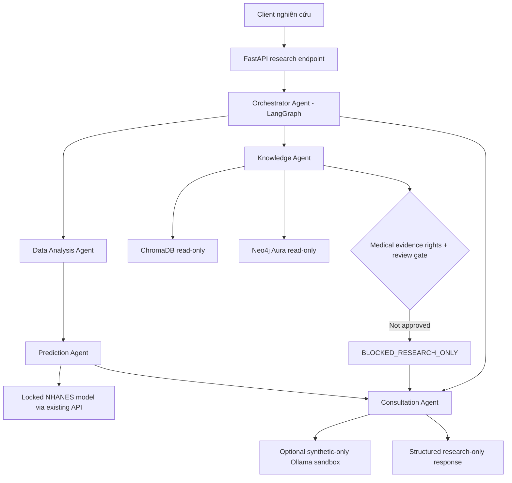

# GIAI ĐOẠN 5 — LỘ TRÌNH TÍCH HỢP HỆ THỐNG MULTI-AGENT AI

**Dự án:** Multi-Agent AI System for Diabetes Risk Assessment  
**Trạng thái:** **Khởi động** — chưa triển khai đủ năm Agent  
**Ngày:** 2026-11-03  
**Tiền đề:** Giai đoạn 3 hoàn tất baseline NHANES + Prediction Agent tối giản; Giai đoạn 4 hoàn tất Knowledge/RAG sandbox theo báo cáo nghiệm thu.

## 1. Đầu ra mục tiêu

Tạo **một luồng nghiên cứu thống nhất** chạy local qua FastAPI + LangGraph, điều phối 5 chức năng Agent với hợp đồng dữ liệu rõ ràng, xử lý ngoại lệ, logging an toàn, cơ chế fail-closed và kiểm thử trên input giả lập. Đây **không** là hệ thống chẩn đoán, kê đơn hoặc đánh giá nguy cơ mắc bệnh tương lai cho cá nhân.

## 2. Phạm vi từng Agent

| Agent | Input / chức năng | Output và giới hạn |
|---|---|---|
| **Orchestrator** | Nhận yêu cầu, định tuyến node LangGraph, timeout/error handling, điều kiện chuyển nhánh | Trạng thái workflow/audit; không bypass Gate |
| **Data Analysis** | Kiểm tra tuổi `RIDAGEYR`, giới tính `RIAGENDR`, BMI `BMXBMI`, định dạng/thiếu dữ liệu | Input đã thẩm định cho model; không tự học/chỉnh preprocessing |
| **Prediction** | Gọi lại FastAPI `POST /api/v1/research/nhanes/hba1c/predict` đã có từ Giai đoạn 3 | Kết quả HbA1c indicator nghiên cứu, giữ nguyên model/threshold; không chẩn đoán |
| **Knowledge** | Query ChromaDB/Neo4j, provenance + review gate | Metadata/chứng cứ chế độ debug; y khoa thật `BLOCKED_RESEARCH_ONLY` |
| **Consultation** | Kết hợp kết quả cấu trúc và status của Gate; LLM chỉ trên dữ liệu hư cấu nếu chế độ sandbox | Thông điệp nghiên cứu có giới hạn, từ chối lời khuyên y khoa chưa được chứng thực |

## 3. Sáu bước phát triển — có điểm dừng rõ ràng

| Bước | Công việc | Điều kiện nghiệm thu |
|---|---|---|
| **1. Integration Contracts & Environment Audit** | Khóa schema AgentState, phân biệt research vs synthetic sandbox, kiểm tra đường dẫn model/API, ChromaDB, Neo4j, Ollama trên máy người dùng | Bản schema và checklist kết nối; chưa gọi model/dữ liệu thật |
| **2. Data Analysis + Prediction Integration** | Bao gói nhánh prediction Giai đoạn 3 thành nodes, dùng lại API và model không sửa | Kiểm thử valid/invalid/upstream error với synthetic input; không train |
| **3. Knowledge Agent Adapter** | Bọc 05L Chroma+Neo4j read-only; chuyển gate thành trường cấu trúc, không truyền nguồn chưa duyệt vào LLM | Provenance đúng; unauthorized evidence không đi qua Gate; fail closed khi mất Neo4j |
| **4. Consultation Agent Sandbox** | Chạy response formatter; nếu dùng Ollama chỉ dựa vào Atlas synthetic 05M | Có citation đúng và abstention, không đưa y khoa thật vào LLM |
| **5. Orchestrator + FastAPI Workflow** | Xây LangGraph gồm 5 Agent, một endpoint nghiên cứu và trace an toàn; gắn vào hợp đồng API Giai đoạn 2 | Luồng thành công/thất bại có response schema thống nhất; kiểm thử local |
| **6. E2E Test + Báo cáo Giai đoạn 5** | Đo kết quả workflow, lỗi, timeouts, gate, no-data, synthetic-only | Báo cáo thực nghiệm thực tế do người dùng chạy; không tạo metric giả |

**Không** tự bổ sung thêm giai đoạn phụ không cần thiết; đi theo sáu bước đã thống nhất. Không cần làm lại các bước Neo4j/RAG Giai đoạn 4.

## 4. Những gì đã có và những gì chưa có

**Đã có (theo báo cáo người dùng):** baseline NHANES và FastAPI inference, minimal LangGraph Prediction Agent, ChromaDB 66 records, Neo4j 66 chunk metadata, các Safe Gate read-only, RAG sandbox Atlas với Ollama.

**Chưa triển khai:** LangGraph 5-agent hoàn chỉnh, một endpoint orchestration thống nhất, response schema chung, integration tests liên Agent, hệ thống xác thực/phân quyền production, xét duyệt lâm sàng và bản quyền.

## 5. Giữ nguyên những giá trị không được tùy tiện thay đổi

- Nhãn ML: `HbA1c >= 5.7% indicator`, **không phải nguy cơ bệnh type 2 tương lai**.
- Baseline: LogisticRegression, threshold **0.225**, SHA256 artifact: `31e9c94b0f14369be7920b9315b026d0c4afedb9f7b2885d120d631d930582b1`.
- ChromaDB collection: `diabetes_kb_step3_e5small_v1`, 66 vectors, embedding dim 384, source snapshot SHA256 `cc064ec7187192c999418051cb2125a0510412843f8d0908e3d6842e4a71c7cd`.
- Neo4j: 4 RelationCandidates/4 TechnicalReviews; **0 approved claims**.
- Medical gate: `BLOCKED_RESEARCH_ONLY`. Không dùng kết quả RAG Atlas để thay thế kiểm định y khoa.

## 6. Việc sẽ làm ngay ở Bước 1

1. Dùng thiết kế Giai đoạn 2 + báo cáo Giai đoạn 3/4 để chốt `AgentState`, request/response và error schema.
2. Thực hiện kiểm kê **chỉ đọc** môi trường local người dùng (phiên bản Python, model path, API base URL, Chroma persist directory, Neo4j URI/database — **không xuất mật khẩu**).
3. Viết skeleton Python LangGraph và hợp đồng mô-đun, nhưng **chưa** tích hợp LLM y khoa hoặc gọi kết nối thật tới khi người dùng chạy thử.
4. Giao bộ smoke-test synthetic để người dùng tự chạy và gửi kết quả thực nghiệm.

**Ghi chú:** REST API Giai đoạn 2 mới là bản thiết kế, endpoint tích hợp Agent sẽ được kiểm tra để tương thích trước khi mã hóa. Không gọi endpoint đề xuất là endpoint đã tồn tại.
