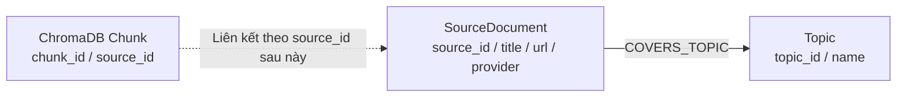

# Giai đoạn 4 – Bước 5B: Tạo Knowledge Graph metadata trên Neo4j Aura Console

**Trạng thái:** Tài liệu thực hành; chờ người dùng chạy các truy vấn trên AuraDB. Không tự động truy cập database, không huấn luyện ML, không tạo embeddings hoặc gọi LLM.

## Mục tiêu
- Nắm mô hình dữ liệu bằng nhãn Node, Relationship và thuộc tính trong Neo4j.
- Lưu metadata của 7 tài liệu đã có trong Source Registry (`source_id` là khóa nối với ChromaDB).
- Biểu diễn chủ đề của tài liệu mà không tự nhận đó là khẳng định y khoa đã được thẩm định.
- Thực hành Cypher bằng trình soạn thảo Neo4j Query trên https://console.neo4j.io/.

## Bối cảnh của dự án
- ChromaDB hiện có 66 chunks từ 7 nguồn.
- Evidence Gate mới xác nhận trích dẫn 25/42, bằng chứng quyền sử dụng 13/42 và chưa có nguồn nào được kiểm định độc lập hoàn toàn.
- Neo4j ở bước này chỉ lưu **metadata tài liệu và topic từ tiêu đề**, không lưu quan hệ y khoa có trạng thái `verified`.
- `registry_approval='self_declared_research'` không phải chứng nhận giấy phép; điều kiện dùng trong sản phẩm vẫn chưa đạt.

## Sơ đồ dữ liệu

Mở trong Neo4j Console, vào Instance đã tạo, chọn **Query**, kết nối database. Dùng file `05B-Aura-Console-Commands.cypher` và chạy **mỗi khối câu lệnh riêng** theo thứ tự:

1. Tạo hai uniqueness constraints cho `SourceDocument.source_id` và `Topic.topic_id`.
2. Dùng `UNWIND`/`MERGE` tạo bảy `SourceDocument`.
3. Tạo sáu `Topic`.
4. Tạo bảy quan hệ `COVERS_TOPIC` (suy ra từ tiêu đề bài, `medical_verified=false`).
5. Chạy các truy vấn kiểm tra và xem kết quả Graph.

**Kết quả kỳ vọng với database mới/trống:** `sources=7`, `topics=6`, `topic_links=7`. Nếu database có dữ liệu trước đó, cần đối chiếu đúng label và ID; không vội xóa dữ liệu.

## Checklist kiểm thử
- [ ] Có 7 node `SourceDocument`, mỗi node có `source_id` duy nhất.
- [ ] Có 6 node `Topic`.
- [ ] Có 7 quan hệ `COVERS_TOPIC`.
- [ ] Mỗi source có URL và tên đơn vị phát hành.
- [ ] `rights_status` vẫn ở trạng thái chờ xác minh độc lập.
- [ ] Không có quan hệ y khoa (`CAUSES`, `INCREASES_RISK`, `DIAGNOSES`) nào được công bố từ bước metadata.
- [ ] Chạy lại lệnh `MERGE` không tạo node trùng.

## Tiến độ tiếp theo – Bước 5C
Sau khi metadata graph đạt tiêu chí, sẽ xây dựng mẫu `MedicalClaim`/`Evidence`/`ChunkRef` để trích xuất **ứng viên** quan hệ từ từng đoạn của 66 chunks, kiểm tra thủ công và chỉ chuyển trạng thái approved khi có bằng chứng nội dung và quyền sử dụng. Không tự động gắn `verified=true` cho quan hệ y khoa.

## Kết quả cần ghi lại

- Ngày thực hiện: _chưa điền_
- Instance / database (không lưu password): _chưa điền_
- `source_documents_processed`: _chưa điền_
- `topics_processed`: _chưa điền_
- `topic_links_processed`: _chưa điền_
- `sources`, `topics`, `topic_links` (truy vấn kiểm tra): _chưa điền_
- Lỗi / điều chỉnh: _chưa điền_
- Ảnh Graph: _chưa đính kèm_

## Lưu ý an toàn
- Không chia sẻ mật khẩu Neo4j hoặc kết nối có thông tin bí mật.
- Tránh chạy `MATCH (n) DETACH DELETE n` trên database đang sử dụng.
- Không đánh dấu nội dung y khoa được thẩm định nếu chưa có kiểm định độc lập.
- Không gửi dữ liệu cá thể người bệnh vào Neo4j ở bước này.
