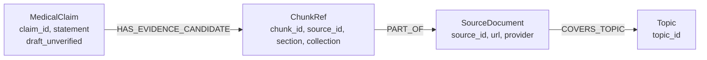

# Giai đoạn 4 – Bước 5C: Chunk Provenance & Medical Claim Candidates trên Neo4j Aura

**Tình trạng:** Đã soạn hướng dẫn và Cypher, **chưa chạy trên AuraDB của người dùng**. Không thay đổi mô hình ML, ChromaDB hay dữ liệu sức khỏe; không dùng LLM. Bước 5B chưa có output thực tế nên cần preflight trước khi chạy 5C.

## 1. Mục tiêu

1. Bảo đảm trong Neo4j có 7 `SourceDocument`, 6 `Topic`, 7 quan hệ `COVERS_TOPIC` từ Bước 5B.
2. Tạo `ChunkRef` với `chunk_id` và `source_id` khớp ChromaDB, thêm quan hệ `(ChunkRef)-[:PART_OF]->(SourceDocument)`.
3. Thiết kế `MedicalClaim` làm nơi lưu mệnh đề **do người dùng xem tài liệu thật rồi diễn đạt**, trạng thái `draft_unverified`, liên kết `HAS_EVIDENCE_CANDIDATE` với đoạn được chọn.
4. Tuyệt đối không đánh dấu `approved`, không tạo `CAUSES`/`INCREASES_RISK` hoặc sử dụng claims trong câu trả lời y khoa khi chưa có đối chiếu và phê duyệt độc lập.

## 2. Căn cứ từ các bước đã hoàn thành

- ChromaDB: collection `diabetes_kb_step3_e5small_v1` lưu **66 chunks từ 7 nguồn**, sử dụng `intfloat/multilingual-e5-small` (384 chiều).
- Snapshot SHA256: `cc064ec7187192c999418051cb2125a0510412843f8d0908e3d6842e4a71c7cd`.
- Retrieval baseline trên 12 câu hỏi trong phạm vi: Precision@3 0,8611; Strict Hit@3 0,8333; MRR@3 0,7778.
- Evidence Gate 5A: citation OK 25/42; rights evidence `yes` 13/42; **không có nguồn nào được xác minh độc lập; `ready_for_llm=false`**.
- Trạng thái 5B: đã có bản lệnh/gợi ý, **chưa có kết quả chạy trên Neo4j do người dùng gửi**.

## 3. Mô hình đồ thị

`ChunkRef` là **tham chiếu** tới đoạn trong ChromaDB, không chứa toàn văn hoặc vector. `HAS_EVIDENCE_CANDIDATE` chỉ là **gợi ý bằng chứng cần duyệt**, không chứng nhận đúng y khoa. Nguồn được đánh dấu `licensed_source_text` trong metadata **không tự chứng minh** đã có giấy phép hợp lệ.

## 4. Hướng dẫn thao tác trên https://console.neo4j.io/

### Bước 0 — Kiểm tra đã chạy Bước 5B

Mở Aura instance > Query và chạy khối `[0]` trong `05C-Neo4j-Provenance-Commands.cypher`. Với database dành riêng cho dự án, kỳ vọng `source_count=7`, `topic_count=6`, `topic_link_count=7`. Nếu khác, **hoàn thành hoặc sửa Bước 5B trước**, không dùng các lệnh xóa toàn bộ graph.

### Bước 1 — Tạo ràng buộc duy nhất

Chạy riêng `[1A]` và `[1B]` để ngăn trùng `ChunkRef.chunk_id` và `MedicalClaim.claim_id`.

### Bước 2 — Nhập 3 tham chiếu chunk thật

Chạy `[2]` với `UNWIND` tạo **3 `ChunkRef`**, không phải 66. Các ID đã có trong báo cáo ChromaDB Bước 3. Chúng liên kết với `SourceDocument` qua `source_id`, và giữ `medical_review_status='pending'` cùng `rights_review_status='pending_independent_check'`. Nếu SourceDocument chưa tồn tại thì câu lệnh không tạo chunk cho source ấy.

### Bước 3 — Kiểm tra provenance

Chạy `[3]`. Kết quả kỳ vọng với database sạch: 3 hàng, mỗi hàng gồm `chunk_id`, `section`, `source_id`, `provider`, `url` và hai trạng thái `pending`. Chạy lại `[2]` không được tăng số node do đã dùng `MERGE`.

### Bước 4 — Tạo 1 ứng viên MedicalClaim sau khi kiểm tra chunk thực tế

- Mở tệp `data/processed/step2_chunks_review_only.jsonl` trong VS Code (hoặc một bản xuất metadata từ ChromaDB nếu đã di chuyển tệp).
- Dùng `Ctrl+F` tìm `NIDDK-T2D-004__v1__9de2376433__0004`.
- Đọc nội dung đoạn thực tế, mở trang nguồn tương ứng, tự viết một câu mệnh đề ngắn **chỉ trong phạm vi đoạn có căn cứ**. Không đưa lời khuyên chẩn đoán/điều trị tự tạo.
- Vào khối `[4]` và thay chính xác chuỗi `DANG_CHO_BAN_DOI_CHIEU_NOI_DUNG` bằng câu bạn tự biên soạn. Nếu để nguyên mẫu, **không có claim mới được tạo**.
- Chạy `[5]` và `[6]` để kiểm tra `MedicalClaim → ChunkRef → SourceDocument`.

**Lưu ý:** Claim vẫn phải có `review_status='draft_unverified'`, `usage_status='blocked_for_answering'`; chưa được phê duyệt sử dụng cho LLM, RAG Answering hoặc tự động kết luận y khoa.

### Bước 5 — Xác nhận không có claim đã duyệt

Chạy `[7]`. Kỳ vọng `approved_claims=0` trong đồ thị nghiên cứu chưa có quy trình phê duyệt. Nếu khác 0, kiểm tra nguồn gốc các claim hiện hữu, không tự xóa.

## 5. Kết quả cần gửi lại

Bạn chỉ cần gửi output từ Aura Query, **không gửi password / URI kèm credentials**:

| Trường | Kết quả mong đợi (chưa thực thi) |
|---|---|
| source_count / topic_count / topic_link_count | 7 / 6 / 7 |
| linked_chunk_refs | 3 nếu các SourceDocument tương ứng tồn tại |
| medical claim candidates | 0 nếu chưa điền; 1 nếu đã đối chiếu và tạo ứng viên |
| approved_claims | 0 |
| Lỗi gặp phải | Chưa ghi nhận |

Chụp thêm ảnh Graph của `MedicalClaim → ChunkRef → SourceDocument` nếu bạn đã tạo ứng viên. Các mốc này là **kỳ vọng**, chưa phải kết quả thực nghiệm.

## 6. Khi nào nhập đủ 66 ChunkRef?

Sau khi kiểm tra trên 3 mẫu, chúng ta sẽ nhập **metadata của 66 chunks** bằng export CSV từ ChromaDB và Neo4j Data Importer hoặc một script import riêng. Không yêu cầu gõ tay 66 `chunk_id`. Phải đối chiếu `source_id` và checksum trước khi nhập.

## 7. Các vấn đề còn mở

- Source rights / medical claims chưa được kiểm định độc lập; không nâng trạng thái chỉ bằng tên file hoặc flag trong registry.
- Chưa có phương thức kiểm tra mâu thuẫn giữa các nguồn. 
- Chưa có đánh giá groundedness/abstention/prompt-injection với LLM.
- Các quan hệ y khoa `INCREASES_RISK`, `INDICATES`, `DIAGNOSES` chỉ xuất hiện ở thiết kế sau khi có xác minh nguồn và claim; không tạo ở bước này.

## 8. Tài liệu tham khảo kỹ thuật

- Neo4j Cypher MERGE: https://neo4j.com/docs/cypher-manual/current/clauses/merge/
- Neo4j create constraints: https://neo4j.com/docs/cypher-manual/current/schema/constraints/create-constraints/
- Neo4j Aura: https://neo4j.com/docs/aura/
