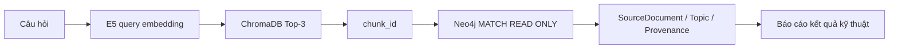

# Giai đoạn 4 – Bước 5E: Graph Retrieval kết hợp ChromaDB + Neo4j Aura

**Phiên bản:** v0.1 · **Trạng thái:** đã chuẩn bị mã, **chưa chạy trên môi trường của người dùng**.

## I. Bằng chứng đầu vào đã có

Ảnh Neo4j Aura do người dùng gửi cho thấy **kết quả thực thi câu lệnh import** `processed_chunks=66` và `linked_sources=7`. Cùng với kết quả Bước 5B–5C trước đó: 7 SourceDocument, 6 Topic, 7 COVERS_TOPIC, 3 ChunkRef ban đầu, 3 PART_OF, không có MedicalClaim.

**Quan trọng:** `processed_chunks=66` không tự động chứng minh tổng số `ChunkRef=66`, `PART_OF=66` hoặc `orphan=0`. Cần chạy 05E-01 (read-only) để kiểm toán thực tế trước khi đánh giá bước này hoàn thành.

Bằng chứng từ ChromaDB Bước 3:

- Collection `diabetes_kb_step3_e5small_v1`, 66 chunks từ 7 nguồn.
- Embedding model `intfloat/multilingual-e5-small` (384 chiều), query phải dùng tiền tố `query:`.
- Source snapshot `cc064ec7187192c999418051cb2125a0510412843f8d0908e3d6842e4a71c7cd`.
- Phân bố chunks mong đợi: CDC-T2D-001=4, CDC-RISK-002=3, NIDDK-DIAG-003=19, NIDDK-T2D-004=11, WHO-DIAB-005=5, LC-HBA1C-006=11, LC-STAGES-007=13.

## II. Mục tiêu

Thực hiện **vector-to-graph enrichment**, không phải GraphRAG lâm sàng:

1. Nhận câu hỏi bằng tiếng Việt hoặc tiếng Anh.
2. Mã hóa bằng E5 với tiền tố `query:`; dùng ChromaDB trả Top-3 `chunk_id`.
3. Dùng **READ-only Cypher** tra `ChunkRef -> PART_OF -> SourceDocument -> COVERS_TOPIC -> Topic` trong Neo4j Aura.
4. Kiểm tra `chunk_id`, `source_id`, `canonical_url`, snapshot và trạng thái đồng bộ khớp giữa hai nguồn.
5. Trả kết quả có nguồn, tiêu đề, chủ đề và trạng thái quyền (chưa độc lập xác nhận).
6. Xuất báo cáo JSON để người dùng gửi lại. **Không viết dữ liệu**, không LLM, không huấn luyện ML.



### Giới hạn cần nhớ

Neo4j hiện chỉ chứa đồ thị **nguồn và chủ đề**; chưa có các quan hệ y khoa được duyệt. Việc kết hợp này bổ sung *provenance/metadata* cho kết quả tìm kiếm, **chưa có khả năng nâng chất lượng trả lời bằng quan hệ chuyên môn y khoa**. Không gọi đây là GraphRAG hoàn chỉnh.

Evidence Gate Bước 5A: citation 25/42, rights evidence 13/42, `ready_for_llm=false`, không có nguồn nào được xác minh độc lập đầy đủ. Các cờ `rights_status` và `medical_review_status` chỉ để theo dõi, không tự động coi là hợp lệ. Trong script: `eligible_for_medical_answer=false` cho mọi hit.

## III. Thao tác 1 – Kiểm tra trên Neo4j Aura Console (không cần Python)

Mở `05E-Aura-ReadOnly-Verification.cypher`. Chạy **từng khối** trong Neo4j Query:

- `05E-01`: kỳ vọng `source_documents=7`, `topics=6`, `topic_links=7`, `chunk_refs=66`, `chunk_links=66`, `orphan_chunks=0`, `approved_medical_claims=0`.
- `05E-02`: phân bố chunks theo từng nguồn đúng Bước 3.
- `05E-03`, `05E-04`: xem metadata và hình graph của một số ChunkRef.

Nếu một chỉ số không khớp, **không xóa database hay chạy lại import tùy ý**. Chụp ảnh hoặc sao chép kết quả để phân tích trước.

## IV. Thao tác 2 – Chạy Graph Retrieval bằng VS Code / PowerShell

Bước này cần hai hệ thống: **ChromaDB nằm trên máy bạn** và **Neo4j Aura trên cloud**. Vì thế, Neo4j Console một mình không thể trực tiếp gọi Python embedding đang cài trên máy. Ta dùng script Python rất nhỏ tại VS Code để gửi truy vấn đọc tới hai hệ thống, **không cần Jupyter**.

### A. Chuẩn bị

Đặt file `tools/05E_chroma_neo4j_retrieval.py` bên trong **thư mục root Giai đoạn 4 đang chứa `data/`** và ChromaDB thật ở `data/vector_store/chroma_step3/`.

Mở terminal tại root đó, dùng Python environment đã chạy Bước 3:

```powershell
python -m pip install chromadb neo4j sentence-transformers
```

Các thư viện đã cài thì không cần cài lại.

### B. Thiết lập địa chỉ Aura, không để lộ mật khẩu

Lấy URI từ **Connection details** của Neo4j Aura, dạng `neo4j+s://<instance>.databases.neo4j.io`. URI này **không phải** `https://console.neo4j.io/`.

```powershell
$env:NEO4J_URI = "neo4j+s://YOUR-INSTANCE.databases.neo4j.io"
$env:NEO4J_USERNAME = "neo4j"
$env:NEO4J_DATABASE = "neo4j"
```

**Không viết mật khẩu vào file `.py`, `.ipynb`, `.md`, Git, log hoặc gửi vào cuộc trò chuyện.** Khi chạy script, terminal sẽ hỏi mật khẩu bằng lệnh nhập ẩn. Nếu đã có `NEO4J_PASSWORD` trong environment, script dùng biến đó; không in ra.

### C. Chạy

```powershell
python .\tools\05E_chroma_neo4j_retrieval.py --project-root .
```

Nếu đường dẫn lưu ChromaDB khác (như cấu trúc thư mục lồng trong dự án hiện tại), chỉ định rõ:

```powershell
python .\tools\05E_chroma_neo4j_retrieval.py --project-root . --chroma-dir ".\data\vector_store\chroma_step3"
```

Script thực hiện kiểm toán tổng số graph trước rồi mới tạo embedding của ba câu hỏi mẫu (không tạo/lưu vector mới). Mô hình E5 có thể tải trọng số nếu máy chưa cache; bước này chỉ tải mô hình embedding, không phải LLM.

Có thể thử một câu hỏi khác bằng `--query`, ví dụ:

```powershell
python .\tools\05E_chroma_neo4j_retrieval.py --project-root . --query "HbA1c là gì?"
```

### D. Đầu ra và tiêu chí đạt

Báo cáo được lưu tại:

`data/outputs/graph_retrieval_step5e/step5e_graph_retrieval_report.json`

Kết quả kỳ vọng với **3 câu hỏi, Top-3**: có 9 hit từ ChromaDB, 9 hit khớp thông tin nguồn trong Neo4j (`provenance_matches=9/9`), `source_documents=7`, `chunk_refs=66`, `chunk_links=66`, `orphans=0`, `status=technical_join_pass`.

Đây là **kỳ vọng kỹ thuật**, chưa phải kết quả người dùng chạy. Độ chính xác câu trả lời, tính an toàn y khoa và độ phù hợp retrieval **không được đánh giá lại bởi script này**.

## V. Giới hạn & bước tiếp theo

- `ChunkRef -> SourceDocument -> Topic` bổ sung metadata. Quan hệ `COVERS_TOPIC` mới suy ra từ nhan đề tài liệu, không phải chứng cứ y khoa.
- Nếu phát hiện thiếu link hoặc khác URL/hash: chặn dùng kết quả và báo lỗi, **không tự cập nhật Neo4j**.
- Không có quyền sử dụng đầy đủ/kiểm duyệt y khoa độc lập cho cả 7 nguồn, vẫn giữ `ready_for_llm=false`.
- Sau khi kiểm thử kỹ thuật thành công, công việc tiếp theo là rà soát/cấp phép nguồn, trích xuất `MedicalClaim` có căn cứ, thiết kế Graph Retrieval có quan hệ y khoa được duyệt và đánh giá thử nghiệm ngoài bộ dev.

## VI. Bàn giao

Bạn gửi **ảnh kết quả 05E-01**, output cuối `GIAI ĐOẠN 4 – BƯỚC 5E: GRAPH RETRIEVAL` và file JSON. **Không gửi mật khẩu Aura**, dữ liệu cá nhân hoặc toàn văn nguồn có giới hạn quyền sử dụng.

**Nguồn kỹ thuật tham khảo:** https://neo4j.com/docs/python-manual/current/connect/ ; https://neo4j.com/docs/python-manual/current/query-simple/ ; https://cookbook.chromadb.dev/core/collections/.
