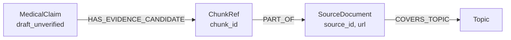

# Giai đoạn 4 – Bước 5F: MedicalClaim Candidates và Evidence Review trên Neo4j Aura

**Phiên bản:** v0.1 · **Trạng thái:** hướng dẫn đã chuẩn bị; chưa chạy truy vấn Bước 5F trên Neo4j của bạn.

## 1. Vì sao cần bước này?

Bước 5E thành công về **kết nối dữ liệu**: 66 ChunkRef, 66 PART_OF, 7 SourceDocument, orphan=0, 9/9 truy vấn nguồn khớp. Tuy nhiên, phần này mới chỉ cung cấp metadata tài liệu. Một Knowledge Graph chuyên môn cần biểu diễn **mệnh đề y khoa** cùng bằng chứng cụ thể, trạng thái kiểm chứng và nguồn gốc rõ ràng.

**Không được suy từ metadata rằng một khẳng định y khoa là đúng.** Cổng kiểm duyệt 5A vẫn chưa đạt: citation 25/42, rights evidence 13/42, 0/7 nguồn được kiểm tra độc lập, `ready_for_llm=false`.

## 2. Mục tiêu thực hành

1. Dùng VS Code đọc **nội dung thật của một chunk** từ ChromaDB đã lưu trên máy bạn (không gửi lên LLM và không thay đổi ChromaDB).
2. Đối chiếu văn bản với nguồn gốc và ghi lại mệnh đề **do bạn tự diễn đạt**, không suy đoán ngoài tài liệu.
3. Tạo một `MedicalClaim` ở trạng thái **`draft_unverified`** và quan hệ `HAS_EVIDENCE_CANDIDATE` nối tới `ChunkRef` hiện có.
4. Xác nhận `approved_claims = 0`, `usage_status = blocked_for_answering`.
5. Ghi log người đọc, ngày truy cập, chunk, tình trạng giấy phép và các vấn đề chưa chắc chắn.

## 3. Kiến trúc và các nhãn



- `MedicalClaim`: `claim_id`, `statement`, `review_status`, `usage_status`, `source_snapshot_sha256`, `created_at`, `research_only`.
- `HAS_EVIDENCE_CANDIDATE`: quan hệ chứng cứ **ứng viên**, chưa xác nhận nội dung đủ hỗ trợ claim.
- `ChunkRef`: chỉ metadata, không sao chép toàn văn vào Neo4j.
- Không tạo quan hệ `CAUSES`, `INCREASES_RISK`, `DIAGNOSES` trong bước này.

## 4. Bước 5F-1 — Kiểm tra Neo4j read-only

Mở Neo4j Aura Console → Query, chạy khối `[0]` trong `05F-Neo4j-Claim-Candidates.cypher`. Cần thấy `sources=7`, `chunks=66`, `chunk_links=66`, `orphans=0`.

**Không xóa graph hay tự sửa trạng thái `approved` khi số liệu không khớp.**

## 5. Bước 5F-2 — Đọc một chunk thật trên máy

Dùng script đọc-only `tools/05F_inspect_chroma_chunk.py` qua VS Code, từ thư mục Giai đoạn 4 đang chứa `data/`:

```powershell
python .\tools\05F_inspect_chroma_chunk.py --project-root . --chunk-id "NIDDK-T2D-004__v1__9de2376433__0004"
```

Nếu đường dẫn ChromaDB khác, truyền `--chroma-dir` tới thư mục `data/vector_store/chroma_step3` thực sự.

Script **không sửa dữ liệu, không tạo claim**, chỉ cho bạn đọc văn bản chunk và metadata. Không gửi toàn văn các bài có giới hạn bản quyền vào chat hoặc public repo. Mở URL chính thức từ metadata để xác minh ngữ cảnh.

## 6. Bước 5F-3 — Viết và kiểm duyệt ứng viên thủ công

Trong `registry/step5f_claim_review_template.csv`, điền:

- `claim_id`: `RESEARCH-CLAIM-001` (hoặc ID mới, duy nhất).
- `chunk_id` và `source_id`: từ kết quả đọc thật.
- `statement`: câu **bạn tự diễn đạt**, không đưa vào chẩn đoán cá nhân.
- `evidence_reason`: vì sao chunk thực tế hỗ trợ câu này.
- `source_url`, `reviewed_at_utc`, `reviewer`: thông tin thực tế.
- `rights_review_status`: `pending_independent_check` nếu chưa có bằng chứng.
- `medical_review_status`: `pending` (không tự đổi thành `approved`).

**Đọc cả đoạn và trang nguồn trước khi viết.** Không lấy tiêu đề làm bằng chứng cho một quan hệ nhân quả. Không viết mệnh đề không thấy trong chunk. Không đồng nhất một trích dẫn với quyền tái sử dụng.

## 7. Bước 5F-4 — Tạo candidate bằng Cypher

Mở file `05F-Neo4j-Claim-Candidates.cypher` và chạy các khối `[1]`, `[2]`, `[3]` theo thứ tự:

1. `[1]`: ràng buộc UNIQUE (nếu chưa có).
2. `[2]`: truy vấn read-only đối chiếu `chunk_id`, source, URL.
3. `[3]`: **chỉ sau khi đã điền câu thật**, thay chuỗi `DANG_CHO_BAN_DOI_CHIEU_NOI_DUNG`, giữ `review_status='draft_unverified'`. Nếu không thay, truy vấn không tạo claim.
4. `[4]` và `[5]`: xác nhận claim và bằng chứng ứng viên đã nối đúng.
5. `[6]`: xác nhận `approved_claims = 0`.

**Không chạy cả file một lần.** Mỗi khối là một truy vấn riêng trong Neo4j Query. Không đưa URI/mật khẩu Aura vào mã hoặc vào ảnh.

## 8. Điều kiện đạt của Bước 5F

- 66 `ChunkRef`, 66 `PART_OF`, 0 orphan như trước.
- Có ít nhất **1 claim do người dùng đã đối chiếu với nội dung chunk thật**, trạng thái `draft_unverified`.
- Có ít nhất **1 `HAS_EVIDENCE_CANDIDATE`** nối đúng `ChunkRef`.
- `approved_claims = 0` và tất cả claims mới có `usage_status=blocked_for_answering`.
- Không sửa ChromaDB, không gọi LLM và không đánh dấu hoàn thành kiểm duyệt y khoa/bản quyền.

Nếu bạn chưa muốn tạo claim hoặc chưa kiểm tra được tài liệu thật, để `MedicalClaim = 0` là đúng và báo trạng thái `awaiting_claim_review`.

## 9. Kết quả bạn gửi lại

Chụp ảnh kết quả các truy vấn `[4]` / `[6]` hoặc gửi những con số: `claim_candidates`, `evidence_candidate_links`, `approved_claims`; cho biết bạn chọn `chunk_id` nào. Không cần gửi toàn văn tài liệu hoặc mật khẩu.

## 10. Hướng triển khai sau đó

**Bước 5G**: xác định bộ thực thể `Disease/RiskFactor/Test/Measurement` và các loại quan hệ chỉ khi claim được chuyên môn rà soát, lưu provenance và xét điều kiện quyền sử dụng. **Bước 5H**: so sánh truy xuất ChromaDB-only với graph-enhanced trên một tập câu hỏi đánh giá riêng; chỉ tích hợp LLM sau khi Evidence Gate đạt.

## 11. Nguồn kỹ thuật

- Neo4j Cypher: https://neo4j.com/docs/cypher-manual/current/clauses/merge/
- Neo4j constraints: https://neo4j.com/docs/cypher-manual/current/schema/constraints/create-constraints/
- Chroma collection get: https://docs.trychroma.com/reference/python/collection
