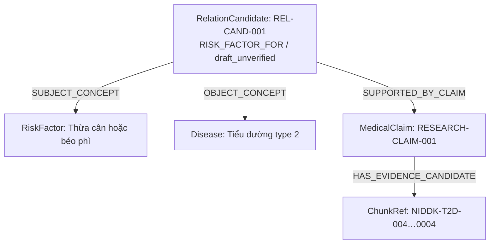

# Giai đoạn 4 – Bước 5H: Quan hệ y khoa ứng viên trong Neo4j

**Phiên bản:** v0.1 · **Ngày:** 03/11/2026 · **Trạng thái:** Hướng dẫn thực hành, **chưa chạy Neo4j thay người dùng**.

## 1. Cơ sở từ kết quả thực nghiệm

Người dùng đã hoàn thành Bước 5G trên Neo4j Aura:

| Hạng mục | Kết quả do người dùng cung cấp |
|---|---:|
| MedicalConcept | 5 |
| MENTIONS_CONCEPT | 5 |
| Approved MedicalClaim | 0 |
| MedicalClaim được bỏ chặn | 0 |

Claim `RESEARCH-CLAIM-001` có bằng chứng ứng viên là chunk `NIDDK-T2D-004__v1__9de2376433__0004`, thuộc `NIDDK-T2D-004`. Trong chunk đã đối chiếu, nguồn liệt kê thừa cân/béo phì, ít vận động, kháng insulin và yếu tố di truyền trong phần *What causes type 2 diabetes?*.

**Ranh giới:** Sự khớp giữa chunk và bài gốc không phải sự phê duyệt y khoa hay xác minh độc lập quyền tái sử dụng. Trạng thái Evidence Gate trước đó: 0/7 nguồn được xác minh độc lập, `ready_for_llm=false`.

## 2. Vì sao tạo `RelationCandidate` thay vì một quan hệ nhân quả trực tiếp?

Bước 5G có `MedicalClaim -[:MENTIONS_CONCEPT]-> MedicalConcept`, nghĩa là claim nhắc đến khái niệm, **không nói các khái niệm liên hệ với nhau ra sao**.

Bước 5H đề xuất mô hình trung gian:

Tất cả `RelationCandidate` có `review_status='draft_unverified'` và `usage_status='blocked_for_answering'`. **Không được dùng để tạo lời khuyên y khoa, không tự tạo `CAUSES` hoặc `INCREASES_RISK` đã phê duyệt.**

## 3. Hướng dẫn thao tác trên Aura Console

1. Mở Neo4j Aura Console → Query. Mở `05H-Neo4j-Relation-Candidates.cypher` trong VS Code.
2. Chạy khối **[0] PRE-FLIGHT**. Mong đợi claim `RESEARCH-CLAIM-001` có `claim_review=draft_unverified`, `claim_usage=blocked_for_answering`, nguồn chứa `NIDDK-T2D-004`, `concept_count=5`. Nếu sai, dừng và kiểm tra bước trước.
3. Chạy riêng khối **[1] CONSTRAINT**; dùng `IF NOT EXISTS`, nên chạy lại sẽ không chủ ý thêm constraint trùng.
4. Chạy khối **[2]** tạo **một** `RelationCandidate` từ thừa cân/béo phì sang tiểu đường type 2 với loại ứng viên `RISK_FACTOR_FOR`.
5. Chạy khối **[3]** kiểm toán và **[4]** hiển thị Graph.
6. **Chưa chạy [5]** cho đến khi kiểm tra [2]–[4] và xác nhận kết quả với người hướng dẫn. Sau đó, [5] mở rộng ba ứng viên còn lại.

### Kết quả mục tiêu lần thứ nhất (sau khối [2])

| relation_candidates | subject_links | object_links | claim_links | approved_relations | not_blocked_relations |
|---:|---:|---:|---:|---:|---:|
| 1 | 1 | 1 | 1 | 0 | 0 |

### Kết quả mục tiêu khi mở rộng (sau khối [5])

| relation_candidates | subject_links | object_links | claim_links | approved_relations | not_blocked_relations |
|---:|---:|---:|---:|---:|---:|
| 4 | 4 | 4 | 4 | 0 | 0 |

Các giá trị trên **là kỳ vọng đối với database chưa có ứng viên quan hệ khác**, không phải kết quả đã chạy.

## 4. Quy tắc bảo mật và QA

- Chỉ sử dụng ID và trạng thái đã xuất hiện trên Neo4j ở các bước trước; không đưa mật khẩu hoặc URI kết nối cá nhân vào tài liệu.
- `MERGE` theo `relation_id` và `ON CREATE SET` để tránh tạo bản sao hoặc ghi đè trạng thái kiểm duyệt khi chạy lại.
- Giữ bằng chứng tại `MedicalClaim → ChunkRef → SourceDocument`, tránh tạo những quan hệ y khoa trực tiếp có vẻ đã được phê duyệt.
- Không gọi LLM, không thay đổi ChromaDB/ML, không mở lại NHANES Test.
- Chưa đánh giá đầy đủ bằng chứng, tình trạng y khoa hay quyền sử dụng ở bước này.

## 5. Kết quả cần cung cấp

- Ảnh bảng khối `[3]` sau khi bạn chạy khối `[2]`.
- Ảnh Graph khối `[4]`.
- Nếu khối `[0]` không khớp, gửi kết quả `[0]` thay vì cố chạy tiếp.

**Bước tiếp:** sau khi có kết quả thật, cập nhật Experiment Log và cân nhắc mở rộng ứng viên theo khối [5], sau đó thiết kế cơ chế duyệt độc lập trước khi cho Knowledge Agent khai thác.
