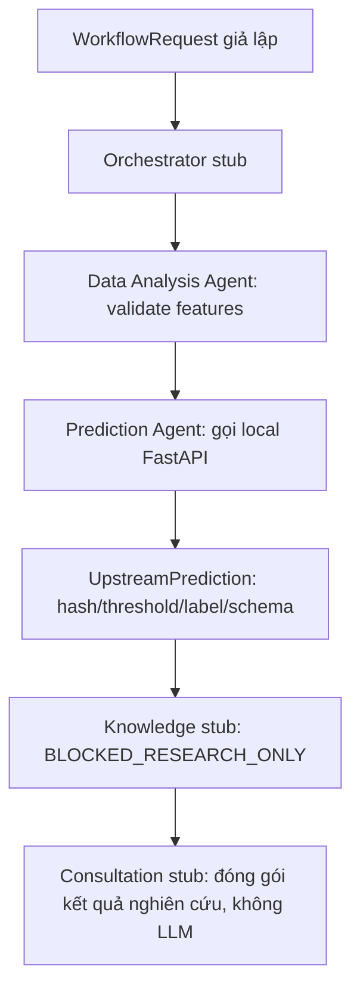

# GIAI ĐOẠN 5 — BƯỚC 2: DATA ANALYSIS + PREDICTION AGENT INTEGRATION

**Mục tiêu:** nối hai Agent trong nhánh nghiên cứu qua LangGraph và tái sử dụng **FastAPI inference đã có từ Giai đoạn 3**. Các Agent Orchestrator, Knowledge và Consultation còn là **stubs**; Giai đoạn 5 Bước 3–5 mới tích hợp tiếp. **Không huấn luyện lại**, **không dùng dữ liệu bệnh nhân**, **không gọi LLM**.

## 1. Tình trạng đầu vào

Output Environment Audit của bạn: `configured_not_connected`, model `SHA256_MATCH`, API URL `LOCAL_ROUTE_VALID_NOT_CONNECTED`, Chroma directory tồn tại, Neo4j URI TLS đúng định dạng. **Đây không phải** kết quả đã kết nối FastAPI/Neo4j/Chroma.

Mô hình giữ nguyên: `LogisticRegression`, ba biến `RIDAGEYR`, `RIAGENDR`, `BMXBMI`; threshold **0.225**; file SHA256 `31e9c94b0f14369be7920b9315b026d0c4afedb9f7b2885d120d631d930582b1`. Đây là **classification HbA1c >=5.7% trên bộ NHANES cắt ngang**, không chẩn đoán và không tính nguy cơ mắc type 2 trong tương lai.

## 2. Vai trò hai Agent được tích hợp trong bước này



**Data Analysis Agent:** xác nhận tuổi nguyên 20..80, `RIAGENDR` là 1/2, BMI là số thực hữu hạn 11.1..74.8; không suy luận thêm chỉ số hay tính BMI từ cân nặng/chiều cao; chỉ chuyển dữ liệu hợp lệ cho Prediction Agent.

**Prediction Agent:** có 2 chế độ tách biệt:
- `mock`: trả một score **giả lập** 0.42 để kiểm hợp đồng, **không phải kết quả mô hình NHANES**; không có network.
- `live`: chỉ khi người dùng chọn rõ ràng mới gọi **API localhost** trên cổng 8000 đã tạo từ Giai đoạn 3, `GET /health/ready` trước, `POST /api/v1/research/nhanes/hba1c/predict` sau. Chương trình **không tự nạp `joblib`**; API Giai đoạn 3 chịu trách nhiệm model.

Response từ API sẽ bị kiểm: `model_sha256`, task, model_name, threshold, score trong [0,1], nhãn khớp threshold, `warning` có thông báo giới hạn nghiên cứu. Mọi sai lệch đều **fail-closed** và trả mã lỗi an toàn; không tự sửa score, không tự tạo score thay thế.

## 3. Tổ chức file

Giải nén ZIP; copy file mới vào thư mục hiện có `05-Multi-Agent-Integration` sao cho có:

```text
05-Multi-Agent-Integration/
├── config/phase5_step1_config.json    # giữ file cấu hình riêng trên máy, KHÔNG có trong ZIP
├── phase5/
│   ├── contracts.py                    # giữ nguyên của Bước 1
│   ├── step2_prediction_integration.py # NEW
│   ├── step2_self_test.py              # NEW
│   └── step2_run.py                    # NEW
├── requirements-step2.txt
├── 06-Step1-Environment-Audit-User-Results.md
├── 07-Step2-Data-Analysis-Prediction-Integration-Guide.md
└── 08-Step2-Test-Matrix.md
```

### 3.1. Terminal ở thư mục `05-Multi-Agent-Integration`

```powershell
python --version
python -m pip install -r requirements-step2.txt
python -m phase5.step1_self_test
python -m phase5.step2_self_test
```

- Bước 1: mục tiêu `Ran 14 tests ... OK` (nếu chưa chạy).
- Bước 2: mục tiêu `Ran 16 tests ... OK`.

Không cần model chạy, không cần bật Neo4j/Chroma hoặc Ollama cho hai bộ unit test này.

### 3.2. Thử tích hợp hoàn toàn không dùng API (`mock`)

```powershell
python -m phase5.step2_run --mode mock
```

**Dự kiến:** `Cases: 2/2`, hai mã `SYN-PRED-01`, `SYN-PRED-02`, status `ok`, hash_match `True`, gate `BLOCKED_RESEARCH_ONLY`, `LLM: NO` và report status `technical_pass_mock_only`. Không suy luận chất lượng mô hình từ số liệu mock.

Báo cáo được lưu: `data/outputs/phase5_step2/step2_prediction_integration_report.json`. Lưu riêng bản mock trước khi chạy live vì mặc định script dùng cùng output path; hoặc dùng `--output data/outputs/phase5_step2/step2_mock.json`.

### 3.3. Bật local FastAPI ở thư mục Giai đoạn 3

Mở **terminal thứ hai** tại thư mục `03-ML-Research` mà bạn đã dùng ở Giai đoạn 3. Chạy server tương tự Bước 8B; dùng môi trường đã tạo model với Python 3.13.9 và scikit-learn 1.8.0:

```powershell
$env:NHANES_MODEL_PATH = (Resolve-Path '.\models\baseline\nhanes_hba1c_baseline_step5.joblib').Path
.\.venv\Scripts\python.exe -m uvicorn app.main:app --app-dir backend --host 127.0.0.1 --port 8000
```

**Không chạy những dòng này từ thư mục Giai đoạn 5.** Nếu đường dẫn `models/baseline` hoặc `.venv` trên máy bạn khác thì sửa theo nơi bạn đã lưu thật. API phải hoạt động tại `http://127.0.0.1:8000/health/ready`, trả `status: ready` và `model_sha256` chính xác. Chỉ dùng artifact do chính bạn tạo; tuyệt đối không bỏ qua SHA/phiên bản để khởi động cho bằng được.

Có thể kiểm tra bằng một terminal khác:

```powershell
Invoke-RestMethod http://127.0.0.1:8000/health/ready
```

### 3.4. Kiểm thử nhánh thật với hai input giả lập

Trở về terminal ở thư mục Giai đoạn 5, đảm bảo file `config/phase5_step1_config.json` còn trường `prediction_api_url` giữ nguyên URL local, rồi chạy:

```powershell
python -m phase5.step2_run --mode live --output .\data\outputs\phase5_step2\step2_live_report.json
```

Chương trình **chỉ gửi hai fixture giả lập có định danh `SYN-PRED-01` và `SYN-PRED-02`** tới localhost, không nhận dữ liệu bệnh nhân thật và không truy cập Neo4j, ChromaDB, Ollama. Không tự train hoặc ghi DB.

**Dự kiến** `Cases: 2/2` và `Status: local_prediction_api_checked`. Nếu API chưa chạy/khác contract, bạn sẽ thấy `failed` cùng mã lỗi như `UPSTREAM_UNAVAILABLE` hoặc `UPSTREAM_SCHEMA_MISMATCH`; **đừng tự thay hash/threshold để ép PASS**.

## 4. Kiểm thử và sự cố thường gặp

| Triệu chứng | Nguyên nhân hay gặp | Cách xử lý |
|---|---|---|
| `MISSING_LANGGRAPH` | Chưa cài thư viện trong đúng Python | `python -m pip install -r requirements-step2.txt` |
| `UPSTREAM_UNAVAILABLE` | API localhost chưa chạy/cổng sai | Kiểm terminal Giai đoạn 3; truy cập `/health/ready` |
| `UPSTREAM_NOT_READY` | API running nhưng model chưa sẵn sàng/hash mismatch | Kiểm file, SHA, Python/sklearn tại GĐ3 |
| `UPSTREAM_SCHEMA_MISMATCH` | API trả response khác 8B contract | Gửi JSON schema đã lược thông tin, không sửa giá trị đã khóa |
| `UNSAFE_API_URL` | URL không phải loopback/route đúng | Điền URL `http://127.0.0.1:8000/api/v1/research/nhanes/hba1c/predict` |
| Input không hợp lệ | Thiếu tuổi, gender sai, BMI vượt miền | Sửa dữ liệu **giả lập**; không dùng dữ liệu cá nhân |

## 5. Điều kiện kết thúc Bước 2

1. **Bắt buộc** 16/16 unit test đạt trên máy bạn.
2. Graph mock chạy 2/2 thành công và Gate giữ `BLOCKED_RESEARCH_ONLY`.
3. Nhánh live gọi localhost và trả 2/2 response đã được schema validate; không cần (và không được) đổi model/threshold.
4. `llm_called=false`, không truy cập ChromaDB/Neo4j, không sửa DB, không train.

**Lưu ý về giới hạn:** 2 input giả lập và unit tests **không phải** đánh giá độ chính xác model hoặc xác nhận an toàn cho người bệnh. Bước 3 mới tích hợp Knowledge Agent read-only. Các bước 4–5 sẽ mở rộng các stub trong LangGraph.

**Gửi về:** output `step2_self_test`, `step2_run --mode mock`, `step2_run --mode live`, file `step2_live_report.json` (sau khi xem lại dữ liệu). Không gửi mật khẩu/config local; chỉ gửi report JSON đã loại bỏ bí mật.

## 6. Tham khảo thư viện

- LangGraph `StateGraph` compile/invoke: https://reference.langchain.com/python/langgraph/graph/state/StateGraph
- FastAPI lifespan: https://fastapi.tiangolo.com/advanced/events/
- Pydantic v2: https://docs.pydantic.dev/latest/concepts/models/
