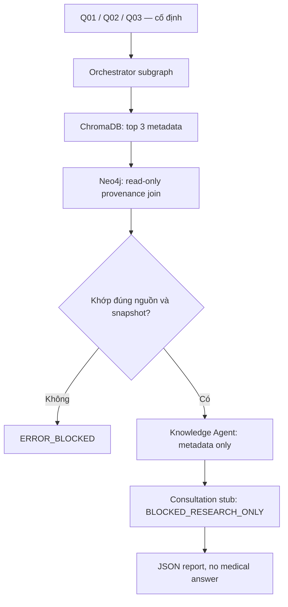

# Giai đoạn 5 — Bước 3: Knowledge Agent Integration

## 1. Mục tiêu và giới hạn

Tích hợp bộ tìm kiếm vector từ Giai đoạn 4 (`ChromaDB`, collection `diabetes_kb_step3_e5small_v1`, 66 chunks) với Neo4j Aura qua **Knowledge Agent subgraph trong LangGraph**. Câu hỏi có 3 ID cố định Q01–Q03. Knowledge Agent chỉ đưa ra **metadata**: `chunk_id`, `source_id`, `source_url`, `provenance_match`, `review_status`, `allowed_to_answer=false`. Không đưa văn bản y khoa thật vào AgentState, không gọi LLM, không sản xuất lời tư vấn và không thực hiện lệnh ghi DB.

Đây là **đồ thị con 3 node** (`orchestrator_agent`, `knowledge_agent`, `consultation_agent_blocked`) kiểm tra đường đi của bằng chứng, **không phải đồ thị điều phối 5 Agent hoàn chỉnh**. Data Analysis và Prediction đã được thử ở Bước 2. Giai đoạn 5 Bước 5 sẽ kết nối tất cả.

### Sơ đồ



### Điều kiện kiểm soát

- Từ dữ liệu thực nghiệm Giai đoạn 4: 7 SourceDocument, 66 ChunkRef, 66 PART_OF, 0 orphan, 4 RelationCandidate, 4 TechnicalReview, 0 approved claims/relations.
- Model embedding: `intfloat/multilingual-e5-small`, `normalize_embeddings=True`, tiền tố câu hỏi `query: `; snapshot SHA256 cố định theo Bước 3 Giai đoạn 4.
- Kiểm tra `source_id`, `canonical_url`, `source_snapshot_sha256`, `metadata_sync_status` giữa hai cơ sở dữ liệu; phát hiện thiếu hoặc trùng hits và chặn.
- Cơ chế này không thay thế phê duyệt y khoa hoặc bản quyền; `allowed_to_answer` luôn `false` kể cả nếu cơ sở dữ liệu thay đổi. Để tăng bảo đảm, dùng tài khoản Neo4j chỉ có quyền **READ** và sao lưu trước thử nghiệm.
- Tác vụ sử dụng các API truy vấn dữ liệu, không gọi create/update/delete. Một số thư viện local persistent có thể ghi housekeeping metadata; báo cáo chỉ xác nhận **mã của bước này không phát lệnh ghi ứng dụng**, không hứa cơ sở dữ liệu không thay đổi ở mức file I/O.

## 2. Giải nén vào dự án Windows

Đặt các tệp mới vào **thư mục đang chứa `phase5`, `config` và các tệp `requirements-step2.txt` của bạn**. Tệp ZIP có tiền tố `05-Multi-Agent-Integration/`; nên giải nén vào thư mục cha của thư mục đó. Không ghi đè `config/phase5_step1_config.json` thực tế: ZIP **không chứa file cấu hình riêng tư đó**.

Mở PowerShell tại thư mục `05-Multi-Agent-Integration`.

## 3. Cài thư viện và chạy test offline

```powershell
python -m pip install -r .\requirements-step3.txt
python -m phase5.step3_self_test
```

Mục tiêu: `Ran 15 tests` và `OK`. Đây chỉ là kiểm thử hợp đồng, chưa kết nối ChromaDB/Neo4j.

Kiểm thử luồng LangGraph dùng **metadata giả**, không có network:

```powershell
python -m phase5.step3_run --mode mock
```

Mục tiêu: `Joined hits: 9 | provenance matches: 9`, `Status: technical_pass_mock_only`. Chú ý số liệu này là *fixture*, **không phải** kết quả DB thật.

## 4. Kiểm tra cấu hình và kết nối thật ở chế độ chỉ đọc

Mở `config/phase5_step1_config.json` mà bạn đã điền ở Bước 1, kiểm tra:

```json
{
  "chroma_persist_dir": "C:/.../data/vector_store/chroma_step3",
  "chroma_collection": "diabetes_kb_step3_e5small_v1",
  "neo4j_uri": "neo4j+s://YOUR-INSTANCE.databases.neo4j.io",
  "neo4j_database": "neo4j"
}
```

**Đây là các trường minh họa**, không phải yêu cầu thay toàn bộ file config; giữ các trường model/API/Ollama đã điền. Không đưa mật khẩu vào JSON hoặc vào cuộc trò chuyện. Tên người dùng Neo4j mặc định là `neo4j` nếu không đặt `NEO4J_USERNAME`.

Nếu bạn có tài khoản read-only, dùng tài khoản đó. Có thể đặt tên người dùng trong phiên terminal:

```powershell
$env:NEO4J_USERNAME = "neo4j"
python -m phase5.step3_run --mode live
```

Chương trình yêu cầu nhập mật khẩu **ẩn**, không lưu vào JSON. Nếu có biến `NEO4J_PASSWORD`, chương trình dùng giá trị đó; không khuyến khích đưa mật khẩu vào dòng lệnh hoặc gửi ảnh terminal chứa thông tin bí mật.

Mô hình embedding được tải **chỉ từ bộ nhớ đệm local** (`local_files_only=True`), để tránh vô tình tải mới qua mạng. Nếu nhận `STOP: BACKEND_UNAVAILABLE`, xác nhận lại môi trường Giai đoạn 4, model cache và quyền kết nối Neo4j trước khi thử lại. Nếu bạn dùng venv khác cho Giai đoạn 4 và Giai đoạn 5, cần cài các dependencies cần thiết vào venv hiện tại; việc tải model/cache phải được thực hiện chủ động.

## 5. Kết quả kỳ vọng (chưa phải số liệu của máy người dùng)

```text
===== GIAI ĐOẠN 5 — BƯỚC 3: KNOWLEDGE AGENT =====
Mode: live
Neo4j: 7 sources | 66 ChunkRef | 0 approved claims
Joined hits: 9 | provenance matches: 9
Q01: blocked_research_only | hits=3 | errors=none
Q02: blocked_research_only | hits=3 | errors=none
Q03: blocked_research_only | hits=3 | errors=none
Answer gate: BLOCKED_RESEARCH_ONLY | LLM: NO | App DB writes: NO | ML training: NO
Status: local_chroma_neo4j_checked
Saved: .../data/outputs/phase5_step3/step3_knowledge_integration_report.json
```

Trường hợp báo lỗi không được tự thay đổi Neo4j hoặc chỉnh trạng thái claim/rights để ép cho qua. Gửi **mã lỗi** (không gửi mật khẩu), sau đó chúng ta điều tra tính khớp snapshot/collection.

## 6. Nghiệm thu và bàn giao

Gửi cả output terminal và file:

`data/outputs/phase5_step3/step3_knowledge_integration_report.json`

Tiêu chí nghiệm thu lần chạy LIVE: Neo4j đủ 7/66/66/0, 4 candidates, 4 technical reviews, 0 approved; 9/9 provenance; 0 câu trả lời, 0 LLM call; `BLOCKED_RESEARCH_ONLY`; không phát lệnh ghi dữ liệu từ ứng dụng.

**Sau Bước 3**: Bước 4 – Consultation Agent chạy riêng trên bộ Atlas giả lập; kho y khoa thật vẫn bị chặn. **Bước 5**: hợp nhất 5 Agent qua LangGraph và FastAPI, có kiểm thử lỗi.
