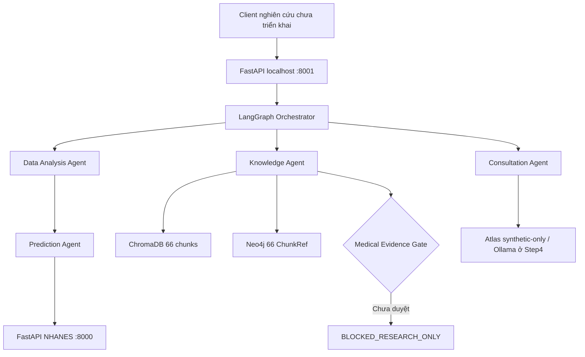

# GIAI ĐOẠN 5 — BÁO CÁO NGHIỆM THU VÀ BÀN GIAO CUỐI KỲ

**Dự án:** Multi-Agent AI System for Diabetes Risk Assessment  
**Ngày tổng kết:** 2026-11-04  
**Mức nghiệm thu:** `RESEARCH_SANDBOX_CLOSED_WITH_LIMITATIONS`  
**Nguồn chứng cứ:** 6 file JSON thực nghiệm do người thực hành xuất từ máy Windows; kiểm tra tổng hợp được chạy **offline**.

## 1. Quyết định nghiệm thu

Báo cáo `EXP-PHASE5-STEP6-001` có `status = phase5_research_sandbox_ready_to_close_with_limitations`, tất cả **5/5** kiểm tra đối chiếu báo cáo đạt, và **3/3** ca Atlas được đánh dấu đã rà soát thủ công (`issues = []`). Vì vậy **Giai đoạn 5 được chốt ở phạm vi nguyên mẫu nghiên cứu** theo tiêu chí đã thống nhất. Đây **không** là phê duyệt vận hành lâm sàng, cấp phép nội dung hay cho phép cung cấp một ứng dụng y tế công khai.

## 2. Bằng chứng thực nghiệm

| Bước | Báo cáo và chế độ | Kết quả người dùng đã chạy | Kết luận có thể rút ra |
|---|---|---|---|
| 1 | Environment audit: `configured_not_connected` | Model checksum khớp, Chroma path tồn tại, Neo4j URL hợp lệ | Cấu hình sẵn sàng; kiểm tra này **không** thử backend live |
| 2 | `EXP-PHASE5-STEP2-001`; `mode=live` | **2/2** thử Prediction API localhost thành công, model hash + threshold khớp | Adapter Data Analysis → Prediction hoạt động với API nghiên cứu |
| 3 | `EXP-PHASE5-STEP3-001`; `mode=live` | **7** source, **66** ChunkRef, **9/9** khớp provenance, **0** approved claims | Knowledge Agent truy xuất metadata thật từ ChromaDB & Neo4j, vẫn `BLOCKED_RESEARCH_ONLY` |
| 4 | `EXP-PHASE5-STEP4-001`; `mode=ollama`, `qwen2.5:1.5b` | **6/6** preflight; **3/3** chặn trước LLM; **3** lượt LLM tạo câu trả lời Atlas giả lập có trích dẫn | Consultation Agent chạy LLM thật trên **dữ liệu giả lập**, không trên kho y khoa thật |
| 5 | `EXP-PHASE5-STEP5-001`; `mode=live`, `consultation_mode=mock` | **11/11** ca; Prediction **2/2**, Knowledge **3/3**, Atlas **6/6** | Orchestrator LangGraph ghép nhánh thật nhưng **Consultation trong bước này là mock** |
| 6A | `EXP-PHASE5-STEP6-HTTP-001`; `mode=mock` | **8/8** smoke test FastAPI `127.0.0.1:8001`, trong đó request sửa Gate từ client bị HTTP 422 | API HTTP, schema và routing thử nghiệm đạt; **không kiểm thử backend live qua HTTP** |
| 6B | `EXP-PHASE5-STEP6-001`; audit offline | **5/5** báo cáo PASS; Atlas review **3/3** PASS | Nghiệm thu tính nhất quán của **các báo cáo lưu sẵn**, không phải quét lại mọi dịch vụ |

**Thông tin quan trọng của Step 6:** `step5_live_ollama_optional = not_supplied`; `llm_called_by_this_audit = false`; `network_called_by_this_audit = false`; `application_db_writes = false`; `ml_training = false`.

**Về ba câu Atlas:** báo cáo E2E do người dùng nộp xác nhận `manual_review.status=pass`, `completed=3`. File CSV ví dụ của bộ thực hành được lưu ở môi trường soạn có thể vẫn còn trống; quyết định nghiệm thu dựa trên **báo cáo JSON mới nhất do người dùng chạy**, không khẳng định đã đối chiếu bản CSV hoàn thiện trên máy người dùng.

## 3. Kiến trúc đã chứng minh trong phạm vi kiểm thử

- **ML khóa:** LogisticRegression, `threshold=0.225`, SHA256 artifact `31e9c94b0f14369be7920b9315b026d0c4afedb9f7b2885d120d631d930582b1`; nhãn chỉ báo `HbA1c ≥ 5.7%` trong tập nghiên cứu, **không dự đoán khả năng mắc tiểu đường type 2 tương lai**.
- **Knowledge khóa:** collection `diabetes_kb_step3_e5small_v1`, 66 vectors/384 chiều, Neo4j 4 quan hệ ứng viên và 4 technical review, **0 approved medical claims**; chỉ dùng metadata cho nghiên cứu.
- **Luồng:** request có kiểu `research_prediction`, `knowledge_research_lookup`, hoặc `synthetic_rag_demo`; không trộn đầu ra những luồng này hoặc mở Gate theo tham số client.
- **Bản FastAPI** hiện tại phục vụ local sandbox; chưa có authentication, quyền người dùng, giới hạn truy cập hoặc khả năng đưa ra Internet.

## 4. Các giới hạn và công việc còn mở

1. **Không có thẩm định lâm sàng** và chưa có người kiểm duyệt độc lập/giấy phép quyền tái sử dụng đầy đủ cho 7 nguồn y khoa. Không dùng LLM để tư vấn y khoa cá nhân hoặc thay đổi liều thuốc.
2. **Step5 `live + Ollama` chưa cung cấp báo cáo**. Điều này **không cản trở đóng Giai đoạn 5 ở phạm vi sandbox theo tiêu chí cũ**, nhưng không được mô tả là đã kiểm thử Ollama xuyên suốt Orchestrator.
3. Các ca kiểm thử **cố định và tổng hợp**, không chứng minh an toàn trước prompt injection tùy ý, chống quá tải, cô lập người dùng, quyền truy cập DB hoặc bảo mật production.
4. FastAPI HTTP smoke chạy `mock`; `/health/ready` chỉ chỉ ra graph được biên dịch, **không xác nhận backend live ready**.
5. Nếu trước đây từng chia sẻ credentials Neo4j, cần đảm bảo **đã xoay vòng mật khẩu lộ**; tuyệt đối không lưu secret trong source, JSON report, screenshots hoặc Git.
6. Các nguồn/chunk có thể bị cập nhật về sau, nhưng không tự ý điều chỉnh snapshot và mở Gate khi chưa hoàn tất review.

## 5. Quy tắc bàn giao sang Giai đoạn 6

- Giữ nguyên 3 operation và response schema từ `phase5.step5_orchestrator.Step5Request/Step5Response`.
- Chỉ client gọi FastAPI; React/Mobile không được truy cập Neo4j/ChromaDB/Ollama trực tiếp.
- Endpoint thực tế trong mã Step5: `GET /health/live`, `GET /health/ready`, `POST /api/v1/research/agents/run` ở `127.0.0.1:8001`.
- Client phải luôn thể hiện nhãn **nghiên cứu / giả lập**, không hiển thị kết quả như chẩn đoán hay tư vấn điều trị.
- Sử dụng backend `--mode mock` khi thiết kế UI; không đưa API không auth lên mạng nội bộ/công khai hoặc kết nối dữ liệu bệnh nhân thật.
- Bước tiếp theo theo Technical Design Giai đoạn 2: **Giai đoạn 6 – Web/Mobile Integration**.

## 6. Tài liệu chứng cứ

Các tệp đính kèm bản bàn giao: `step2_prediction_integration_report.json`, `step3_knowledge_integration_report.json`, `step4_consultation_report.json`, `step5_orchestrator_report.json`, `step6_http_smoke_report.json`, `step6_phase5_e2e_report.json`, kèm `31-Phase5-Release-Manifest.json` ghi checksum.

**Kết luận:** Giai đoạn 5 **đã nghiệm thu và đóng** trong giới hạn `research_sandbox_only`. Bắt đầu Giai đoạn 6 với client Web/Mobile, ưu tiên an toàn dữ liệu và khóa tri thức y khoa chưa được phê duyệt.
