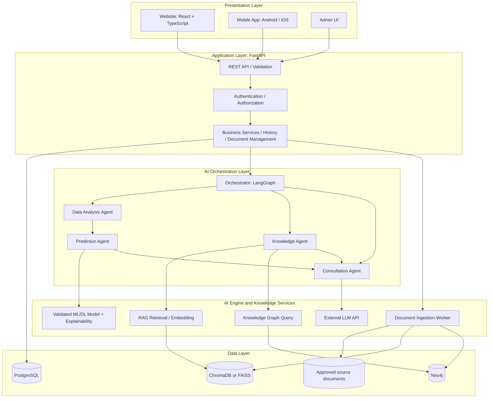

# GIAI ĐOẠN 2 – BƯỚC 1: SYSTEM ARCHITECTURE

**Dự án:** Multi-Agent AI System for Diabetes Risk Assessment  
**Trạng thái:** Bản thiết kế đề xuất v0.1 – cần rà soát trước khi chốt  
**Nguồn yêu cầu:** Tài liệu dự án 45 trang, đặc biệt Problem Statement, SRS (FR01–FR18, NFR01–NFR10), Activity Diagrams và mục 6.2 ở cuối tài liệu.

## 1. Mục tiêu kiến trúc

Xây dựng ứng dụng Website và Mobile dùng chung Backend, có khả năng tiếp nhận dữ liệu sức khỏe, kiểm tra tính hợp lệ, đánh giá nguy cơ tiểu đường bằng mô hình ML/DL đã kiểm định, hỗ trợ giải thích mô hình, truy xuất kiến thức y khoa bằng RAG/Knowledge Graph và tạo phản hồi có nguồn tham chiếu bằng Multi-Agent. Hệ thống phục vụ học tập, nghiên cứu, sàng lọc tham khảo; không chẩn đoán hay kê đơn.

## 2. Nguyên tắc thiết kế

1. **Một Backend dùng chung:** Web và Mobile không kết nối trực tiếp đến database hoặc Agent.
2. **Tách nghiệp vụ khỏi AI:** Backend quyết định xác thực, phân quyền, lưu dữ liệu, audit và chính sách; Orchestrator điều phối tác vụ AI.
3. **Nguồn dự đoán duy nhất:** Nhãn và điểm dự đoán chỉ đến từ mô hình ML/DL; LLM không được tự suy luận hoặc sửa kết quả.
4. **Có thể từ chối dự đoán:** Dữ liệu thiếu, bất hợp lệ hoặc ngoài phạm vi mô hình phải trả về lý do phù hợp thay vì tự tạo một con số.
5. **Có nguồn cho tư vấn y khoa:** Knowledge Agent trả về tài liệu có nguồn, phiên bản, ngày cập nhật; Consultation Agent không được tự tạo căn cứ.
6. **Bảo vệ dữ liệu sức khỏe:** Xác thực, kiểm soát truy cập theo người sở hữu, giảm thiểu dữ liệu gửi bên thứ ba, ghi log có che dữ liệu nhạy cảm.
7. **Có thể mở rộng:** Mỗi Agent là một mô-đun có hợp đồng đầu vào/đầu ra rõ ràng; không yêu cầu 5 microservice độc lập ở phiên bản đầu.

## 3. Sơ đồ kiến trúc tổng thể (đề xuất)

**Lưu ý:** Mũi tên thể hiện phụ thuộc/đường giao tiếp logic, không hàm ý mọi nút đều là một server riêng hoặc mọi luồng đều bắt buộc được kích hoạt. Điều phối chi tiết, thứ tự và trường hợp chạy song song sẽ được đặc tả trong các bước 2–4.

## 4. Chức năng và ranh giới từng lớp

| Lớp | Thành phần | Trách nhiệm | Không chịu trách nhiệm |
|---|---|---|---|
| Presentation | Website, Mobile, Admin UI | Biểu mẫu, chat, kết quả, lịch sử, quản trị | Quyết định chẩn đoán, gọi database trực tiếp |
| Application | FastAPI, Auth, Business Services | Xác thực, phân quyền, kiểm tra đầu vào ở mức API, API thống nhất, lưu lịch sử, quản trị tài liệu | Sinh nhãn dự đoán bằng LLM |
| AI Orchestration | Orchestrator (LangGraph) | Xác định loại yêu cầu, điều phối Agent, timeout, tổng hợp trạng thái | Vượt qua quyền truy cập của Backend |
| Data Analysis | Data Analysis Agent | Kiểm tra đặc trưng, đơn vị, dữ liệu thiếu, transform theo đúng pipeline đã huấn luyện | Tự thay đổi quy tắc tiền xử lý độc lập với mô hình |
| Prediction | Prediction Agent | Gọi mô hình đã kiểm định, trả kết quả, phiên bản, lý do không hỗ trợ; truy xuất giải thích mô hình | Tạo lời khuyên điều trị |
| Knowledge | Knowledge Agent | Truy vấn RAG, KG, gắn nguồn, đánh giá mức độ liên quan | Bịa tài liệu hoặc nguồn |
| Consultation | Consultation Agent | Tạo phản hồi dễ hiểu từ dữ liệu dự đoán và tri thức có nguồn | Sửa điểm dự đoán, kê đơn, chẩn đoán |
| AI Engines | ML/DL, explainability, LLM, retrieval | Suy luận mô hình và truy xuất/sinh phản hồi theo chức năng | Quản lý sở hữu dữ liệu người dùng |
| Data Layer | PostgreSQL, Vector DB, Neo4j, tài liệu nguồn | Lưu trữ đúng từng loại dữ liệu | Tự đưa tài liệu chưa kiểm duyệt vào tri thức |
| Operations | Docker, logs, monitoring | Đóng gói, quan sát, giám sát, backup và phục hồi | Ghi log tràn lan dữ liệu sức khỏe |

## 5. Ba luồng nghiệp vụ chính

### 5.1. Đánh giá nguy cơ tiểu đường

1. User nhập thông tin qua Website hoặc Mobile.
2. Backend xác thực người dùng theo yêu cầu của nghiệp vụ, kiểm tra schema, quyền và giới hạn cơ bản.
3. Backend gửi yêu cầu đã hợp lệ đến Orchestrator.
4. Orchestrator điều phối Data Analysis Agent chuẩn hóa theo chính pipeline huấn luyện đã lưu phiên bản.
5. Khi đầu vào phù hợp phạm vi mô hình, Prediction Agent gọi ML/DL Model; có thể gọi chức năng explainability để trả các yếu tố ảnh hưởng.
6. Nếu cần phản hồi giải thích có kiến thức nền, Knowledge Agent truy xuất nguồn và Consultation Agent diễn đạt, nhưng không được thay đổi nhãn/điểm dự đoán.
7. Orchestrator tổng hợp đầu ra có cấu trúc; Backend kiểm tra kết quả, lưu lịch sử khi được phép rồi trả về Client.
8. Nếu bất kỳ bước quan trọng nào thất bại, trả trạng thái lỗi/không đủ điều kiện thay vì tạo một dự đoán giả.

### 5.2. Chatbot kiến thức y khoa

1. User gửi câu hỏi. Backend kiểm tra quyền nếu cần dùng thông tin cá nhân.
2. Orchestrator phân loại câu hỏi: kiến thức chung, giải thích kết quả cá nhân, hoặc câu hỏi nằm ngoài phạm vi.
3. Knowledge Agent truy xuất Vector DB và/hoặc Neo4j; trả đoạn liên quan kèm nguồn.
4. Consultation Agent tạo phản hồi dựa trên kết quả truy xuất; kiểm tra nội dung, đặc biệt câu hỏi yêu cầu chẩn đoán, dùng thuốc, có dấu hiệu cần chăm sóc y tế khẩn cấp.
5. Backend trả câu trả lời và nguồn; không có nguồn đủ phù hợp thì thông báo giới hạn.

### 5.3. Quản trị tài liệu tri thức

1. Admin tải tài liệu; Backend xác thực quyền admin, lưu metadata và trạng thái `pending`.
2. Tài liệu được kiểm duyệt/phê duyệt, sau đó đưa vào Document Ingestion Worker.
3. Worker trích xuất nội dung, làm sạch, chia đoạn, tạo embedding và thực thể/quan hệ nếu phù hợp.
4. Cập nhật Vector DB và Knowledge Graph theo phiên bản tài liệu; chỉ chuyển trạng thái sang `active` khi các bước cần thiết thành công.
5. Nếu xử lý lỗi, đánh dấu `failed` và không để dữ liệu chưa phê duyệt được dùng trong truy xuất. Khi xóa/thay thế, phải đồng bộ chỉ mục cũ.

## 6. Quy ước kết nối và dữ liệu (sơ bộ)

- Client ↔ Backend: HTTPS + REST API; JSON cho dữ liệu nghiệp vụ.
- Backend ↔ AI Orchestrator: giao diện nội bộ có schema xác định (có thể là lời gọi Python khi cùng ứng dụng ở MVP); tách thành service API khi có nhu cầu triển khai độc lập.
- Orchestrator ↔ Agent: trạng thái tác vụ có cấu trúc, gắn `request_id`, `status`, `errors`, `model_version`/`source_refs` khi có.
- Backend ↔ PostgreSQL: truy vấn theo quyền và ID người dùng; mã hóa đường truyền và bảo vệ bí mật truy cập.
- Knowledge Agent ↔ Vector DB / Neo4j: chỉ truy xuất nội dung đã có trạng thái `active`.
- Consultation Agent ↔ LLM Provider: chỉ gửi dữ liệu tối thiểu cần thiết theo chính sách đồng ý và riêng tư.

**Phản hồi đánh giá – các trường lõi đề xuất:** `assessment_id`, `status` (`completed`/`needs_input`/`out_of_scope`/`failed`), `prediction` (chỉ khi completed), `model_version`, `explanation`, `references`, `limitations`, `created_at`.

**Lưu ý về mô hình:** Bộ Pima là dữ liệu nghiên cứu có phạm vi dân số giới hạn. Không được mặc định mọi người dùng, mọi giới tính/nhóm tuổi đều phù hợp, hoặc biến điểm mô hình thành xác suất mắc bệnh thực tế khi chưa hiệu chỉnh và xác thực. Bộ đặc trưng cuối cùng sẽ được chốt sau nghiên cứu dữ liệu/mô hình ở Giai đoạn 3.

## 7. Đề xuất tổ chức triển khai MVP

- **Kiến trúc logic:** các lớp và Agent độc lập theo module như sơ đồ.
- **Kiến trúc triển khai đầu tiên:** một ứng dụng FastAPI chứa các module nghiệp vụ và LangGraph; worker xử lý tài liệu độc lập nếu tác vụ dài; PostgreSQL/Vector DB/Neo4j dùng qua kết nối dịch vụ; frontend web và mobile là hai client.
- **Không triển khai 5 Agent thành 5 microservice ngay từ đầu.** Tránh gia tăng vận hành khi chưa có yêu cầu tải/độc lập hệ thống.
- **Điểm mở rộng:** có thể tách AI Orchestrator/Model Service thành deployment riêng mà không thay đổi API công khai.
- **Docker:** dùng khi tích hợp và kiểm thử; không bắt buộc dựng toàn bộ hạ tầng trước khi thiết kế xong.

## 8. Liên kết yêu cầu SRS

| Nhóm | Thành phần chịu trách nhiệm chính |
|---|---|
| FR01–FR04: tài khoản | FastAPI Auth + PostgreSQL |
| FR05–FR09: dữ liệu, dự đoán, giải thích | Client + Backend + Data Analysis/Prediction Agents + ML Model |
| FR10–FR12: tri thức, tư vấn, chatbot | Orchestrator + Knowledge/Consultation Agents + RAG/KG/LLM |
| FR13–FR15: lịch sử và tài liệu | Backend + PostgreSQL + Ingestion Worker + Vector DB/KG |
| FR16–FR17: quản trị/giám sát | Admin UI + Backend + Monitoring |
| FR18: Multi-Agent | Orchestrator/LangGraph |

NFR01–NFR10 được phản ánh qua phân lớp, kiểm soát truy cập, xử lý timeout/lỗi, ghi log an toàn, khả năng truy vết phiên bản và API dùng chung.

## 9. Các quyết định cần chốt ở Giai đoạn 2

1. Chọn công nghệ Mobile chính thức (tài liệu mới xác định Android/iOS, chưa chốt framework).
2. Chốt cách triển khai LangGraph nội bộ hay tách dịch vụ khi chạy thực tế.
3. Chọn ChromaDB hay FAISS và quy trình quản lý metadata/phiên bản nguồn.
4. Đặc tả dữ liệu đầu vào dùng trong mô hình cuối cùng, đơn vị đo, thiếu dữ liệu, tiêu chí `out_of_scope`.
5. Xác định chính sách lưu dữ liệu sức khỏe, đồng ý xử lý, retention và phân quyền cụ thể.
6. Hoàn thiện chính sách xử lý lỗi/safety cho câu hỏi y khoa và quy tắc dẫn nguồn.

## 10. Tiêu chí hoàn thành Bước 1

- [x] Xác định các tầng và thành phần chính.
- [x] Sơ đồ System Architecture đề xuất.
- [x] Mô tả trách nhiệm/ràng buộc các thành phần.
- [x] Mô tả ba luồng nghiệp vụ lõi ở mức tổng thể.
- [x] Liên kết tới FR/NFR trong SRS.
- [ ] Rà soát và chốt các lựa chọn kiến trúc còn mở.

**Bước tiếp theo của Giai đoạn 2:** Bước 2 – Agent Architecture: đặc tả từng Agent (nhiệm vụ, công cụ, input/output schema, quyền hạn, tiêu chí lỗi và các guardrail).
