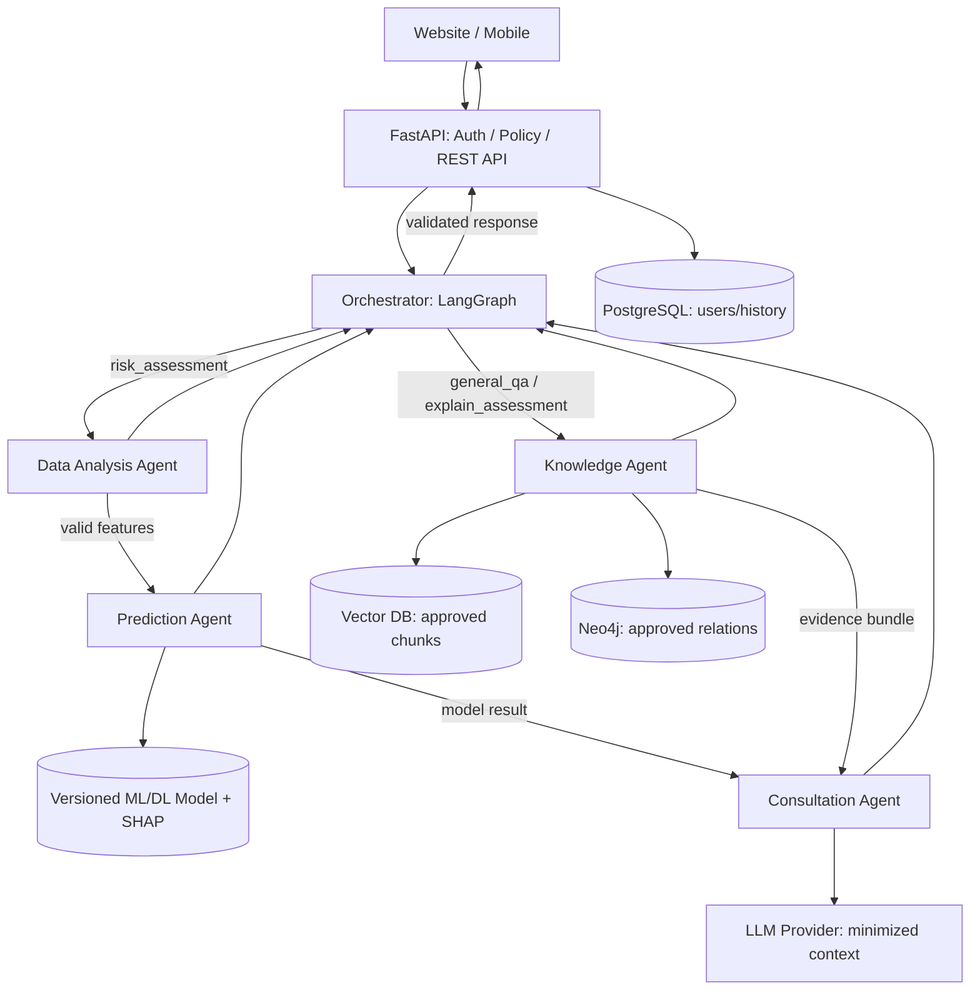
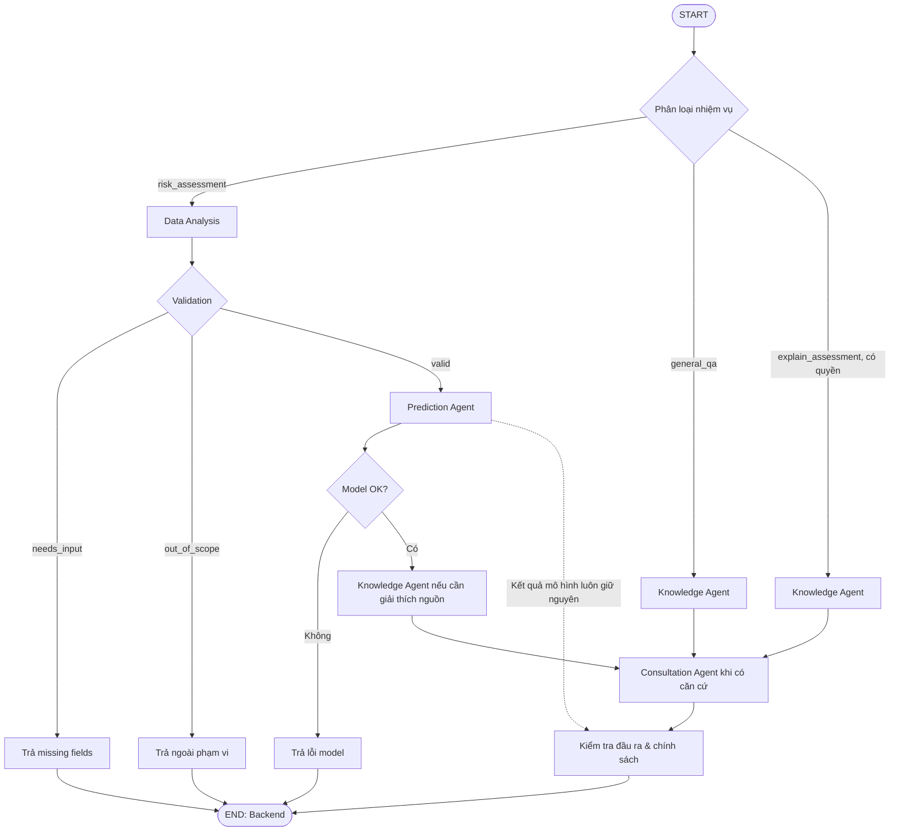

# GIAI ĐOẠN 2 – BƯỚC 2: AGENT ARCHITECTURE

**Dự án:** Multi-Agent AI System for Diabetes Risk Assessment  
**Phiên bản:** v0.1 – bản thiết kế đề xuất, chưa chốt triển khai  
**Tài liệu liên quan:** `01-System-Architecture.md` (Bước 1); tài liệu dự án gốc 45 trang, mục 3.1–3.2 và SRS FR05–FR12, FR18, BR03–BR12.  
**Đầu ra:** Phân rã trách nhiệm 5 Agent, kiến trúc điều phối, hợp đồng dữ liệu, lỗi/guardrails, tiêu chí kiểm thử.

> **Phân biệt nguồn:** Danh sách 5 Agent và các chức năng cốt lõi được xác định trong tài liệu gốc. Các trường schema, tên trạng thái, luồng fallback, cấu trúc LangGraph, phân quyền tool và test case dưới đây là **đề xuất kỹ thuật cho Bước 2**; cần rà soát trước khi triển khai.

## 1. Mục tiêu và nguyên tắc

- Thiết kế **1 Orchestrator Agent + 4 Agent chuyên môn**: Data Analysis, Prediction, Knowledge, Consultation.
- Mỗi Agent có nhiệm vụ độc lập, đầu vào/đầu ra xác định và chỉ được gọi công cụ cần thiết.
- **LLM không thay thế mô hình ML/DL** và không được tự sửa nhãn/điểm dự đoán.
- Data Analysis, Prediction và lớp truy xuất của Knowledge có thể hoạt động **không cần LLM**; Orchestrator/Consultation có thể dùng LLM trong phạm vi kiểm soát.
- **Backend** quyết định xác thực, phân quyền, lấy/lưu dữ liệu; **Orchestrator** quyết định thứ tự thực hiện các tác vụ AI, không có quyền vượt qua Backend.
- Kết quả chỉ mang tính **hỗ trợ sàng lọc nguy cơ tiểu đường type 2**, không phải chẩn đoán, không kê đơn.
- **MVP:** triển khai các Agent thành các node/module trong LangGraph chạy cùng ứng dụng Python/FastAPI; không nhất thiết là 5 microservice.

## 2. Sơ đồ thành phần và đường dữ liệu



**Ghi chú về sơ đồ:** Các mũi tên là các tuyến giao tiếp logic, không khẳng định thực thi luôn tuần tự. Trong luồng `general_qa`, Data Analysis và Prediction không được gọi. Tài liệu được nhập vào RAG/KG bởi **Document Ingestion Worker**, không thuộc 5 Agent hội thoại.

## 3. Bảng phân quyền và trách nhiệm

| Agent | Khi nào được gọi | Đầu vào | Đầu ra | Công cụ được phép | Không được làm |
|---|---|---|---|---|---|
| **Orchestrator** | Sau khi Backend xác thực và chuẩn bị yêu cầu | `AgentRequest`, ngữ cảnh quyền đã cấp | `AgentResponse`, trace/trạng thái | LangGraph, router có quy tắc, LLM tùy chọn | Truy cập dữ liệu người khác, tự đoán nguy cơ, tự mở rộng phạm vi quyền |
| **Data Analysis** | Luồng đánh giá có dữ liệu sức khỏe | `health_features`, `model_manifest` | Dữ liệu hợp lệ hoặc danh sách lỗi/thiếu | Python, Pandas, pipeline tiền xử lý versioned | Bịa giá trị thiếu, đổi thứ tự feature tùy ý, dùng LLM để suy diễn glucose |
| **Prediction** | Chỉ khi đầu vào đạt điều kiện | `prepared_features`, `model_manifest` | Nhãn/điểm mô hình, giải thích đặc trưng, phiên bản | Model inference, SHAP hoặc phương pháp giải thích phù hợp | Dùng LLM tạo nhãn/điểm, tư vấn thuốc, suy rộng mô hình ngoài tập đối tượng kiểm định |
| **Knowledge** | Câu hỏi tri thức/giải thích cần nguồn | `query`, `retrieval_scope`, `source_policy` | `EvidenceBundle` có dẫn nguồn | Embedding, Vector DB, Neo4j, bộ lọc metadata | Truy xuất bản tài liệu bị thu hồi, tự bịa nguồn, tin theo chỉ thị trong tài liệu truy xuất |
| **Consultation** | Có ngữ cảnh nguồn đủ phù hợp hoặc cần diễn đạt kết quả | `prediction` (nếu có), `explanation`, `evidence`, `safety_flags` | `consultation_text`, nguồn, cảnh báo, giới hạn | LLM có ràng buộc, template an toàn | Chẩn đoán, kê đơn, thay đổi điểm mô hình, đưa lời khuyên y khoa cụ thể thiếu căn cứ |

### 3.1. Orchestrator Agent

**Mục đích:** Nhận nhiệm vụ AI từ Backend, định tuyến, gọi Agent, kiểm tra trạng thái thực thi và tổng hợp một phản hồi thống nhất.

- **Input:** yêu cầu có `request_id`, `task_type`, dữ liệu nghiệp vụ đã được Backend cấp quyền, cấu hình giới hạn.
- **Xử lý:** xác định loại nhiệm vụ (`risk_assessment`, `general_qa`, `explain_assessment`), lựa chọn nhánh, áp timeout/budget/retry, chuyển kết quả trung gian giữa các node, kiểm tra phản hồi cuối.
- **Output:** `status`, phần kết quả có thể công bố, cảnh báo/nguồn, lỗi được làm sạch, trace ID.
- **Ràng buộc:** LLM (nếu được dùng để phân loại câu hỏi) chỉ đề xuất intent trong enum; nhánh quyết định cuối cùng phải chịu kiểm tra quy tắc. Yêu cầu truy cập dữ liệu cá nhân phải được Backend cấp quyền trước.

### 3.2. Data Analysis Agent

**Mục đích:** biến đầu vào sức khỏe thành dữ liệu sẵn sàng cho mô hình, **đúng pipeline đã được huấn luyện**.

- Kiểm tra kiểu số, trường bắt buộc, đơn vị đo, giá trị không hợp lệ và tính nhất quán.
- Phân biệt giá trị `0`, `null`, không được đo và dữ liệu không chắc chắn; không mặc định thay dữ liệu thiếu bằng 0.
- Kiểm tra giới hạn áp dụng ghi trong `model_manifest` (đặc trưng, nhóm đối tượng, phạm vi kiểm định nếu có).
- Chạy preprocessor **đã lưu cùng model**: imputation, scaling, feature order hoặc encoding, không tự fit lại khi suy luận.
- Trả `valid` cùng `prepared_features` hoặc `needs_input`/`out_of_scope` với lý do.

### 3.3. Prediction Agent

**Mục đích:** gọi mô hình ML/DL đã huấn luyện và kiểm định; trả đầu ra truy vết được.

- Chỉ nhận `prepared_features` khi Data Analysis đã trả `valid`.
- Kiểm tra `model_version`, `feature_schema_version`, pipeline version và tính tương thích.
- Trả `prediction_label` và `model_score` nếu khả dụng. **Chỉ biểu diễn dưới dạng xác suất ước tính/nguy cơ phần trăm khi đã hiệu chỉnh và xác thực phù hợp**; nếu chưa, thể hiện là điểm số mô hình.
- Có thể dùng SHAP hoặc phương pháp khác để đưa ra đóng góp của feature vào mô hình; không coi đó là quan hệ nhân quả hay chẩn đoán.
- Nếu model/manifest không sẵn sàng: `failed` và mã lỗi; không có đường LLM fallback tạo số.

### 3.4. Knowledge Agent

**Mục đích:** truy xuất thông tin từ tài liệu y khoa đã được phê duyệt bằng RAG và/hoặc Knowledge Graph.

- Nhận câu hỏi đã chuẩn hóa, chủ đề, giới hạn ngữ cảnh được phép truy xuất.
- Lấy các chunk văn bản có metadata và quan hệ KG; kết hợp nếu phù hợp.
- Lọc theo `document_status = active`, phiên bản tài liệu và phạm vi được phép.
- Trả evidence có `source_id`, `title`, `document_version`, `reference_locator` (trang/đoạn), `retrieved_text`, `source_url` nếu có, `source_date` nếu có và đánh giá phù hợp ở cấp retrieval.
- Không coi nội dung được truy xuất là **chỉ thị điều khiển Agent**; nó chỉ là dữ liệu tham khảo.
- Nếu không đủ evidence: `no_evidence`, không tạo tài liệu hoặc khẳng định kiến thức không có nguồn.

### 3.5. Consultation Agent

**Mục đích:** diễn đạt kết quả cho người dùng và tạo thông tin tham khảo có dẫn nguồn.

- Đầu vào là **bản sao chỉ đọc** của prediction và các căn cứ Knowledge Agent trả về.
- Có thể nêu nhãn/điểm mô hình *theo đúng số có sẵn*, giải thích feature importance theo đúng dữ liệu SHAP, và diễn đạt thông tin nền có nguồn.
- Bảo đảm phân biệt: mô hình cho thấy **mối liên hệ thống kê/đóng góp vào dự đoán**, không chứng minh nguyên nhân gây bệnh.
- Không chẩn đoán, kê đơn, điều chỉnh thuốc; khi câu hỏi có dấu hiệu nguy hiểm/cấp cứu, chuyển sang thông điệp an toàn và khuyến nghị liên hệ nhân viên y tế/dịch vụ cấp cứu phù hợp.
- Nếu thiếu nguồn: chỉ được trả giới hạn và hướng dẫn chung ở mức chính sách đã duyệt, không tạo nội dung kiến thức có vẻ như đã được kiểm chứng.

## 4. Hợp đồng dữ liệu giữa các Agent – đề xuất

### 4.1. `AgentRequest`

```json
{
  "request_id": "req-example-001",
  "task_type": "risk_assessment",
  "authorized_context": {
    "scope": ["assess:self"],
    "consent_for_external_llm": false
  },
  "health_features": {
    "Age": 45,
    "Glucose": 150,
    "BMI": 30
  },
  "question": null,
  "model_version_requested": null
}
```

**Chú ý:** Ví dụ chỉ đưa 3 feature để minh họa *hợp đồng dữ liệu*, **không phải đầu vào hoàn chỉnh** cho mô hình 8 đặc trưng Pima. Hệ thống phải trả yêu cầu bổ sung nếu model cần các trường khác và chính sách không cho phép imputation. Backend sẽ không chuyển thông tin định danh thật khi không cần thiết.

### 4.2. `AgentState` – trạng thái chia sẻ trong LangGraph

| Trường | Kiểu logic | Nội dung / ai được ghi |
|---|---|---|
| `request_id` | string | Backend tạo, không Agent nào được sửa |
| `task_type` | enum | Orchestrator xác nhận, chỉ thuộc các loại được hỗ trợ |
| `authorized_context` | object | Backend cấp; **chỉ đọc** trong AI |
| `health_features` | object/null | Đầu vào tối thiểu cho đánh giá |
| `question` | string/null | Câu hỏi từ user đã được kiểm tra giới hạn |
| `validation` | object/null | Data Analysis ghi: `valid`/`needs_input`/`out_of_scope` |
| `prepared_features` | object/null | Data Analysis ghi theo schema model |
| `prediction` | object/null | Chỉ Prediction được ghi |
| `evidence` | array | Chỉ Knowledge được ghi |
| `consultation` | object/null | Chỉ Consultation được ghi, **không được sửa** `prediction` |
| `errors` | array | Mỗi node thêm mã lỗi và loại lỗi đã được làm sạch |
| `final_status` | enum | Orchestrator tổng hợp |

Quyền ghi mô tả ở đây là **hợp đồng triển khai và bài kiểm thử**, không mặc định LangGraph tự cưỡng chế. Cần đảm bảo bằng việc tách node, validation và schema ở application layer.

### 4.3. `PredictionResult`

```json
{
  "prediction_label": "model_label_from_artifact",
  "model_score": null,
  "score_kind": "unavailable",
  "risk_percent": null,
  "model_version": "model-version-from-registry",
  "feature_schema_version": "feature-schema-version",
  "explanation": [
    {"feature": "BMI", "contribution": null, "method": "pending"}
  ],
  "limitations": ["Nhãn và điểm được tạo bởi mô hình đã kiểm định; không phải chẩn đoán."]
}
```

Đây là **schema minh họa, không phải một lần dự đoán thật**. `score_kind` đề xuất gồm `uncalibrated_score`, `calibrated_probability`, `unavailable`; chỉ tạo `risk_percent` nếu là xác suất đã hiệu chỉnh và được chứng minh thích hợp cho ngữ cảnh sử dụng.

### 4.4. `AgentResponse`

```json
{
  "request_id": "req-example-001",
  "status": "needs_input",
  "prediction": null,
  "explanation": null,
  "references": [],
  "limitations": [],
  "missing_fields": ["Các trường bắt buộc được lấy từ model_manifest"],
  "errors": [
    {"code": "MISSING_REQUIRED_FEATURES", "component": "data_analysis"}
  ]
}
```

**Trạng thái chuẩn, giữ nhất quán với Bước 1:** `completed`, `needs_input`, `out_of_scope`, `failed`. Trường `warnings` (nếu bổ sung) cho phép báo thiếu phần tư vấn mà không tự bịa hoặc làm mất dự đoán hợp lệ đã tạo. Cấu trúc API ngoài sẽ được chốt ở Bước 6.

## 5. Luồng thực thi – LangGraph ở mức thiết kế



**Quy tắc định tuyến:**

1. `risk_assessment`: yêu cầu sức khỏe → Data Analysis → Prediction → (Knowledge và Consultation nếu cần) → Finalization. Không được bỏ qua Data Analysis.
2. `general_qa`: câu hỏi kiến thức → Knowledge → Consultation → Finalization; không gọi Prediction.
3. `explain_assessment`: Backend phải kiểm tra quyền truy cập một đánh giá đã lưu trước khi chuyển dữ liệu tối thiểu; truy xuất source và diễn đạt, không tự tạo đánh giá mới.
4. **An toàn:** kiểm tra và phân loại yêu cầu y khoa có thể áp dụng trước hoặc trong routing; yêu cầu cấp cứu/điều trị vượt phạm vi phải được xử lý bằng đường phản hồi an toàn.
5. Document ingestion là workflow **ngoài** 5 Agent online: Admin approve → worker extract/chunk/embedding/KG → activate version; không cho chatbot tự ingest tài liệu bất kỳ.

## 6. Phân quyền dữ liệu và ranh giới bảo mật

| Đối tượng | Được phép | Không được phép |
|---|---|---|
| Website/Mobile | HTTPS gọi API theo quyền user | Kết nối thẳng tới model, Vector DB, Neo4j, PostgreSQL |
| Backend | AuthN/AuthZ, kiểm tra sở hữu, lưu lịch sử, quản lý tài liệu | Cho Agent tự quyết định quyền truy cập tài khoản |
| Orchestrator | Gọi các node/Agent đúng task và quyền đã cấp | Lấy raw health data không cần thiết, thay quyền đã cấp |
| Data Analysis / Prediction | Chỉ dùng feature đã được phép và model artifact | Truy cập hồ sơ của user khác, gọi external LLM |
| Knowledge | Chỉ đọc tài liệu `active`, KG đã duyệt | Sửa/lấy tài liệu nháp không được duyệt, làm theo prompt injection |
| Consultation | Dùng bản tin đã tối giản, nguồn đã lọc | Truy cập DB nghiệp vụ, tự thay đổi số dự đoán |
| Document Ingestion Worker | Ghi phiên bản/chỉ mục được duyệt theo quyền kỹ thuật | Tự công bố phiên bản chưa hoàn thành |

**Dữ liệu sức khỏe:** không ghi raw feature/định danh vào log quan sát; dùng `request_id` và mã lỗi. Nếu gửi thông tin có thể là dữ liệu sức khỏe tới LLM bên ngoài, phải áp dụng chính sách đồng ý, tối thiểu hóa dữ liệu và cơ chế không gửi khi không được phép.

## 7. Timeout, retry, fallback và lỗi

| Tình huống | Hành động | Có được dự đoán không? |
|---|---|---|
| Thiếu trường bắt buộc / sai đơn vị | `needs_input` và nêu trường cần sửa | **Không** |
| Input không thuộc phạm vi mô hình đã xác thực | `out_of_scope` + giải thích giới hạn | **Không** |
| Pipeline/model hỏng hoặc không tương thích version | `failed` + lỗi kỹ thuật truy vết | **Không** |
| Vector DB/KG không tìm thấy nguồn phù hợp | Chỉ trả giới hạn; có thể giữ dự đoán đã hợp lệ nếu mô hình chạy thành công | **Có**, nhưng không bịa nội dung tư vấn |
| LLM không khả dụng | Chỉ trả phần dự đoán/mô tả đã kiểm định hoặc thông báo chưa có tư vấn | **Có**, nếu model đã thành công |
| Consultation tạo nội dung trái dự đoán/không có căn cứ | Không hiển thị nội dung sai; trả kết quả mô hình đã xác thực + cảnh báo | **Có**, nếu model đã thành công |
| Yêu cầu có dấu hiệu cấp cứu hoặc kê đơn | Chuyển sang phản hồi an toàn và hướng đến dịch vụ y tế phù hợp | Không tự chẩn đoán |
| Retry | Chỉ thử lại các lỗi tạm thời có thể lặp an toàn; giới hạn số lần và thời gian | Không retry tùy tiện lỗi validation |

**Timeout/retry là cấu hình ở giai đoạn triển khai**, không gắn số cứng khi chưa biết độ trễ và chi phí thực tế.

## 8. Điểm kiểm soát chất lượng (guardrails)

- **Trước dự đoán:** schema, loại dữ liệu, missing values, đơn vị, feature order, applicability/đối tượng đã xác thực.
- **Sau dự đoán:** output schema, model/version trace, nhãn/điểm lấy nguyên từ model, `calibrated_probability` chỉ khi có bằng chứng hiệu chỉnh.
- **Trước consultation:** chỉ cung cấp được các nguồn `approved` + `active`, đánh dấu các phần chưa chắc chắn, tối thiểu hóa dữ liệu cá nhân.
- **Sau consultation:** kiểm tra mâu thuẫn với kết quả mô hình, không đưa chẩn đoán/kê đơn, có dẫn nguồn cho nội dung y khoa, thông báo giới hạn.
- **Với retrieval:** chống prompt injection từ văn bản truy xuất; giới hạn truy vấn KG/không cho LLM chạy truy vấn bất kỳ có quyền ghi.
- **Quan sát:** latency từng node, tỷ lệ thành công, error code, phiên bản mô hình/knowledge base; không log dữ liệu sức khỏe thô.

## 9. Các kiểm thử chấp nhận Bước 2

| ID | Tình huống | Kỳ vọng |
|---|---|---|
| AT01 | Nhập đủ feature đúng schema | Data Analysis `valid`, Prediction được gọi |
| AT02 | Thiếu feature bắt buộc | `needs_input`, Prediction không được gọi |
| AT03 | Giá trị hoặc đối tượng ngoài phạm vi đã kiểm định | `out_of_scope`, không tạo score |
| AT04 | Hỏng model artifact | `failed`, không gọi LLM để sinh nhãn |
| AT05 | Model trả score, LLM diễn đạt khác số | Finalizer giữ score gốc, chặn nội dung sai |
| AT06 | Hỏi kiến thức chung | Knowledge + Consultation, không Prediction |
| AT07 | Không có nguồn tri thức phù hợp | Thông báo giới hạn, không tạo trích dẫn giả |
| AT08 | Tài liệu đã bị thu hồi | Knowledge không sử dụng nguồn đó |
| AT09 | LLM timeout sau Prediction thành công | Trả được kết quả mô hình có giới hạn, không bịa tư vấn |
| AT10 | Truy cập lịch sử người dùng khác | Backend từ chối trước khi vào graph |
| AT11 | Tài liệu RAG chứa prompt injection | Bỏ chỉ thị độc hại; coi đó là nội dung nguồn |
| AT12 | Người dùng yêu cầu chẩn đoán/kê đơn hoặc có dấu hiệu cấp cứu | Áp dụng phản hồi an toàn, không chẩn đoán/điều trị tự động |

## 10. Liên kết SRS và quyết định mở

| Yêu cầu | Thiết kế đảm bảo |
|---|---|
| FR05–FR06 | Data Analysis kiểm tra và tiền xử lý theo model pipeline |
| FR07–FR09 | Prediction/model version/giải thích/hiển thị kết quả |
| FR10–FR12 | Knowledge + Consultation + Orchestrator điều phối chatbot |
| FR13–FR15 | Backend lịch sử, document worker, chỉ mục có phiên bản |
| FR18 | Orchestrator định tuyến, timeout/retry và tổng hợp |
| BR03–BR05 | Không dự đoán trước validation; LLM không sửa dự đoán |
| BR07–BR08 | Có nguồn, tài liệu cần được phê duyệt |
| BR10–BR12 | Truy vết model và bảo vệ quyền riêng tư dữ liệu |

**Cần chốt ở các bước sau:**

1. `model_manifest`: bộ feature và đơn vị chuẩn, phạm vi đối tượng được kiểm định, policy missing data, `model_version`, `feature_schema_version`.
2. **Bước 3:** quy ước trao đổi `AgentState`, quan hệ tuần tự/song song và kết quả trả về khi lỗi.
3. **Bước 4:** Sequence Diagram cho risk assessment, general QA, explain assessment, quản trị tri thức.
4. **Bước 5:** ERD tài khoản, hồ sơ, assessment, chat, tài liệu, nguồn và versioning.
5. **Bước 6:** cấu trúc code, lựa chọn Vector DB, SDK LLM, triển khai LangGraph trong ứng dụng hay dịch vụ riêng.
6. Chính sách đồng ý xử lý dữ liệu sức khỏe; kiểm duyệt nguồn; guardrail cần rà soát với chuyên gia y tế trước khi coi là phù hợp thực tế.

## 11. Kết luận và Definition of Done

- [x] Có đủ 5 Agent theo tài liệu dự án.
- [x] Có mục tiêu, ranh giới trách nhiệm, quyền công cụ cho từng Agent.
- [x] Có hợp đồng dữ liệu và trường trạng thái chung ở mức thiết kế.
- [x] Có luồng định tuyến cho dự đoán và hỏi đáp y khoa.
- [x] Có cơ chế lỗi, fallback và kiểm soát an toàn.
- [x] Có kiểm thử chấp nhận và liên kết yêu cầu.
- [ ] Chốt những quyết định kỹ thuật đang mở (trước khi triển khai thật).

**Bước tiếp theo: Giai đoạn 2 – Bước 3: Agent Interaction Diagram**, mô tả đường truyền `AgentRequest`/`AgentState`/`AgentResponse`, trình tự giao tiếp, nhánh lỗi và cơ chế gửi kết quả về Backend.
