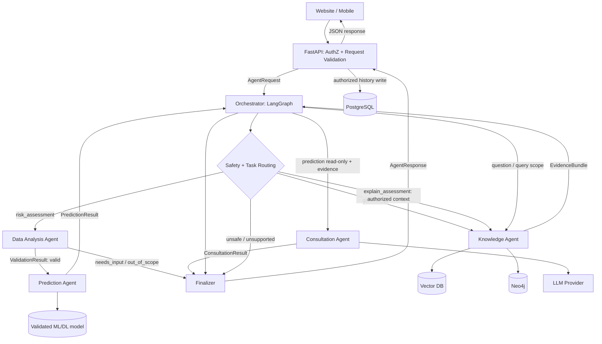
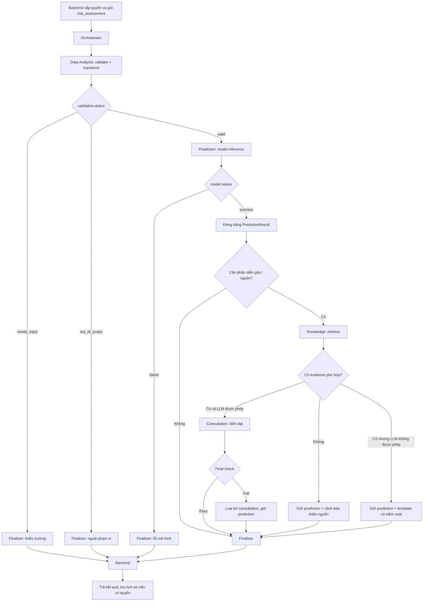
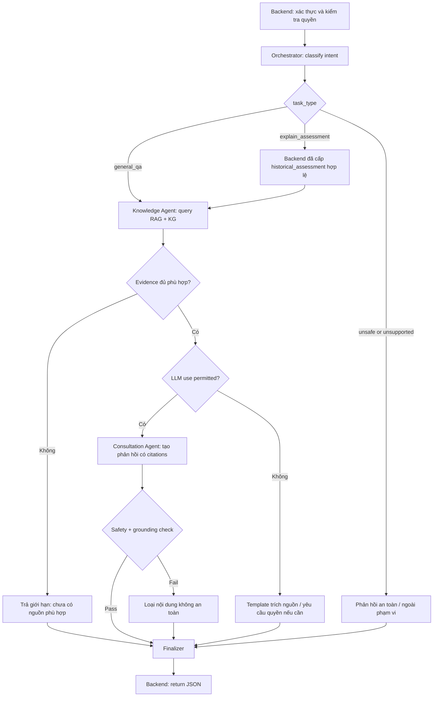
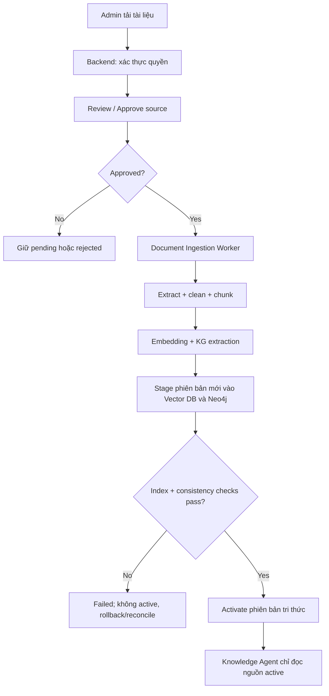

# GIAI ĐOẠN 2 – BƯỚC 3: AGENT INTERACTION DIAGRAM

**Dự án:** Multi-Agent AI System for Diabetes Risk Assessment  
**Phiên bản:** v0.1 – bản thiết kế đề xuất, chưa phải hệ thống đã triển khai  
**Kế thừa:** `01-System-Architecture.md`, `02-Agent-Architecture.md` và tài liệu gốc 45 trang (SRS, Activity Diagram, mục 6.2).  
**Đầu ra của Bước 3:** Sơ đồ tương tác, ma trận thông điệp, quy ước `AgentState`, 3 luồng nghiệp vụ, xử lý lỗi và tiêu chí chấp nhận.

> **Nguồn và đề xuất:** Tài liệu gốc xác định 5 Agent, các vai trò, các nghiệp vụ và quy tắc BR03–BR12. Những tên thông điệp, enum, mã lỗi, sơ đồ tương tác, dữ liệu trao đổi và cơ chế fallback dưới đây là **đề xuất kỹ thuật trong Giai đoạn 2**. Chưa quyết định mô hình ML thực tế, ngưỡng đánh giá hay chính sách triển khai lâm sàng.

## 1. Mục tiêu và ranh giới

Bước 2 đã xác định **Agent làm gì**. Bước 3 xác định **Agent trao đổi dữ liệu gì, gọi nhau thông qua đâu, khi nào phải dừng và kết quả trả về như thế nào**. Bước này mô tả **luồng tương tác và hợp đồng dữ liệu**; bản Sequence Diagram UML với lifeline và lời gọi theo thời gian chi tiết thuộc **Bước 4**.

Quy ước quan trọng:

1. Backend xử lý **authentication/authorization/ownership/consent**, sau đó mới tạo `AgentRequest`.
2. Orchestrator/LangGraph **điều phối**; không trao cho Agent tự do gọi nhau hoặc query PostgreSQL tuỳ ý.
3. Data Analysis phải xác thực điều kiện trước khi Prediction được gọi.
4. Chỉ **Prediction Agent** tạo `prediction`; chỉ **Knowledge Agent** tạo `evidence`; **Consultation Agent** chỉ viết phần giải thích/ngôn ngữ, không được thay đổi dữ liệu hai phần trên.
5. Agent có thể xuất dữ liệu trung gian qua `AgentState`; tất cả thay đổi đều phải được kiểm tra schema/ownership tại ranh giới node, không mặc định LangGraph bảo đảm quyền ghi này.
6. Không có kết quả ML hợp lệ thì không được đưa ra số nguy cơ giả. Không đủ căn cứ RAG thì không tạo nguồn giả.
7. Hệ thống chỉ hỗ trợ **đánh giá nguy cơ tiểu đường type 2 mang tính tham khảo**, không chẩn đoán hoặc kê đơn.

## 2. Các thành phần trao đổi thông tin

| Thành phần | Phát thông điệp | Nhận thông điệp | Ranh giới |
|---|---|---|---|
| Website / Mobile | HTTPS yêu cầu API | JSON phản hồi | Chỉ kết nối Backend |
| FastAPI Backend | `AgentRequest` đã kiểm soát quyền | `AgentResponse` | Quản lý danh tính, dữ liệu, quyền, ghi lịch sử |
| Orchestrator | Lệnh gọi node / trạng thái | Kết quả node, mã lỗi, metadata | Giữ luồng và tổng hợp; không tạo điểm dự đoán |
| Data Analysis Agent | `ValidationResult` + features đã transform | Health features + model manifest | Không gửi giá trị tự bịa |
| Prediction Agent | `PredictionResult` | Features hợp lệ, manifest | ML/DL inference + explainability |
| Knowledge Agent | `EvidenceBundle` | Query + nguồn/giới hạn được phép | RAG/Neo4j chỉ đọc tài liệu active |
| Consultation Agent | `ConsultationResult` | Prediction chỉ đọc + evidence + safety policy | LLM có ràng buộc; không chẩn đoán/kê đơn |
| Finalizer (logic nội bộ của Orchestrator) | `AgentResponse` | Trạng thái đã được kiểm tra | Chỉ tổng hợp và loại bỏ phần không hợp lệ |
| Document Ingestion Worker | `IngestionResult` / cập nhật chỉ mục | Tài liệu đã phê duyệt | Workflow ngoài 5 Agent hội thoại |

**Không có Agent số 6:** `Finalizer`, `SafetyGate` và `Document Ingestion Worker` là node/logic/service phụ trợ, không phải thay đổi tập 5 Agent đã thống nhất.

## 3. Sơ đồ tương tác tổng quát



**Lưu ý đồ thị:** Các mũi tên đến/đi Orchestrator biểu diễn trao đổi trạng thái/điều phối logic. Riêng việc gọi Consultation chỉ thực hiện nếu đủ điều kiện. Không phải mọi nhánh cùng chạy cho một yêu cầu.

## 4. Phân loại yêu cầu và quyền gọi Agent

| Task | Điều kiện | Agent bắt buộc | Agent tùy chọn | Không được gọi |
|---|---|---|---|---|
| `risk_assessment` | Bộ feature phù hợp và được phép xử lý | Data Analysis → Prediction | Knowledge → Consultation (giải thích có nguồn) | Prediction nếu validation chưa `valid` |
| `general_qa` | Câu hỏi thuộc phạm vi kiến thức, tuân thủ safety policy | Knowledge | Consultation nếu có evidence đủ phù hợp | Data Analysis / Prediction |
| `explain_assessment` | Backend đã xác nhận chủ sở hữu và tải kết quả cũ | Knowledge, Consultation nếu đủ căn cứ | Không cần gọi model mới | Prediction mặc định; không tự đoán lại |
| `unsupported_or_unsafe` | Yêu cầu ngoài phạm vi hoặc cần xử lý an toàn | Không gọi mô hình dự đoán | Phản hồi safety được phê duyệt | LLM tự chẩn đoán/kê đơn |
| `document_ingestion` | Admin được phân quyền, tài liệu được phê duyệt | **Worker ngoài graph tương tác** | Embedding/KG extraction | Agent hội thoại tự nhập tài liệu chưa duyệt |

Mối quan hệ `risk_assessment` có thể được biểu diễn là **D → P** bắt buộc; phần truy xuất tri thức/diễn đạt xảy ra **sau khi có kết quả hợp lệ**, và sự cố RAG/LLM không được làm thay đổi dự đoán gốc.

## 5. Hợp đồng dữ liệu (schemas ở mức thiết kế)

### 5.1. `AgentRequest` (Backend → Orchestrator)

```json
{
  "request_id": "req-demo-001",
  "task_type": "risk_assessment",
  "authorized_context": {
    "scope": ["assess:self"],
    "data_access_granted": true,
    "external_llm_allowed": false
  },
  "health_features": {
    "Age": 45,
    "Glucose": 150,
    "BMI": 30
  },
  "question": null,
  "assessment_ref": null
}
```

**Ví dụ chỉ là payload minh họa cách truyền dữ liệu, không phải đủ 8 đặc trưng cho Pima.** Đơn vị đo, feature bắt buộc và tính đủ điều kiện sẽ do `model_manifest` của mô hình cuối xác định; không đưa ra dự đoán từ JSON này.

### 5.2. `AgentState` (trạng thái chung của graph)

| Trường | Loại logic | Quyền ghi | Ghi chú |
|---|---|---|---|
| `request_id` | string | Backend | Bất biến; dùng correlation/audit |
| `task_type` | enum | Orchestrator sau xác thực | `risk_assessment`, `general_qa`, `explain_assessment`, ... |
| `authorized_context` | object | Backend | Chỉ đọc trong graph |
| `health_features` | object/null | Backend | Dữ liệu thô đã tối thiểu hóa |
| `question` | string/null | Backend | Đã giới hạn độ dài |
| `historical_assessment` | object/null | Backend | Chỉ được cấp nếu có quyền truy cập |
| `validation` | object/null | Data Analysis | Status và mã lỗi theo field |
| `prepared_features` | object/null | Data Analysis | Schema/version/order theo model |
| `prediction` | object/null | Prediction hoặc Backend với bản ghi cũ đã xác thực | Kết quả bất biến sau khi chốt |
| `evidence` | array | Knowledge | Chỉ tài liệu đã active, có locator |
| `consultation` | object/null | Consultation | Chỉ trả lời ở mức thông tin tham khảo |
| `errors` | array | Mỗi node được append bằng middleware | Mã lỗi an toàn, không lộ dữ liệu sức khỏe |
| `warnings` | array | Node liên quan / Finalizer | Các giới hạn hay phần bị lược bỏ |
| `final_status` | enum | Finalizer | `completed`, `needs_input`, `out_of_scope`, `failed` |

**Quy tắc bảo vệ:** Áp dụng DTO/validation khi node cập nhật state. Không đưa định danh người dùng, access token hay dữ liệu y tế không liên quan vào lời gọi LLM.

### 5.3. Thông điệp Data Analysis → Prediction

```json
{
  "request_id": "req-demo-001",
  "validation": {
    "status": "valid",
    "model_version": "from-validated-manifest",
    "feature_schema_version": "from-validated-manifest"
  },
  "prepared_features": "transformed feature vector in model-defined order"
}
```

`prepared_features` ở đây mô tả **kiểu dữ liệu**, không phải feature vector thật. Chỉ phát thông điệp khi `validation.status = valid`.

### 5.4. Thông điệp Prediction → Orchestrator

```json
{
  "request_id": "req-demo-001",
  "prediction": {
    "prediction_label": "label-from-model",
    "model_score": null,
    "score_kind": "unavailable",
    "risk_percent": null,
    "model_version": "from-validated-manifest",
    "feature_schema_version": "from-validated-manifest",
    "explanation": [],
    "limitations": ["Chỉ hỗ trợ sàng lọc, không phải chẩn đoán."]
  }
}
```

Không tự gọi `risk_percent` là xác suất mắc bệnh thực tế nếu chưa có hiệu chỉnh/kiểm định phù hợp. `model_version` là bắt buộc với kết quả dự đoán.

### 5.5. Thông điệp Knowledge → Consultation

```json
{
  "status": "found",
  "evidence": [
    {
      "source_id": "approved-document-id",
      "document_version": "approved-version",
      "title": "Tên tài liệu được phê duyệt",
      "locator": "page-or-section",
      "source_url": null,
      "source_date": null,
      "snippet": "Đoạn nội dung đã truy xuất"
    }
  ]
}
```

Đây là **nguồn minh họa**, không phải trích dẫn từ tài liệu y khoa cụ thể. Khi triển khai, `EvidenceBundle` chỉ lấy dữ liệu từ tài liệu đã kiểm duyệt và có trạng thái `active`. Nội dung nguồn là dữ liệu, **không phải lệnh cho Agent**.

### 5.6. Thông điệp Consultation → Finalizer

```json
{
  "consultation": {
    "text": "Nội dung diễn đạt từ kết quả mô hình và bằng chứng có nguồn",
    "source_ids": ["approved-document-id"],
    "has_medical_diagnosis": false,
    "has_medication_instruction": false
  }
}
```

Các cờ trên chỉ là metadata phục vụ kiểm tra, **không thay thế** bộ kiểm soát chính sách độc lập. Consultation Agent không thể ghi đè trường `prediction`.

### 5.7. Thông điệp Orchestrator → Backend

```json
{
  "request_id": "req-demo-001",
  "status": "needs_input",
  "prediction": null,
  "consultation": null,
  "references": [],
  "missing_fields": ["Các feature bắt buộc từ model_manifest"],
  "warnings": [],
  "errors": [
    {"code": "MISSING_REQUIRED_FEATURES", "component": "data_analysis"}
  ]
}
```

Với `completed`, trường `prediction` chỉ tồn tại nếu mô hình đã chạy và trả kết quả hợp lệ hoặc Backend cung cấp một bản ghi cũ đã xác thực trong `explain_assessment`; `completed` của `general_qa` có thể không chứa prediction.

## 6. Luồng A – Đánh giá nguy cơ tiểu đường



**Yêu cầu không thể bỏ qua:** `Data Analysis.valid` → `Prediction` là ràng buộc bắt buộc. Nếu model chưa được triển khai hoặc bị lỗi, không sinh `prediction`; không dùng LLM làm phương án thay thế. Nếu retrieval/LLM lỗi **sau khi** model thành công, có thể trả phần prediction kèm thông báo chưa có lời giải thích có nguồn.

### Cơ chế song song

- **Không** được chạy Data Analysis và Prediction song song vì Prediction phụ thuộc kết quả validation.
- Sau Prediction, có thể triển khai **explainability của model** và **retrieval tri thức** song song nếu hai tác vụ đã có đầu vào đầy đủ; điều phối đợi kết quả rồi mới gọi Consultation.
- Các nhánh song song cập nhật **khác key** trong state hoặc có reducer/merge rõ ràng để tránh ghi đè race condition.
- Retrieval có thể chạy trước phần mô hình trong một số câu hỏi tổng quát, nhưng chỉ khi không cần truy cập dữ liệu cá nhân và có lợi rõ ràng; phương án mặc định trên dễ kiểm chứng hơn.

## 7. Luồng B – Chatbot kiến thức y khoa / giải thích kết quả đã lưu



Với `explain_assessment`, Backend xác minh ownership trước khi trích xuất assessment; không tự động chạy mô hình lần nữa. Khi không có quyền xem dữ liệu cá nhân, dừng trước graph, không xem đó là lỗi RAG.

Trường hợp câu hỏi có dấu hiệu cấp cứu hoặc hỏi kê đơn/điều trị vượt phạm vi: áp dụng đường phản hồi an toàn được phê duyệt, không tiếp tục để LLM tự chẩn đoán.

## 8. Luồng C – Quản lý tài liệu tri thức (workflow riêng)



Đây là **quy trình dịch vụ quản trị** được kích hoạt bởi Admin/Backend, không phải Agent hội thoại tự đọc tài liệu tải lên chưa duyệt. Khi xóa hoặc thay thế tài liệu, phải ngừng truy xuất phiên bản cũ theo chính sách (tombstone/deactivation) và đồng bộ chỉ mục khi xử lý thất bại.

## 9. Ma trận thông điệp giữa các thành phần

| ID | Sender → Receiver | Message | Điều kiện / kết quả mong đợi |
|---|---|---|---|
| M01 | Client → Backend | `HealthAssessmentRequest` hoặc `ChatRequest` | HTTPS, schema hợp lệ |
| M02 | Backend → Orchestrator | `AgentRequest` | Đã AuthZ; scope chỉ đọc |
| M03 | Orchestrator → Data Analysis | `health_features`, `model_manifest` | Chỉ `risk_assessment` |
| M04 | Data Analysis → Orchestrator | `ValidationResult` | `valid`, `needs_input`, `out_of_scope` |
| M05 | Orchestrator → Prediction | `prepared_features` và version | Chỉ nếu `valid` |
| M06 | Prediction → Orchestrator | `PredictionResult` | Có `model_version`; no LLM fallback |
| M07 | Orchestrator → Knowledge | Query, scope, source policy | Chỉ nội dung active |
| M08 | Knowledge → Orchestrator | `EvidenceBundle` hoặc `no_evidence` | Có metadata/locator nếu found |
| M09 | Orchestrator → Consultation | Prediction read-only + Evidence + safety flags | Khi đủ căn cứ và quyền dùng LLM |
| M10 | Consultation → Orchestrator | `ConsultationResult` | Không sửa prediction |
| M11 | Finalizer → Backend | `AgentResponse` | `completed`/`needs_input`/`out_of_scope`/`failed` |
| M12 | Backend → PostgreSQL | `AssessmentRecord` / history | Có quyền, ghi idempotent |
| M13 | Admin Backend → Worker | `ApprovedDocumentVersion` | Quyền admin, tài liệu đã duyệt |
| M14 | Worker → DB indexes | `IndexUpdate` / activate | Chỉ active sau khi consistency pass |

**Lưu ý về kênh gọi:** M02–M11 có thể là *hàm Python/node LangGraph trong cùng tiến trình*, không phải bắt buộc HTTP/microservices. M01 và đầu ra Client mới là REST API bên ngoài theo Bước 1.

## 10. Quy tắc quyết định, lỗi và fallback

| Điều kiện | Quyết định | Nội dung trả về | Có số dự đoán? |
|---|---|---|---|
| Thiếu/sai feature bắt buộc | Dừng trước Prediction | `needs_input`, trường cần sửa | Không |
| Input ngoài phạm vi được xác thực | Dừng trước Prediction | `out_of_scope`, lý do phù hợp | Không |
| Model timeout/artefact mismatch | Không gọi LLM để thay thế | `failed`, mã lỗi model | Không |
| Model thành công, Knowledge không có evidence | Không gọi Consultation dựa trên nguồn giả | `completed` + prediction + warning | Có |
| Model thành công, LLM timeout/không có consent | Giữ prediction, dùng thông báo/templating đã duyệt | `completed` + cảnh báo tư vấn chưa khả dụng | Có |
| General QA, Knowledge không tìm thấy nguồn | Dừng tạo nội dung y khoa có vẻ có căn cứ | `completed` hoặc giới hạn nghiệp vụ + no_evidence | Không |
| Consultation mâu thuẫn prediction | Reject consultation, log mã lỗi | Prediction nguyên gốc + warning | Có |
| Xem kết quả đánh giá của user khác | Backend trả 403 | Không vào graph | Không |
| Prompt injection trong tài liệu | Bỏ chỉ thị nguồn; không mở rộng quyền | Câu trả lời có nguồn nếu hợp lệ | Không ảnh hưởng ML |
| Có dấu hiệu nguy hiểm/cấp cứu | Áp safety route | Thông tin hướng đến chăm sóc y tế phù hợp | Không tự đưa chẩn đoán |

**Lưu ý về trạng thái:** `completed` nghĩa workflow xử lý yêu cầu thành công trong phạm vi được phép, **không** có nghĩa tình trạng sức khỏe an toàn, không có nguy cơ hay model dự đoán chắc chắn.

## 11. Giữ nhất quán trạng thái và phiên bản

- `request_id`: bất biến xuyên suốt; phát sinh trace ID ở từng node cho monitoring và xử lý lỗi.
- Mọi nhãn/điểm/giải thích model phải được đóng gói với `model_version`, `feature_schema_version` và pipeline version (nếu có).
- `prediction` đã được tạo hợp lệ là **read-only** khi chuyển tới Consultation. Nếu Consultation tạo số mới hoặc diễn đạt mâu thuẫn, loại bỏ đoạn đó.
- Retrieval evidence phải có `source_id`, `document_version`, `locator`, thông tin nguồn/ngày nếu tồn tại, và trạng thái active.
- Backend chỉ lưu lịch sử khi có quyền/đúng chính sách; retry ghi history phải idempotent dựa trên request hoặc assessment ID, tránh lưu trùng.
- Cấu hình timeout, retry tối đa, LLM token budget và mức tương đồng retrieval là **tham số sẽ kiểm thử**, chưa đặt giá trị cứng trong thiết kế này.
- `external_llm_allowed = false` không đồng nghĩa cấm mọi đầu ra: vẫn có thể trả prediction và văn bản mẫu đã kiểm duyệt mà không gửi dữ liệu y tế ra API bên ngoài.

## 12. Traceability và test cases

| Kiểm thử | Yêu cầu liên quan | Kỳ vọng |
|---|---|---|
| IT01 – thiếu feature | FR05–FR07, BR03–BR04 | Prediction không được chạy |
| IT02 – hợp lệ | FR06–FR09, BR10 | Có kết quả model gắn version |
| IT03 – mô hình lỗi | FR07, BR05, BR11 | Không có số do LLM thay thế |
| IT04 – tài liệu không có nguồn | FR10–FR11, BR07 | Trả giới hạn, không bịa citations |
| IT05 – QA tổng quát | FR10–FR12 | Không gọi Prediction |
| IT06 – giải thích bản ghi cũ | FR08, FR13, BR02 | Backend cấp quyền; không tự dự đoán lại |
| IT07 – truy cập trái phép | FR13, NFR02/03 | Chặn trước graph |
| IT08 – prompt injection | FR10, NFR02 | Không làm theo chỉ thị trong nguồn |
| IT09 – lỗi LLM sau model | FR07–FR11 | Giữ nguyên prediction và cảnh báo |
| IT10 – consultation sửa score | FR07, BR05 | Finalizer loại nội dung sai |
| IT11 – tài liệu revoked | FR15, BR08 | Knowledge không retrieve source cũ |
| IT12 – retry ghi lịch sử | FR13, NFR06/10 | Không tạo bản ghi trùng |
| IT13 – emergency/safety | FR11–FR12, BR06 | Từ chối chẩn đoán/kê đơn, hướng dẫn an toàn |
| IT14 – concurrency | FR18, NFR06/08 | State merge không ghi đè prediction/evidence |

## 13. Tiêu chí hoàn thành và chuyển Bước 4

- [x] Xác định các kênh tương tác logic giữa Backend, Orchestrator và 4 Agent chuyên môn.
- [x] Thiết kế sơ đồ thông điệp tổng quát và 3 workflow chính.
- [x] Có `AgentRequest`, `AgentState`, `AgentResponse` và kết quả từng Agent ở mức cấu trúc.
- [x] Xác định chính sách gọi Agent, điều kiện dừng, xử lý lỗi/fallback và quyền sở hữu dữ liệu.
- [x] Có ma trận thông điệp và test cases để đối chiếu SRS.
- [ ] Chốt schema/model manifest thật, consent, latency budget, nguồn y khoa và các chính sách chỉ số cần định lượng (trước khi triển khai).

**Bước tiếp theo: Giai đoạn 2 – Bước 4 (Sequence Diagrams).** Tạo sơ đồ UML với lifeline cho đánh giá nguy cơ, QA-RAG, giải thích đánh giá cũ, quản lý tài liệu; thể hiện điều kiện `alt/opt`, lỗi, quyền truy cập và thứ tự gọi chi tiết.
