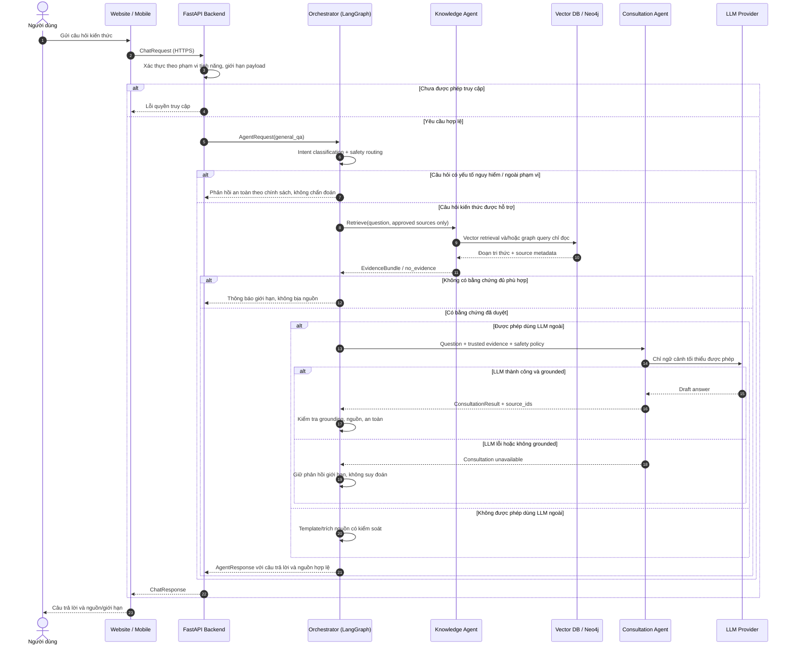

# GIAI ĐOẠN 2 – BƯỚC 4: SEQUENCE DIAGRAMS

**Dự án:** Multi-Agent AI System for Diabetes Risk Assessment  
**Phiên bản:** v0.1 – thiết kế đề xuất, chưa triển khai hay xác minh vận hành  
**Kế thừa:** `01-System-Architecture.md`, `02-Agent-Architecture.md`, `03-Agent-Interaction-Diagram.md`; tài liệu gốc 45 trang (SRS FR01–FR18, BR01–BR12, Activity Diagrams và lộ trình Giai đoạn 2).  
**Sản phẩm:** 4 Sequence Diagram Mermaid UML, mô tả trình tự lời gọi, nhánh `alt`/`opt`, dữ liệu trao đổi, xử lý lỗi, kiểm tra quyền, quy tắc nhất quán và kiểm thử.

> **Phân biệt nguồn – đề xuất:** Tài liệu gốc xác định 5 Agent, công nghệ và ba nghiệp vụ chính; Bước 3 bổ sung luồng giải thích bản ghi lịch sử và các hợp đồng dữ liệu. Các tên endpoint, method, nhánh hệ thống và mã lỗi dưới đây là **đề xuất thiết kế cho Bước 4**, không phải API hoặc tính năng đang chạy. Không coi kết quả mô hình là chẩn đoán bệnh tiểu đường, không giả định mô hình Pima áp dụng cho mọi đối tượng.

## 1. Mục tiêu và nguyên tắc

Sequence Diagram bổ sung **thứ tự thời gian của lời gọi** so với Agent Interaction Diagram (Bước 3): ai gọi ai, cần điều kiện gì, khi nào nhận phản hồi, lúc nào không được gọi dịch vụ tiếp theo. Phân biệt *lifeline* của Agent, dịch vụ ML/RAG và nghiệp vụ Backend.

Quy tắc thống nhất:

1. **Website/Mobile → FastAPI:** Client không được gọi trực tiếp Agent, PostgreSQL, Vector DB, Neo4j hay LLM.
2. **Backend → Orchestrator:** Backend xác thực, phân quyền, kiểm tra sở hữu bản ghi, giới hạn payload và quyết định quyền truyền dữ liệu ra ngoài (`external_llm_allowed`). Scope được cấp từ Backend là **chỉ đọc** trong graph.
3. **Orchestrator điều phối, không tự dự đoán.** Data Analysis phải `valid` trước khi Prediction chạy; Prediction là nguồn duy nhất của kết quả ML mới.
4. **Knowledge chỉ đọc tài liệu active**, trả nguồn thật kèm locator; không để dữ liệu truy xuất trở thành lệnh thực thi.
5. **Consultation chỉ diễn đạt** kết quả mô hình và bằng chứng đã truy xuất; không được sửa `prediction`, kê đơn hoặc tự tạo chẩn đoán.
6. **Finalizer là logic/node nội bộ**, không phải Agent thứ sáu. `Document Ingestion Worker` là dịch vụ quản trị, không phải Agent hội thoại.
7. **Agent ↔ Agent là giao tiếp logic qua LangGraph state**, không bắt buộc HTTP riêng; ở MVP có thể dùng hàm Python. HTTP/HTTPS được dùng giữa Client và FastAPI.
8. **Không có hardcoded clinical thresholds** trong các sơ đồ này. `model_manifest` quyết định schema, đơn vị, missing value policy, phạm vi đã kiểm định và version.

## 2. Ký hiệu và hợp đồng thông điệp

| Ký hiệu | Ý nghĩa | Ví dụ áp dụng |
|---|---|---|
| `->>` | Lời gọi/đề nghị đồng bộ ở mức logic | Backend → Orchestrator |
| `-->>` | Phản hồi/trả trạng thái | Prediction → Orchestrator |
| `alt/else` | Điều kiện loại trừ | Hợp lệ hoặc thiếu dữ liệu |
| `opt` | Thực hiện có điều kiện | Thêm giải thích và nguồn |
| `par` | Xử lý song song (nếu có) | Retrieval và explainability, *chỉ sau khi đủ dữ liệu* |
| `Note over` | Chú thích ranh giới/quy định | LLM không được sửa prediction |

**Hợp đồng logic (kế thừa Bước 3):**

- `AgentRequest`: `request_id`, `task_type`, `authorized_context`, `health_features`/`question`/`historical_assessment` (tuỳ tác vụ).
- `ValidationResult`: `status` (`valid`, `needs_input`, `out_of_scope`), field errors, `prepared_features`, `feature_schema_version`.
- `PredictionResult`: `prediction_label`, `model_score`/`risk_percent` nếu đủ căn cứ, `score_kind`, `model_version`, `feature_schema_version`, `explanation`, `limitations`.
- `EvidenceBundle`: `status`, chỉ các nguồn `active` với `source_id`, `document_version`, `locator`, `snippet`, ngày/URL nếu có.
- `ConsultationResult`: `text`, `source_ids`, các metadata kiểm tra an toàn; không ghi đè prediction.
- `AgentResponse`: `request_id`, `status` (`completed`, `needs_input`, `out_of_scope`, `failed`), `prediction`, `consultation`, `references`, `warnings`, `errors`.

**Quy ước nhất quán:** `authorized_context.external_llm_allowed` ở Bước 3 biểu thị **quyết định cuối do Backend tính** từ đồng ý của người dùng và chính sách hệ thống. Bước 2 dùng tên `consent_for_external_llm`; khi lập trình phải chuẩn hoá thành *một schema*, không coi hai cờ này mặc định có cùng ý nghĩa. `request_id` là bất biến cho một lượt xử lý.

## 3. SD-01 – Đánh giá nguy cơ tiểu đường (`risk_assessment`)

### 3.1. Mục tiêu và tiền điều kiện

- Người dùng gửi thông tin sức khỏe cho chức năng đánh giá nguy cơ; Backend kiểm tra phiên đăng nhập và quyền tương ứng.
- Mô hình đã được đánh giá và có `model_manifest`/artifact/version phù hợp; nếu chưa có thì quy trình trả lỗi an toàn.
- Input phải qua validation & preprocessing **cùng pipeline với lúc huấn luyện**; không suy diễn giá trị 0 thành dữ liệu đã đo khi không có căn cứ.
- Chỉ lưu lịch sử thuộc tài khoản hợp lệ và theo chính sách dữ liệu đã thống nhất.

### 3.2. Sequence Diagram

```mermaid
sequenceDiagram
    autonumber
    actor U as Người dùng
    participant UI as Website / Mobile
    participant API as FastAPI Backend
    participant O as Orchestrator (LangGraph)
    participant DA as Data Analysis Agent
    participant P as Prediction Agent
    participant ML as Validated ML/DL Model
    participant K as Knowledge Agent
    participant C as Consultation Agent
    participant L as LLM Provider
    participant DB as PostgreSQL

    U->>UI: Nhập dữ liệu và yêu cầu đánh giá
    UI->>API: Gửi HealthAssessmentRequest (HTTPS)
    API->>API: Xác thực, phân quyền, kiểm tra payload
    alt Không có quyền hoặc payload sai định dạng
        API-->>UI: 401/403/422; không gọi Agent
    else Được phép xử lý
        API->>O: AgentRequest (risk_assessment, authorized_context)
        O->>DA: Validate + preprocess theo model_manifest
        DA-->>O: ValidationResult
        alt needs_input
            O-->>API: AgentResponse(needs_input, prediction=null)
        else out_of_scope
            O-->>API: AgentResponse(out_of_scope, prediction=null)
        else valid
            O->>P: prepared_features + model/version
            P->>ML: Inference + model explainability (nếu hỗ trợ)
            alt Model lỗi / artifact mismatch / timeout
                ML-->>P: Model error
                P-->>O: Failed (no prediction)
                O-->>API: AgentResponse(failed, prediction=null)
            else Mô hình thành công
                ML-->>P: Label, score, explanation metadata
                P-->>O: PredictionResult + model_version
                Note over O,P: PredictionResult được đóng băng, Consultation không được sửa
                opt Có yêu cầu giải thích dựa trên nguồn
                    O->>K: Retrieve approved evidence theo phạm vi câu hỏi
                    K-->>O: EvidenceBundle / no_evidence
                    alt Có nguồn phù hợp và được phép dùng external LLM
                        O->>C: Read-only prediction + evidence + policy
                        C->>L: Gửi ngữ cảnh tối thiểu được phép
                        alt LLM hoạt động và đầu ra hợp lệ
                            L-->>C: Draft consultation
                            C-->>O: ConsultationResult
                            O->>O: Grounding + safety + consistency check
                        else LLM lỗi / đầu ra không hợp lệ
                            C-->>O: Consultation unavailable
                            O->>O: Bỏ phần tư vấn, giữ prediction
                        end
                    else Không có nguồn hoặc không được gửi LLM
                        O->>O: Dùng thông báo giới hạn / template được duyệt
                    end
                end
                O-->>API: AgentResponse(completed, prediction nguyên gốc)
                opt Được lưu lịch sử theo chính sách
                    API->>DB: Upsert assessment theo idempotency key
                    DB-->>API: Lưu thành công / lỗi lưu
                end
            end
        end
        API-->>UI: Kết quả hoặc lỗi có cấu trúc
    end
    UI-->>U: Hiển thị kết quả, cảnh báo và nguồn nếu có
```

**Giải thích:** Đường bắt buộc là `Backend → Orchestrator → Data Analysis → Prediction → Model → Orchestrator → Backend`. Knowledge/Consultation là nhánh tùy chọn sau khi có kết quả ML hợp lệ. Không có mô hình thành công thì **không tồn tại** `prediction`, kể cả khi LLM vẫn hoạt động. Khi chỉ ghi lịch sử thất bại, Backend phải báo trạng thái lưu chưa thành công; không tuyên bố đã lưu.

### 3.3. Dữ liệu qua ranh giới

| Chặng | Nội dung | Điều kiện |
|---|---|---|
| UI → Backend | Các feature có đơn vị/kiểu dữ liệu; không có score tự đặt | HTTPS; validate request schema |
| Backend → O | `AgentRequest`, scope, quyền gửi LLM | Đã AuthZ và tối thiểu hóa dữ liệu |
| O → DA | Features + `model_manifest` | Kiểm tra thiếu, giới hạn, domain |
| DA → P | `prepared_features` + version | Chỉ khi `validation.status = valid` |
| P → O | `PredictionResult` | Bắt buộc có `model_version`; không sửa sau khi chốt |
| K → O | `EvidenceBundle` | Chỉ tài liệu đã active, có locator |
| C → O | `ConsultationResult` | Không thay đổi prediction; có kiểm tra an toàn |
| O → Backend | `AgentResponse` | Finalizer rà soát bất biến |
| Backend → DB | Lịch sử assessment, metadata phiên bản | AuthZ, chính sách lưu trữ và idempotency |

## 4. SD-02 – Chatbot hỏi đáp kiến thức y khoa (`general_qa`)

### 4.1. Mục tiêu

- Câu hỏi chung về tiểu đường phải dùng Knowledge Agent để lấy kiến thức có nguồn trước khi Consultation soạn câu trả lời.
- Không gọi Data Analysis hay Prediction nếu không có yêu cầu đánh giá nguy cơ.
- Yêu cầu chẩn đoán/kê đơn, dấu hiệu nguy hiểm hoặc nội dung ngoài phạm vi phải đi qua nhánh an toàn, không mặc nhiên chuyển cho LLM trả lời tùy ý.

### 4.2. Sequence Diagram



**Điểm kiểm soát:** Nếu `no_evidence`, hệ thống không sinh câu trả lời y khoa có vẻ được dẫn chứng. Các lời chỉ dẫn trong tài liệu nguồn bị coi là **dữ liệu không đáng tin**, không thể cấp quyền hành động cho Agent. Câu hỏi y khoa chung không làm phát sinh một lần chạy model.

## 5. SD-03 – Giải thích lại một kết quả đã lưu (`explain_assessment`)

### 5.1. Mục tiêu

Nghiệp vụ mở rộng từ FR08/FR13 và Bước 3: người dùng xem một bản ghi cũ, yêu cầu diễn giải bằng kiến thức phù hợp. **Không tạo một dự đoán mới** và **không tự sửa điểm** của lần đánh giá đã lưu.

### 5.2. Sequence Diagram

```mermaid
sequenceDiagram
    autonumber
    actor U as Người dùng
    participant UI as Website / Mobile
    participant API as FastAPI Backend
    participant DB as PostgreSQL
    participant O as Orchestrator (LangGraph)
    participant K as Knowledge Agent
    participant V as Approved Knowledge Store
    participant C as Consultation Agent
    participant L as LLM Provider

    U->>UI: Mở lịch sử và chọn xem giải thích
    UI->>API: Request explanation (assessment_id)
    API->>API: Xác thực và xác định user hiện tại
    API->>DB: Lấy assessment theo owner_id + assessment_id
    alt Không tồn tại hoặc không thuộc tài khoản
        DB-->>API: Not found / forbidden
        API-->>UI: Không cấp dữ liệu cá nhân
    else Bản ghi có quyền truy cập
        DB-->>API: Saved PredictionResult + model_version
        API->>API: Kiểm tra metadata, chính sách sử dụng dữ liệu
        alt Bản ghi thiếu dữ liệu truy vết cần thiết
            API-->>UI: Không thể giải thích đáng tin cậy, giữ bản ghi gốc
        else Đủ metadata cho giải thích giới hạn
            API->>O: AgentRequest(explain_assessment, historical_assessment)
            Note over O,C: Không gọi Data Analysis hoặc Prediction; prediction là chỉ đọc
            O->>K: Retrieve evidence phù hợp với kết quả đã lưu
            K->>V: Query only active sources
            V-->>K: Evidence / no_evidence
            K-->>O: EvidenceBundle
            alt Có nguồn và LLM được phép
                O->>C: Saved result read-only + evidence
                C->>L: Context tối thiểu được phép
                L-->>C: Draft explanation / error
                C-->>O: ConsultationResult / unavailable
                O->>O: Kiểm tra mâu thuẫn, nguồn và safety
            else Không đủ nguồn hoặc không có quyền LLM
                O->>O: Trả hạn chế, không tự tái tạo dự đoán
            end
            O-->>API: Explanation response + references/warnings
            API-->>UI: Trả phần giải thích hoặc giới hạn
        end
    end
    UI-->>U: Hiển thị kết quả lịch sử nguyên gốc
```

**Điểm bắt buộc:** Backend kiểm tra sở hữu bản ghi **trước** khi chuyển bất kỳ dữ liệu cá nhân nào vào graph; không cho LLM tự thay đổi kết quả lịch sử. Nếu nguồn hiện tại khác nguồn từng dùng lúc đánh giá, phải chỉ rõ ngữ cảnh/phiên bản tri thức khác nhau khi hiển thị.

## 6. SD-04 – Admin phê duyệt và lập chỉ mục tài liệu y khoa (`document_ingestion`)

### 6.1. Mục tiêu

Quy trình quản trị Knowledge Base thuộc FR14–FR15; là workflow **tách biệt khỏi 5 Agent**. Tài liệu mới tải lên chưa đồng nghĩa được truy xuất. Phiên bản chỉ chuyển `active` sau khi quá trình trích xuất, embedding, cập nhật graph và kiểm tra đạt yêu cầu.

### 6.2. Sequence Diagram

```mermaid
sequenceDiagram
    autonumber
    actor A as Admin
    participant UI as Admin UI
    participant API as FastAPI Backend
    participant DB as PostgreSQL / Metadata
    participant W as Document Ingestion Worker
    participant V as Vector Database
    participant KG as Neo4j
    participant K as Knowledge Agent (read only)

    A->>UI: Tải tài liệu và yêu cầu quản lý
    UI->>API: Upload metadata + file
    API->>API: AuthN/AuthZ Admin; kiểm tra định dạng
    alt Không có quyền / tài liệu không hợp lệ
        API-->>UI: Từ chối, không lập chỉ mục
    else Upload hợp lệ
        API->>DB: Tạo document_version(status=pending)
        DB-->>API: document_id + version
        API-->>UI: Pending review
        A->>UI: Xem xét và phê duyệt phiên bản
        UI->>API: Approve(document_version)
        API->>API: Kiểm tra role + phê duyệt nguồn
        alt Không được phê duyệt
            API->>DB: Ghi rejected/pending
            API-->>UI: Không đưa vào Knowledge Base
        else Approved
            API->>DB: Ghi approved, tạo ingestion_job
            API->>W: Enqueue approved document version
            W->>W: Extract, clean, chunk, embed, extract KG
            W->>V: Upsert vectors vào staging theo version
            V-->>W: Stage result / error
            W->>KG: Upsert entities + relations vào staging theo version
            KG-->>W: Stage result / error
            alt Lỗi xử lý hoặc kiểm tra nhất quán không đạt
                W->>DB: Mark job failed; không active phiên bản mới
                W->>W: Schedule cleanup/reconcile staging
                API-->>UI: Hiển thị failed (khi truy vấn trạng thái)
            else Cả hai chỉ mục và kiểm tra đạt
                W->>DB: Activate document_version (visible pointer)
                DB-->>W: Activation confirmed
                Note over K,DB: Chỉ truy vấn phiên bản active được cấp phép
                API-->>UI: Hiển thị active (khi truy vấn trạng thái)
            end
        end
    end
```

**Chú ý về tính nhất quán:** Vector DB, Neo4j và PostgreSQL thường **không có giao dịch ACID xuyên ba hệ**. Vì vậy worker dùng staging theo `document_version` và một trạng thái/manifest **active duy nhất** để quyết định dữ liệu nào được phép đọc; các chỉ mục staging không được xuất hiện trong kết quả RAG. Khi thất bại, giữ phiên bản cũ đang active (nếu có), đồng thời lên lịch dọn rác/đối soát. Khi thu hồi hoặc thay thế tài liệu, phải vô hiệu hóa quyền truy xuất phiên bản bị thu hồi và cập nhật các chỉ mục liên quan.

## 7. Ma trận thời điểm, nhánh điều kiện và trạng thái

| Nghiệp vụ | Tiền điều kiện | Bước không thể bỏ qua | Nhánh lỗi | Kết quả trả |
|---|---|---|---|---|
| SD-01 Risk | AuthZ + input hợp lệ về cấu trúc | DA.valid **trước** Prediction | `needs_input`, `out_of_scope`, model error, LLM error | `completed` có prediction hoặc trạng thái không dự đoán |
| SD-02 Chat | Query và phạm vi truy cập hợp lệ | Knowledge nguồn approved trước tư vấn | No evidence, prompt injection, LLM error, unsafe question | Có nguồn thật hoặc nói rõ giới hạn |
| SD-03 Explain | Đúng owner và record có metadata | DB ownership check **trước** graph | Record thiếu version, no evidence, LLM error | Không thay đổi kết quả cũ |
| SD-04 Ingest | Admin có quyền và nguồn đã được duyệt | Index staged **trước** activate | Parse/index/consistency failed | Job active/failed, không lộ nguồn pending |

### 7.1. HTTP và trạng thái ứng dụng (đề xuất chưa chốt API)

| Trạng thái | `AgentResponse.status` | HTTP gợi ý | Ghi chú |
|---|---|---|---|
| Câu hỏi/đánh giá hoàn thành | `completed` | 200 | Không đồng nghĩa chẩn đoán chắc chắn |
| Thiếu dữ liệu bắt buộc | `needs_input` | 422 | Không có prediction |
| Ngoài phạm vi model | `out_of_scope` | 422 | Không có prediction |
| Lỗi model/hệ thống | `failed` | 500/503 | Không tự tạo score |
| Chưa xác thực | Không vào graph | 401 | Backend xử lý |
| Không có quyền sở hữu | Không vào graph | 403 hoặc 404 | Chính sách tránh lộ sự tồn tại dữ liệu |
| Job ingestion đã nhận | Trạng thái job | 202 | Xử lý bất đồng bộ ngoài graph |

Các route và mã HTTP cụ thể sẽ được chuẩn hóa ở **Bước 6 – Technical Design**; bảng trên chỉ thể hiện quan hệ giữa domain status và response transport.

## 8. Quan hệ với Message Matrix từ Bước 3

| Message ID Bước 3 | Lifeline tương ứng | Vai trò trong Sequence |
|---|---|---|
| M01 | Client → Backend | Request có xác thực, validation |
| M02 | Backend → O | `AgentRequest` có scope |
| M03–M04 | O ↔ Data Analysis | Validation / prepared_features |
| M05–M06 | O ↔ Prediction ↔ Model | Inference và immutable `PredictionResult` |
| M07–M08 | O ↔ Knowledge ↔ Vector/KG | Retrieval và nguồn có version |
| M09–M10 | O ↔ Consultation ↔ LLM | Giải thích có chính sách và nguồn |
| M11 | O → Backend | `AgentResponse` có status/error |
| M12 | Backend ↔ PostgreSQL | Ghi lịch sử idempotent |
| M13–M14 | Admin Backend → Worker → Indexes | Tài liệu approved, staged, active |

## 9. Quy tắc bảo mật, an toàn và tin cậy

- **Authentication/Authorization:** thực thi tại Backend, dùng user context lấy từ token/session hợp lệ; không tin `user_id` do Client tự khai báo.
- **Privacy:** gửi ít dữ liệu cá nhân nhất có thể. Không đưa mật khẩu, token, số nhận dạng, toàn bộ lịch sử sức khỏe vào prompt LLM khi không cần.
- **Nguồn tri thức:** chỉ tài liệu được duyệt, `active`; có `source_id`, `document_version`, `locator`, nguồn/ngày nếu tồn tại. Không nhận tài liệu được truy xuất là mệnh lệnh hệ thống.
- **Không chẩn đoán:** đánh giá nguy cơ type 2 mang tính sàng lọc, không kê đơn hoặc tự xử lý cấp cứu bằng chatbot. Đường phản hồi an toàn cần được kiểm định cùng chuyên gia y tế trước khi triển khai thực tế.
- **Prediction immutability:** LLM không tạo/sửa nhãn, điểm, `risk_percent`, `model_version` và không nâng model score thành nguy cơ thực tế khi chưa hiệu chỉnh.
- **State ownership:** schema validation/middleware kiểm soát Agent nào được phép ghi state key nào; LangGraph tự thân không bảo đảm quyền này.
- **Timeout/retry:** retries có giới hạn với thao tác idempotent; không retry vô hạn hoặc nhân đôi assessment/ingestion; thời gian timeout cụ thể sẽ được kiểm thử.
- **Observability:** log `request_id`, node, status, duration, version, error code đã làm sạch; tránh log dữ liệu sức khỏe thô.
- **Consistency:** `document_version` và `model_version` truy xuất được khi xem lịch sử; phiên bản bị thu hồi không được retrieve cho câu hỏi mới.

## 10. Kiểm thử chấp nhận thiết kế Sequence Diagrams

| Test ID | Sơ đồ | Ca kiểm thử | Kết quả kỳ vọng |
|---|---|---|---|
| SDT01 | SD-01 | Request không có quyền | Backend chặn trước O |
| SDT02 | SD-01 | Thiếu trường model bắt buộc | `needs_input`; không gọi P |
| SDT03 | SD-01 | Input ngoài phạm vi đã kiểm định | `out_of_scope`; không gọi ML |
| SDT04 | SD-01 | Model trả nhãn/điểm hợp lệ | `PredictionResult` có `model_version` |
| SDT05 | SD-01 | Model timeout | `failed`; prediction=null |
| SDT06 | SD-01 | RAG không có nguồn sau model | Giữ prediction, cảnh báo giới hạn |
| SDT07 | SD-01 | LLM sửa điểm hoặc thiếu grounding | Chặn consultation, giữ prediction |
| SDT08 | SD-01 | Retry lưu history | Không tạo 2 assessment trùng |
| SDT09 | SD-02 | FAQ y khoa có nguồn | Chỉ Knowledge/Consultation; không gọi Prediction |
| SDT10 | SD-02 | Không tìm thấy nguồn | Trả giới hạn, không bịa tài liệu |
| SDT11 | SD-02 | Prompt injection từ PDF trong RAG | Không mở rộng quyền/không làm theo instructions |
| SDT12 | SD-02 | Câu hỏi vượt phạm vi / cần can thiệp khẩn | Safety route, không kê đơn/chẩn đoán |
| SDT13 | SD-03 | Người A xem assessment người B | Chặn trước graph và không lộ dữ liệu |
| SDT14 | SD-03 | Người có quyền yêu cầu giải thích assessment cũ | Không gọi model lại; giữ version cũ |
| SDT15 | SD-04 | Tài liệu chưa phê duyệt | Không có trong kết quả Knowledge |
| SDT16 | SD-04 | Vector DB thành công, Neo4j thất bại | Không activate, staging không truy xuất được |
| SDT17 | SD-04 | Phiên bản mới active thành công | Knowledge chỉ đọc phiên bản active |
| SDT18 | SD-04 | Revoked document version | Không retrieve bản đã thu hồi |

## 11. Liên kết tới SRS và Activity Diagram (tài liệu gốc)

| SRS / Rule | Sequence | Nội dung bảo đảm |
|---|---|---|
| FR05–FR09, BR03–BR06, BR10–BR11 | SD-01 | Nhập dữ liệu → kiểm tra → mô hình → kết quả, không tự chẩn đoán |
| FR10–FR12, BR07 | SD-02 | Truy xuất nguồn y khoa, chatbot có căn cứ và giới hạn |
| FR08, FR13, BR02, NFR03 | SD-03 | Giải thích kết quả lịch sử đúng quyền |
| FR14–FR15, BR08 | SD-04 | Tài liệu phê duyệt → indexing → active |
| FR18, NFR06/08/10 | Tất cả | Orchestrator, xử lý lỗi, tương thích module, truy vết |

**Tương ứng Activity Diagram Giai đoạn 1:** SD-01 triển khai trình tự cho đánh giá nguy cơ; SD-02 cho RAG và chatbot; SD-04 cho quản lý tài liệu. SD-03 chi tiết hóa chức năng xem lịch sử và giải thích kết quả vốn đã nằm trong SRS và Bước 3.

## 12. Các quyết định còn mở (không tự coi là đã được xác nhận)

1. Đầu vào cuối cùng theo model: feature list, đơn vị, phạm vi đối tượng, missing policy, phương pháp explainability, hiệu chỉnh xác suất.
2. Chính sách phân quyền chính thức với Guest/User/Admin; `risk_assessment` và history trong SRS hiện gắn với User, nên ví dụ sequence mặc định yêu cầu đăng nhập.
3. Consent và data retention; có gửi dữ liệu y tế sang API LLM bên thứ ba hay không và mức tối thiểu nào.
4. Nguồn tài liệu y khoa được duyệt, tiêu chí relevance và tính hợp lệ của KG triples.
5. Cơ chế worker/queue, hỗ trợ xóa/thay thế và reconciliation khi một index thất bại.
6. Các HTTP endpoint, status/mã lỗi, latency budget, timeout, số lần retry và giới hạn tải.

## 13. Bàn giao cho Bước 5 – Thiết kế cơ sở dữ liệu (ERD)

Sequence ở Bước 4 gợi ra những thực thể cần cân nhắc, nhưng **chưa chốt ERD**: `users`, `profiles`, `health_assessments`, `assessment_features` (hoặc JSON có schema), `model_versions`, `agent_runs`, `chat_sessions`, `chat_messages`, `documents`, `document_versions`, `document_ingestion_jobs`, `knowledge_sources`, `retrieval_citations` và `audit_logs`.

Ràng buộc nên phản ánh khi tạo ERD: `health_assessments.owner_id` theo user; lịch sử assessment truy xuất đúng owner; `model_version` gắn mỗi dự đoán; ingestion phải có state/phiên bản; tài liệu `active` mới được truy xuất; idempotency keys phải unique theo phạm vi phù hợp; sức khỏe người dùng phải được bảo vệ ở mức ứng dụng và cơ sở dữ liệu.

## 14. Definition of Done (Bước 4)

- [x] Có 4 Sequence Diagram logic dưới dạng Mermaid có thể chỉnh sửa.
- [x] Thể hiện auth/ownership, luồng success, invalid input, model/RAG/LLM failure và document staging.
- [x] Không tạo Agent thứ sáu; giữ đường dẫn xử lý theo Bước 1–3.
- [x] Có ma trận message với M01–M14, mapping SRS và kiểm thử kỳ vọng.
- [x] Có handoff cụ thể sang Bước 5 – ERD.
- [ ] Chờ triển khai/kiểm thử thực tế; các quyết định còn mở phải được chốt trước khi đưa vào hệ thống thật.

**Bước tiếp theo:** **Giai đoạn 2 – Bước 5: Entity Relationship Diagram (ERD)**, từ các luồng nghiệp vụ ở đây thiết kế dữ liệu, khóa, quan hệ, phân quyền, các phiên bản model và tài liệu tri thức.
