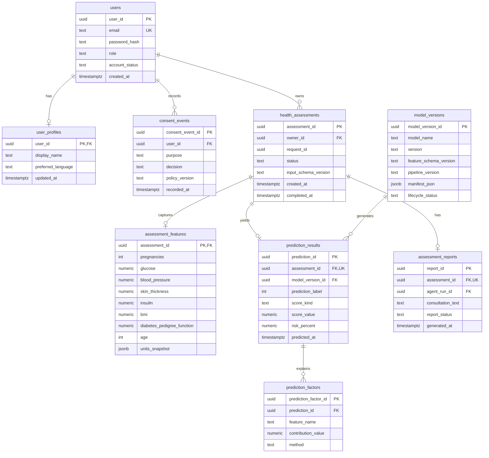
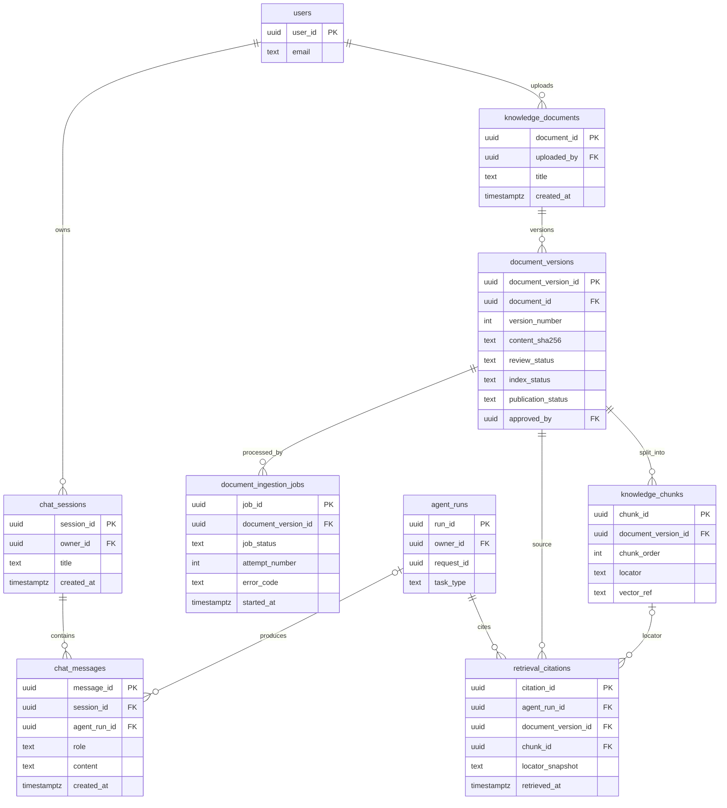
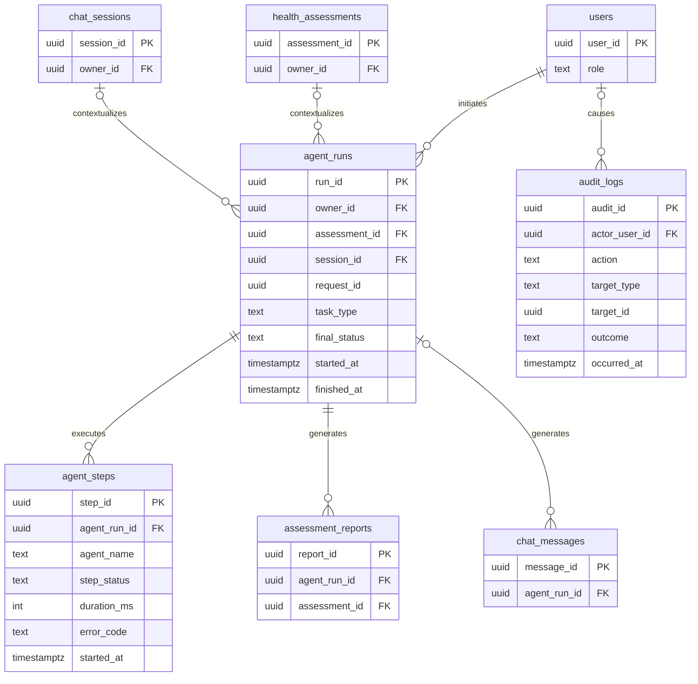

# GIAI ĐOẠN 2 – BƯỚC 5: THIẾT KẾ CƠ SỞ DỮ LIỆU (ERD)

**Dự án:** Multi-Agent AI System for Diabetes Risk Assessment  
**Tài liệu:** `05-Entity-Relationship-Diagram.md`  
**Phiên bản:** v0.1 – bản thiết kế để rà soát, **chưa triển khai**  
**Liên kết:** GĐ1 SRS FR01–FR18, BR01–BR12; GĐ2 Bước 1–4 (`01-...` đến `04-Sequence-Diagrams.md`).

> **Ranh giới nguồn và đề xuất:** Tài liệu dự án quy định các nhóm nghiệp vụ, 5 Agent, Web/Mobile, PostgreSQL, Vector Database, Neo4j, kiểm soát quyền, lịch sử, nguồn y khoa và khả năng truy vết. **Tên bảng, kiểu cột, chuẩn hóa, số lượng 19 bảng, quy ước trạng thái và quan hệ dưới đây là phương án thiết kế bổ sung của Bước 5**, không phải lược đồ đã được phê duyệt hoặc cơ sở dữ liệu đang hoạt động. Hệ thống chỉ hỗ trợ **đánh giá/sàng lọc nghiên cứu**; không phải chẩn đoán lâm sàng.

## 1. Mục tiêu và phạm vi

Thiết kế lược đồ dữ liệu phục vụ:

1. Xác thực, tài khoản, hồ sơ, phân quyền và sự đồng ý.
2. Ghi nhận dữ liệu đầu vào, kết quả đánh giá nguy cơ, giải thích, phiên bản mô hình.
3. Hỗ trợ chatbot và lịch sử hội thoại.
4. Quản lý vòng đời tài liệu y khoa, cập nhật RAG/Knowledge Graph có phê duyệt.
5. Truy vết Agent, nguồn y khoa, xử lý lỗi, nhật ký quản trị mà không ghi log dữ liệu sức khỏe thô.

**Không thuộc ERD PostgreSQL:** vector embedding và chỉ mục tương tự (ChromaDB/FAISS); các node/edge tri thức (Neo4j); tệp gốc/model artifact (object/file storage). PostgreSQL quản lý metadata và trạng thái phát hành; các hệ được nối bằng ID/phiên bản chứ không có foreign key xuyên hệ.

## 2. Phân hệ và danh sách thực thể (19 bảng)

| # | Nhóm | Bảng | Trách nhiệm |
|---|---|---|---|
| 1 | Người dùng | `users` | Tài khoản, email chuẩn hóa, password hash, role, trạng thái |
| 2 | Người dùng | `user_profiles` | Thông tin hiển thị tối thiểu |
| 3 | Người dùng | `consent_events` | Lịch sử cấp/thu hồi đồng ý theo mục đích |
| 4 | Đánh giá | `health_assessments` | Phiên đánh giá, chủ sở hữu, trạng thái, request idempotency |
| 5 | Đánh giá | `assessment_features` | Snapshot đặc trưng sức khỏe, giữ `NULL` cho giá trị chưa đo |
| 6 | Đánh giá | `model_versions` | Model manifest, feature/pipeline version, kiểm định/calibration |
| 7 | Đánh giá | `prediction_results` | Nhãn và điểm mô hình **bất biến**, liên kết version |
| 8 | Đánh giá | `prediction_factors` | Đóng góp đặc trưng từ explainability (nếu có) |
| 9 | Đánh giá | `assessment_reports` | Diễn giải/ngữ cảnh sau dự đoán, tách khỏi kết quả ML |
| 10 | Chatbot | `chat_sessions` | Hội thoại theo tài khoản |
| 11 | Chatbot | `chat_messages` | Tin nhắn, nguồn gốc request/agent run |
| 12 | Tri thức | `knowledge_documents` | Thực thể tài liệu logic, quản trị viên tải lên |
| 13 | Tri thức | `document_versions` | Từng phiên bản, phê duyệt, indexing, publish/revoke |
| 14 | Tri thức | `document_ingestion_jobs` | Trạng thái ingestion/retry/error |
| 15 | Tri thức | `knowledge_chunks` | Locator và ánh xạ vector ID tới phiên bản tài liệu |
| 16 | Giám sát | `agent_runs` | Một lần điều phối, task type, status, request_id |
| 17 | Giám sát | `agent_steps` | Dấu vết từng Agent, latency và error code |
| 18 | Giám sát | `retrieval_citations` | Nguồn được sử dụng trong từng lần chạy Agent |
| 19 | Giám sát | `audit_logs` | Sự kiện bảo mật/quản trị được làm sạch |

**Thứ tự phát triển đề xuất:** lõi User + Assessment + Model + Prediction → Agent runs + Chat → Documents/versions/chunks + citations → Consent/audit và tính năng mở rộng. Bảo mật, phân quyền và kiểm soát dữ liệu tối thiểu phải có từ bản đầu, không hoãn đến cuối.

## 3. ERD-A – Người dùng và đánh giá nguy cơ

**Cardinality:** `users 1:N health_assessments`; mỗi lần đánh giá có tối đa một snapshot feature và tối đa một `prediction_results`; nếu invalid/failed sẽ không có bản ghi prediction; mỗi `prediction_results` dùng **đúng một** `model_versions`. `assessment_reports` tách phần tư vấn có thể thay đổi khỏi dữ liệu mô hình bất biến. Báo cáo có `agent_run_id` tham chiếu `agent_runs` ở ERD-C.

## 4. ERD-B – Chatbot, tài liệu và nguồn RAG

**Bất biến quản lý tri thức:** Knowledge Agent chỉ truy xuất phiên bản `review_status='approved' AND index_status='ready' AND publication_status='active'`, dùng whitelist/tập active từ PostgreSQL. Dữ liệu ở staging bên Vector DB/Neo4j **không** được trở thành kết quả truy xuất. PostgreSQL không có giao dịch ACID chung với Vector DB/Neo4j, vì vậy worker phải kiểm tra, công bố trạng thái active nguyên tử trong PostgreSQL rồi dọn phiên bản cũ; on-failure giữ phiên bản cũ và đối soát. `retrieval_citations` lưu dấu vết nguồn đã từng sử dụng, không có nghĩa nguồn đó vẫn còn đang active.

## 5. ERD-C – Agent, lịch sử vận hành và bảo mật

**Tránh tạo Agent mới:** `agent_runs` và `agent_steps` là dữ liệu monitoring của 5 Agent đã định nghĩa, không phải Agent thứ sáu. `audit_logs` chỉ lưu metadata sự kiện đã làm sạch, không chứa glucose, BMI, prompt thô, token hay câu trả lời có dữ liệu sức khỏe.

## 6. Data Dictionary – Trường và ràng buộc quan trọng

### 6.1. Người dùng và đồng ý

**`users`**

| Cột | Kiểu PostgreSQL | Ràng buộc |
|---|---|---|
| `user_id` | UUID | PK |
| `email` | TEXT | NOT NULL, UNIQUE sau khi chuẩn hóa lowercase |
| `password_hash` | TEXT | NOT NULL, băm an toàn, không lưu mật khẩu gốc |
| `role` | TEXT | NOT NULL, CHECK IN (`user`,`admin`) |
| `account_status` | TEXT | CHECK IN (`active`,`locked`,`deactivated`) |
| `created_at`, `updated_at` | TIMESTAMPTZ | NOT NULL |

**`user_profiles`**: `user_id` (PK+FK users), `display_name` (TEXT NULL), `preferred_language` (TEXT NULL), `updated_at` (TIMESTAMPTZ). Không thu thập dữ liệu nhân thân không cần thiết.

**`consent_events`**: `consent_event_id` PK, `user_id` FK, `purpose` (ví dụ: `external_llm_processing`, `secondary_model_training`), `decision` (`granted`,`withdrawn`), `policy_version`, `recorded_at`. Đây là nhật ký bằng chứng; quyết định cho phép phải dựa vào bản ghi gần nhất **và** chính sách/cơ sở pháp lý hiện hành, không mặc định chỉ có click đồng ý là đủ.

### 6.2. Đánh giá sức khỏe

**`health_assessments`**

| Cột | Kiểu | Ràng buộc / Ý nghĩa |
|---|---|---|
| `assessment_id` | UUID | PK |
| `owner_id` | UUID | FK NOT NULL → users, chủ sở hữu |
| `request_id` | UUID | NOT NULL, UNIQUE (`owner_id`,`request_id`) để chống ghi trùng |
| `status` | TEXT | `created`, `processing`, `completed`, `needs_input`, `out_of_scope`, `failed` |
| `input_schema_version` | TEXT | Version dữ liệu nhập, NOT NULL |
| `created_at`, `completed_at` | TIMESTAMPTZ | Bắt đầu/kết thúc; completed_at có thể NULL |
| `warning_codes` | JSONB | Danh sách cảnh báo đã chuẩn hóa, không chứa thông tin sức khỏe thô |

**`assessment_features`**: `assessment_id` (PK/FK), `pregnancies` INT, `glucose`, `blood_pressure`, `skin_thickness`, `insulin`, `bmi`, `diabetes_pedigree_function` NUMERIC, `age` INT, `units_snapshot` JSONB, `captured_at` TIMESTAMPTZ. Các feature có thể NULL khi chưa đo; tuyệt đối không mặc định `0` là chưa có dữ liệu hoặc tự thay thế bằng `0`. Các giới hạn/đơn vị và điều kiện đủ dự đoán phải đến từ **model_manifest** có version, không hardcode một bộ ngưỡng chung. Không kết luận mô hình Pima phù hợp mọi dân số.

**`model_versions`**: `model_version_id` PK; `model_name` + `version` UNIQUE; `feature_schema_version`, `pipeline_version`; `manifest_json` JSONB (schema, thứ tự feature, đơn vị, tiền xử lý, phạm vi áp dụng đã kiểm định, data/model lineage, đánh giá/calibration), `artifact_uri` TEXT (đường dẫn nội bộ), `lifecycle_status` (`draft`,`validated`,`active`,`retired`), `created_at`. Chỉ dùng mô hình đủ điều kiện đã được kích hoạt trong quy trình production/inference. Không lưu access token trong `manifest_json`.

**`prediction_results`**

| Cột | Kiểu | Ràng buộc / Ý nghĩa |
|---|---|---|
| `prediction_id` | UUID | PK |
| `assessment_id` | UUID | UNIQUE, NOT NULL, FK → assessments |
| `model_version_id` | UUID | NOT NULL, FK → model_versions |
| `prediction_label` | SMALLINT | NOT NULL, CHECK IN (0,1), không tương đương chẩn đoán |
| `score_kind` | TEXT | `calibrated_probability`, `uncalibrated_score`, `unavailable` |
| `score_value` | NUMERIC | NULL nếu không hỗ trợ; không mặc định là phần trăm |
| `risk_percent` | NUMERIC | Chỉ xuất hiện khi có hiệu chỉnh/kiểm định thích hợp, CHECK 0..100 |
| `predicted_at` | TIMESTAMPTZ | NOT NULL |

**Ràng buộc điểm số:** `risk_percent IS NULL` nếu `score_kind <> 'calibrated_probability'`; nếu `score_kind='calibrated_probability'` thì điểm xác suất hợp lệ mới được lưu cùng đánh dấu đã hiệu chỉnh. `prediction_results` phải bất biến đối với LLM/Consultation và các vai trò không có quyền. Sửa/huỷ phải có nghiệp vụ audit, không âm thầm ghi đè.

**`prediction_factors`**: `prediction_factor_id` PK, `prediction_id` FK, `feature_name`, `contribution_value`, `method` (ví dụ SHAP), `explainer_version`. Đây là đóng góp cho dự đoán, không phải bằng chứng nhân quả y học.

**`assessment_reports`**: `report_id` PK, `assessment_id` UNIQUE/FK, `agent_run_id` FK, `consultation_text` TEXT, `report_status` (`generated`,`withheld`,`failed`), `generated_at`. Đây là kết quả diễn giải có nguồn; nếu không có căn cứ không lưu tư vấn như một kết luận y tế.

### 6.3. Chatbot

**`chat_sessions`**: `session_id` PK; `owner_id` FK NOT NULL; `title` TEXT NULL; `created_at`, `updated_at` TIMESTAMPTZ; `deleted_at` TIMESTAMPTZ NULL (phục vụ chính sách xóa/lưu giữ).

**`chat_messages`**: `message_id` PK; `session_id` FK NOT NULL; `agent_run_id` FK NULL cho phản hồi do agent tạo; `role` (`user`,`assistant`); `content` TEXT; `client_message_id` TEXT NULL (UNIQUE theo session khi có); `created_at`. Chỉ lưu nội dung theo chính sách lưu giữ và quyền người dùng, không tái sử dụng để huấn luyện nếu chưa có cơ sở phù hợp.

### 6.4. Knowledge Base

**`knowledge_documents`**: `document_id` PK, `title`, `uploaded_by` FK users, `created_at`, `deleted_at` NULL. Một tài liệu logic có nhiều phiên bản.

**`document_versions`**: `document_version_id` PK, `document_id` FK, `version_number` INT, `content_sha256` TEXT, `file_uri` TEXT, `source_url` TEXT NULL, `publication_date` DATE NULL, `source_publisher` TEXT NULL, `license_info` TEXT NULL, `review_status` (`pending`,`approved`,`rejected`), `index_status` (`pending`,`building`,`ready`,`failed`), `publication_status` (`inactive`,`active`,`revoked`), `approved_by` FK users NULL, `approved_at` NULL, `activated_at` NULL. UNIQUE (`document_id`,`version_number`). Chỉ một version `active`/document nhờ **partial unique index**. Nguồn/tài liệu có nguồn gốc, ngày cập nhật và khả năng kiểm chứng, nếu biết.

**`document_ingestion_jobs`**: `job_id` PK, `document_version_id` FK, `job_status` (`queued`,`running`,`completed`,`failed`), `attempt_number`, `error_code` NULL, `started_at`, `finished_at`. Worker chịu trách nhiệm chống trùng lặp, retry có giới hạn và dọn staging.

**`knowledge_chunks`**: `chunk_id` PK, `document_version_id` FK, `chunk_order` INT, `locator` TEXT (trang/đoạn), `content_hash` TEXT, `vector_ref` TEXT NULL, `created_at`. UNIQUE (`document_version_id`,`chunk_order`); `vector_ref` là ID bên Vector Database. Knowledge Graph dùng metadata `document_version_id`, `chunk_id` trên node/edge liên quan để kiểm tra phiên bản/revoke, chứ không FK SQL sang Neo4j.

### 6.5. Agent và giám sát

**`agent_runs`**: `run_id` PK; `owner_id` FK; `request_id` UUID; `assessment_id` FK NULL; `session_id` FK NULL; `task_type` (`risk_assessment`,`general_qa`,`explain_assessment`); `final_status` (`started`,`completed`,`needs_input`,`out_of_scope`,`failed`); `started_at`, `finished_at`, `error_code` NULL. UNIQUE (`owner_id`,`request_id`). Kiểm tra `owner_id` phải đồng nhất với chủ sở hữu assessment/chat, kể cả khi có FK hợp lệ.

**`agent_steps`**: `step_id` PK, `agent_run_id` FK, `agent_name` một trong 5 Agent, `step_status`, `duration_ms`, `error_code`, `started_at`, `finished_at`. Chỉ lưu tracing kỹ thuật đã làm sạch; không chứa prompt thô, dữ liệu sức khỏe, nội dung token nhạy cảm.

**`retrieval_citations`**: `citation_id` PK, `agent_run_id` FK, `document_version_id` FK, `chunk_id` FK NULL, `locator_snapshot`, `source_title_snapshot`, `retrieved_at`, `retrieval_score` NUMERIC NULL. Khi tạo, xác nhận version hiện active và `chunk_id` thực sự thuộc `document_version_id`; giữ bằng chứng lịch sử kể cả sau thu hồi, nhưng không coi nguồn cũ là còn hợp lệ cho lời khuyên mới.

**`audit_logs`**: `audit_id` PK, `actor_user_id` FK NULL, `action` TEXT, `target_type` TEXT, `target_id` UUID NULL, `outcome` TEXT, `request_id` UUID NULL, `occurred_at` TIMESTAMPTZ; metadata nếu có phải allowlist đã làm sạch. Không lưu raw health input, mật khẩu, access token, full prompt.

## 7. Quan hệ, khóa và tính toàn vẹn

| Quan hệ | Kiểu | Ràng buộc bắt buộc |
|---|---|---|
| User → Assessments | 1:N | `health_assessments.owner_id` FK NOT NULL; kiểm tra ownership mọi truy vấn |
| Assessment → Features | 1:0..1 | `assessment_features.assessment_id` PK+FK |
| Assessment → Prediction | 1:0..1 | `prediction_results.assessment_id` UNIQUE; không có row khi validation/model lỗi |
| Model Version → Predictions | 1:N | Mỗi kết quả liên kết version mô hình thật |
| Assessment → Report | 1:0..1 | Report không được thay đổi ML result |
| User → Chat Sessions → Messages | 1:N → 1:N | Chỉ owner có quyền xem dữ liệu |
| Knowledge Document → Versions → Chunks | 1:N → 1:N | Nguồn có version, locator và trạng thái publish |
| Document Version → Ingestion Jobs | 1:N | Retry và trạng thái có thể audit |
| Agent Run → Steps / Citations | 1:N / 1:N | Truy vết Agent, nguồn và lỗi |
| User → Consent Events / Audit Logs | 1:N / 0:N | Bằng chứng thay đổi quyền xử lý dữ liệu |

**Ràng buộc bổ sung nên triển khai:** index cho `(owner_id, created_at DESC)`, `(session_id, created_at)`, `(document_id, version_number)`, `(agent_run_id, started_at)`; index từng bảng theo FK. Để chống *cross-owner joins*, tạo UNIQUE `(assessment_id, owner_id)` ở assessments, `(session_id, owner_id)` ở chat_sessions rồi dùng composite FK tại agent_runs nếu chọn làm ràng buộc CSDL; không chỉ tin vào kiểm tra UI. Với email, nên chuẩn hóa lowercase phía ứng dụng và dùng unique functional index trên `lower(email)` hoặc `citext` (chốt ở Bước 6).

## 8. Tính nhất quán xuyên PostgreSQL – Vector DB – Neo4j

**Giai đoạn nhập tài liệu:** upload tạo `document_version` (inactive/pending) → Admin review/approve → worker chunk/embed + graph ở staging → kiểm tra đủ chunks, vector và node/edge liên quan → cập nhật index ready → giao dịch PostgreSQL chuyển bản cũ inactive, bản mới active (hoặc revoke), giữ tối đa 1 active version theo doc.

**Giai đoạn đọc:** Knowledge Agent bắt buộc lọc theo danh sách `(document_version_id, publication_status='active')` đọc từ PostgreSQL; không tin trạng thái từ Vector Database/Neo4j riêng lẻ. Nếu đồng bộ chưa hoàn thành thì trả no-evidence hoặc nguồn active cũ, tuyệt đối không sử dụng staging/đã thu hồi.

**Giai đoạn lỗi/thu hồi:** hủy active trước khi cho phép truy xuất mới, đánh dấu tombstone; worker đối soát và xóa/vector, graph cũ không đồng bộ; không tuyên bố rollback xuyên ba DB bằng một SQL transaction. Ghi `job_id`, `document_version_id` và lỗi đã làm sạch để retry có kiểm soát.

## 9. Bảo mật, riêng tư và giới hạn AI

1. **Ownership + RBAC:** `User` chỉ truy cập bản ghi sở hữu; `Admin` có quyền đúng phạm vi, không mặc nhiên được đọc toàn bộ nội dung sức khỏe. Backend kiểm tra trên từng endpoint, có thể bổ sung PostgreSQL RLS.
2. **Health data:** dùng HTTPS/TLS, mã hóa phù hợp khi lưu, chính sách retention/xóa, secret manager, backup có kiểm soát. Không nhúng dữ liệu cá nhân vào monitoring log.
3. **Consent:** theo dõi việc cho phép xử lý bởi LLM bên ngoài và dùng dữ liệu cho huấn luyện thứ cấp. Thu hồi phải có hiệu lực với các yêu cầu sau; cân nhắc quy định pháp luật và hợp đồng xử lý dữ liệu.
4. **Prediction integrity:** chỉ Prediction Agent sinh `prediction_results`, không cho Consultation/LLM ghi đè. `risk_percent` chỉ hợp lệ nếu có hiệu chỉnh xác suất và bằng chứng kiểm định phù hợp.
5. **Clinical limitation:** Pima và các tập dữ liệu công khai chỉ phục vụ mục tiêu nghiên cứu đã kiểm định; ứng dụng có thể từ chối ngoài phạm vi, không dùng kết quả để xác định tiểu đường type 1 hoặc chẩn đoán y khoa.
6. **Source integrity:** truy xuất từ nguồn approved/active; câu trả lời phải có locator/version; nguồn bị thu hồi không được dùng cho tư vấn mới.

## 10. Chuyển đổi nghiệp vụ thành thao tác dữ liệu

| Nghiệp vụ | Read | Write | Lưu ý |
|---|---|---|---|
| Đăng ký/đăng nhập | `users` | `users`, `user_profiles` | Password hash + unique email; phiên xác thực ở Backend |
| Dự đoán | `model_versions` | `health_assessments`, `assessment_features`, `prediction_results`, `agent_runs`, `agent_steps` | Không có prediction row nếu thất bại; idempotent |
| Giải thích kết quả | `prediction_results`, `retrieval_citations` | `assessment_reports`, `retrieval_citations` | Không sửa dự đoán nguồn |
| Chat hỏi đáp | `chat_sessions`, `document_versions`, `knowledge_chunks` | `chat_messages`, `agent_runs`, `retrieval_citations` | Chỉ evidence active và authorized context |
| Quản trị tài liệu | `knowledge_documents`, `document_versions` | `document_versions`, `document_ingestion_jobs`, `knowledge_chunks`, `audit_logs` | Staging → publish atomic in PostgreSQL |
| Xem lịch sử | `health_assessments`, `prediction_results`, `assessment_reports` | Không bắt buộc | Query theo owner, pagination |

## 11. Kiểm thử cơ sở dữ liệu đề xuất

| Mã | Tình huống | Kỳ vọng |
|---|---|---|
| DBT01 | Hai user đăng ký email trùng (khác chữ hoa) | Unique conflict sau chuẩn hóa |
| DBT02 | User A cố truy cập assessment của user B | Từ chối; không rò thông tin |
| DBT03 | Một request_id bị gửi lại | Không tạo assessment/prediction lặp |
| DBT04 | Feature chưa đo | NULL + trạng thái validation, không tự đổi thành 0 |
| DBT05 | Data Analysis kết luận invalid | Không tạo prediction_results |
| DBT06 | Model lỗi | Không tạo prediction_results giả |
| DBT07 | Prediction có risk_percent nhưng chưa calibrated | Bị từ chối bởi invariant |
| DBT08 | Kết quả ML sau tư vấn | Nhãn/score không bị sửa |
| DBT09 | Hai version cùng active trên một document | Partial unique chặn |
| DBT10 | Document pending hoặc staging | Không xuất hiện trong RAG |
| DBT11 | Thu hồi phiên bản tài liệu | Ngừng truy xuất cho request mới |
| DBT12 | Vector DB thành công, Neo4j lỗi | Không publish version mới; giữ active cũ |
| DBT13 | Trích dẫn từ chunk của version khác | Chặn bằng validation/constraint |
| DBT14 | Agent run tham chiếu session khác owner | Chặn qua composite FK/authorization |
| DBT15 | Monitoring ghi input sức khỏe | Bị loại bởi log sanitizer/policy |
| DBT16 | Consent external LLM bị thu hồi | Request kế tiếp không truyền dữ liệu tới provider |
| DBT17 | User chỉ xem lịch sử bản thân | Query luôn lọc chủ sở hữu |
| DBT18 | Admin chỉnh sửa tài liệu/role | Có sự kiện audit phù hợp |

## 12. Mapping yêu cầu – bảng

| SRS | Thực thể liên quan |
|---|---|
| FR01–FR04 (tài khoản) | `users`, `user_profiles`, `consent_events` |
| FR05–FR09 (nhập/dự đoán/giải thích) | `health_assessments`, `assessment_features`, `model_versions`, `prediction_results`, `prediction_factors`, `assessment_reports` |
| FR10–FR12 (RAG/chatbot) | `chat_sessions`, `chat_messages`, `document_versions`, `knowledge_chunks`, `retrieval_citations` |
| FR13 (lịch sử) | `health_assessments`, `prediction_results`, `assessment_reports` |
| FR14–FR15 (tài liệu) | `knowledge_documents`, `document_versions`, `document_ingestion_jobs`, `knowledge_chunks` |
| FR16–FR17 (quản trị/giám sát) | `users`, `audit_logs`, `agent_runs`, `agent_steps` |
| FR18 (điều phối) | `agent_runs`, `agent_steps`, `retrieval_citations` |

## 13. Quyết định còn mở (phải chốt ở Bước 6)

1. Chọn chính sách lưu/ẩn danh/xóa dữ liệu sức khỏe và chat; cơ sở pháp lý cho từng loại xử lý.
2. Cấu trúc `model_manifest` thực tế, đơn vị chuẩn, thứ tự features và miền áp dụng; có cần hỗ trợ nhiều schema ngoài Pima không.
3. Kiểm tra độ phù hợp và calibration score trước khi xuất phần trăm nguy cơ.
4. Chốt extension UUID, case-insensitive email (`citext`/index), SQL migration framework.
5. Chọn Vector DB (ChromaDB hay FAISS), thiết kế namespace/chỉ mục và cách xoá đồng bộ Neo4j.
6. Cơ chế RLS, mã hóa nhạy cảm, backup, retention, API auth/refresh sessions.
7. Quy định lỗi/retry/idempotency và eventual consistency với worker ingest.
8. Có cần versioned reports thay vì `assessment_reports` 1:1 khi giải thích lại nhiều lần; bản v0.1 chỉ giữ báo cáo mới nhất được quản lý.

## 14. Definition of Done – Bước 5

- [x] Xác định PostgreSQL vs Vector DB vs Neo4j, không thiết kế FK xuyên hệ.
- [x] Đề xuất 19 bảng, chia 5 nhóm có liên kết SRS.
- [x] Có 3 sơ đồ ERD Mermaid theo phân hệ.
- [x] Có data dictionary, PK/FK/cardinality, unique, trạng thái, ownership.
- [x] Thiết kế model version, định danh nguồn RAG, ingest staging, retry và trạng thái active.
- [x] Có quy tắc riêng tư và 18 kiểm thử đề xuất.
- [ ] Chưa triển khai DDL/migrations/DB thực tế; chưa kiểm thử tích hợp hoặc chốt chính sách bảo mật, retention.

**Bước tiếp theo: Giai đoạn 2 – Bước 6: Technical Design.** Chuẩn hóa cấu trúc thư mục backend/frontend/mobile/AI, API contract, migration/ORM, LangGraph state, model manifest và Docker deployment design. Sau khi Bước 6 được chốt, mới tạo module/DDL/migrations trong giai đoạn xây dựng.
