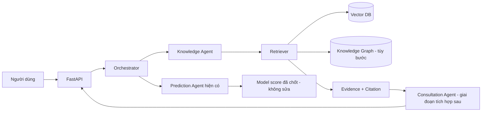

# GIAI ĐOẠN 4 — KNOWLEDGE BASE & RAG: LỘ TRÌNH

**Dự án:** Multi-Agent AI System for Diabetes Risk Assessment  
**Phiên bản:** v0.1 — 2026-11-03  
**Trạng thái:** Khởi động thiết kế; chưa cài thư viện, thu thập toàn văn hàng loạt, tạo embeddings, vector index hoặc triển khai LLM.

## 1. Mục tiêu

Xây dựng kho tri thức y khoa được kiểm duyệt và cơ chế Retrieval-Augmented Generation để Knowledge Agent tìm nguồn đáng tin cậy, trả lời có trích dẫn và nêu rõ giới hạn. Nội dung RAG độc lập với dự đoán HbA1c hiện có; **không thay nhãn hoặc điểm mô hình ML**. Định hướng tích hợp Neo4j/Knowledge Graph theo thiết kế Giai đoạn 2.

## 2. Các bước đề xuất

| Bước | Công việc | Đầu ra | Khi nào cần viết/chạy code? |
|---|---|---|---|
| 1 | Xác định phạm vi câu hỏi, nguồn tri thức, tính cập nhật, quyền sử dụng và schema metadata | `01-Knowledge-Source-Selection.md`, registry nguồn | **Không** |
| 2 | Quy trình duyệt tài liệu, làm sạch, tách đoạn/chunk và gắn citation | Data processing specification, notebook chuẩn bị | **Có, chủ dự án tự chạy** |
| 3 | Lựa chọn embedding model và Vector DB (ChromaDB đề xuất), lập chỉ mục versioned | Local vector index nghiên cứu | **Có, tự chạy** |
| 4 | Retrieval, lọc metadata, đánh giá ranking, optional hybrid rerank | Retrieval pipeline + benchmark | **Có, tự chạy** |
| 5 | RAG answering, nguồn dẫn, từ chối khi thiếu căn cứ, chống prompt injection | Knowledge Agent nghiên cứu | **Có, tự chạy** |
| 6 | Đánh giá retrieval/citations/safety, theo dõi phiên bản và xóa tài liệu | Báo cáo kiểm thử và quyết định tích hợp | **Có, tự chạy** |

**Ghi chú:** Đây là phân chia triển khai đề xuất cho giai đoạn 4, không tự ý thay các mốc trong tài liệu gốc. Khi chuyển bước có code, trợ lý thông báo trước và hướng dẫn; người dùng tự chạy.

## 3. Mối liên hệ với hệ thống đã xây dựng

## 4. Điều kiện an toàn bắt buộc

- Không dùng nguồn y khoa không được xác minh, quảng cáo, blog cá nhân hoặc Q&A không kiểm chứng làm tài liệu chuẩn.
- Mỗi đoạn phải truy xuất được `source_id`, `document_id`, `version`, `url`, `title`, `retrieved_at`, `section`, `content_hash`, `approval_status`.
- Không kích hoạt tài liệu khi chưa duyệt, chưa kiểm tra giấy phép và chưa kiểm tra chất lượng.
- Loại bỏ/không dùng nội dung quá hạn hoặc bị rút khỏi Knowledge Base.
- Prompt injection trong tài liệu được xem là dữ liệu độc hại, không được thực thi chỉ dẫn nằm trong đoạn truy xuất.
- Trả lời không có đủ căn cứ thì nói rõ thiếu thông tin; không tự phán đoán kết quả khám bệnh, kê đơn hoặc thay đổi đầu ra ML.
- Không lưu PII hoặc dữ liệu sức khỏe cá thể trong vector index công khai.
- Không đánh đồng cảnh báo `HbA1c >=5.7%` từ baseline NHANES với kết luận chẩn đoán type 2 hoặc dự đoán phát bệnh trong tương lai.

## 5. Tiêu chí thành công dự kiến

- Có registry nguồn hợp lệ và trạng thái duyệt rõ.
- Có các câu hỏi kiểm thử truy xuất: đúng nguồn, không nguồn, thông tin mâu thuẫn, nguồn lỗi thời, yêu cầu chẩn đoán/kê thuốc, prompt injection.
- Đánh giá các metric retrieval (Recall@k, Precision@k/Hit@k, MRR hoặc nDCG khi có relevance labels), citation correctness, groundedness, tỷ lệ từ chối đúng và latency.
- Báo cáo số liệu **chỉ sau khi người dùng thực nghiệm**; không phát biểu metric chưa đo.

## 6. Tài liệu liên quan

- `../03-ML-Research/10-Phase-3-Final-Report.md`: mô hình NHANES và giới hạn.
- `01-Knowledge-Source-Selection.md`: nguồn y khoa được xem xét và kiểm tra quyền sử dụng.
- Giai đoạn 2: FR10/FR11/FR14/FR15/FR18 và sơ đồ Agent/Knowledge Base.
