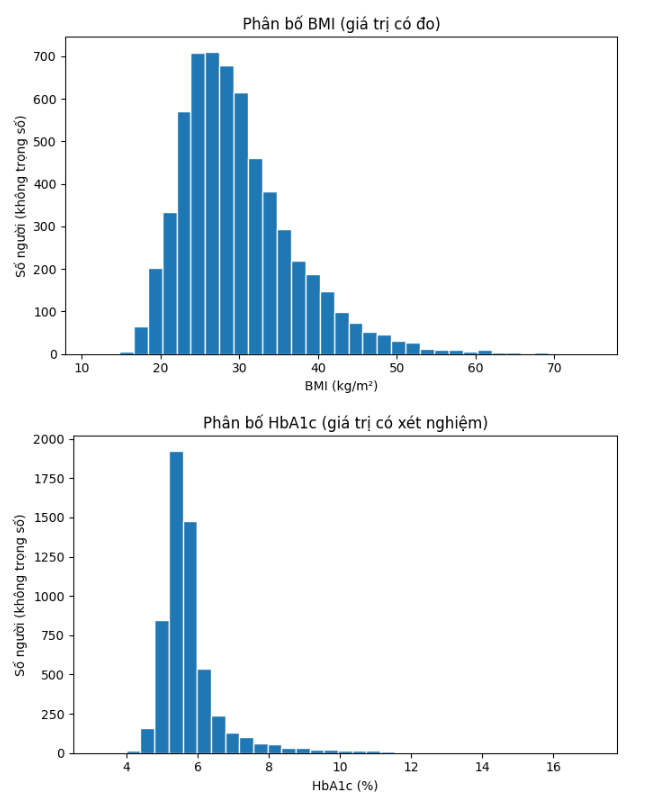
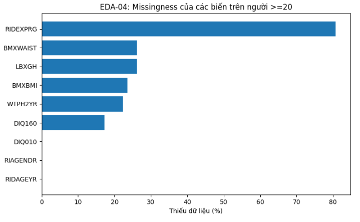

# GIAI ĐOẠN 3 – BƯỚC 3: EDA (NHANES 2021–2023)

**Dự án:** Multi-Agent AI System for Diabetes Risk Assessment  
**Phiên bản:** v1.0 — cập nhật theo kết quả **người dùng tự chạy**  
**Trạng thái:** **Hoàn thành phân tích khám phá mô tả**, chưa huấn luyện mô hình.  
**Môi trường thực tế:** Python 3.13.9, Pandas 3.0.0.  
**Nguồn dữ liệu:** NHANES 2021–2023 (`DEMO_L`, `BMX_L`, `GHB_L`, `DIQ_L`).

## 1. Mục tiêu và phương pháp

- Ghép 4 bảng theo `SEQN` bằng quan hệ một-một; chọn người từ 20 tuổi trở lên.
- Đếm tỷ lệ có/thiếu BMI (`BMXBMI`) và HbA1c (`LBXGH`).
- Khám phá hình dạng phân bố tuổi, BMI, HbA1c; đánh giá theo nhóm tuổi và hỏi bệnh tự khai (`DIQ010`).
- **Tất cả số liệu ở đây là thống kê mẫu chưa áp dụng trọng số khảo sát**; không suy ra tỷ lệ dân số Hoa Kỳ hay xác suất mắc bệnh.

## 2. Kết quả ghi nhận từ Jupyter do người dùng cung cấp

| Chỉ số | Giá trị thực tế |
|---|---:|
| Bảng sau khi ghép | 11.933 dòng × 13 cột |
| Người >=20 tuổi | 7.809 |
| Có xét nghiệm HbA1c | 5.767 |
| Có BMI | 5.970 |
| **Có đồng thời BMI và HbA1c** | **5.686** |
| HbA1c có, BMI thiếu | 81 |
| BMI có, HbA1c thiếu | 284 |
| Cả BMI và HbA1c đều thiếu (suy ra từ phép đếm) | 1.758 |
| Tuổi: trung vị; min–max | 57; 20–80 (80 là mã gộp ≥80) |
| BMI: trung vị; min–max | 28,5; 11,1–74,8 |
| HbA1c: trung vị; min–max | 5,5; 3,2–17,1 |

### Thiếu dữ liệu trên tập người trưởng thành

| Biến | Thiếu (%) | Ghi chú |
|---|---:|---|
| `RIDEXPRG` | 80,75 | Chỉ công bố cho phụ nữ 20–44, có thể không hỏi/không phát hành ở nhóm khác; không gán NA là không mang thai |
| `BMXWAIST` | 26,21 | Thiếu đo vòng eo |
| `LBXGH` | 26,15 | Không có kết quả HbA1c; không được điền khuyết nhãn |
| `BMXBMI` | 23,55 | Thiếu BMI trên toàn bộ người trưởng thành, nhưng chỉ 81 trường hợp khi đã có HbA1c |
| `WTPH2YR` | 22,35 | Trọng số lấy máu; không thay bằng 0 hay đưa vào feature model |
| `DIQ160` | 17,21 | Có skip logic, không đồng nhất với câu trả lời No |
| `DIQ010` | 0,03 | Missing / other 2; don't know 1 ở thống kê nhãn |
| `RIDAGEYR`, `RIAGENDR` | 0 | Đủ thông tin tuổi và giới |

### Phân bố `DIQ010` (người >=20)

| Trả lời | Số mẫu |
|---|---:|
| No | 6.466 |
| Yes | 1.070 |
| Borderline | 270 |
| Don't know | 1 |
| Missing / other | 2 |

*Chưa biết số nhóm `DIQ010=No` **đồng thời có HbA1c**: phải tính ở Bước 4, không lấy 6.466 làm số mẫu mô hình.*

### Tỷ lệ có HbA1c theo nhóm tuổi (chưa trọng số)

| Nhóm tuổi | Có HbA1c (%) |
|---|---:|
| 20–29 | 66,48 |
| 30–39 | 72,03 |
| 40–49 | 74,38 |
| 50–59 | 76,00 |
| 60–69 | 79,77 |
| 70–79 | 75,45 |
| 80+ | 61,14 |

## 3. Nhận xét hai biểu đồ do người dùng gửi

- **BMI:** phân bố một đỉnh, lệch phải; tập trung nhiều quanh 20–35; các trường hợp BMI cực đoan cần kiểm tra, **không tự động xóa**.
- **HbA1c:** phân bố lệch phải mạnh, mật độ lớn gần 5–6%, đuôi lên tới 17,1%; không được biến quan sát đơn lẻ thành chẩn đoán xác định.

- `RIDEXPRG` thiếu theo phạm vi công bố/đối tượng đủ điều kiện; `DIQ160` có nhánh câu hỏi. Không áp dụng imputation kiểu trung bình hoặc mode cho các giá trị mang tính skip logic.
- **98,60% người có HbA1c cũng có BMI** (5.686/5.767); còn 81 mẫu cần quyết định xử lý BMI thiếu sau khi tách tập dữ liệu.
- Tỷ lệ lấy xét nghiệm khác nhau giữa các độ tuổi; có thể tạo thiên lệch chọn mẫu. Không suy ra tỷ lệ bệnh ở quần thể bằng tỷ lệ chưa trọng số.

## 4. Giới hạn khoa học và rủi ro rò rỉ thông tin

1. Nhãn đề xuất tiếp theo: `LBXGH >= 5.7%` chỉ là **chỉ dấu HbA1c tăng trong lần khảo sát**, không phải chẩn đoán mắc type 2 hoặc dự báo mắc bệnh tương lai.
2. Khi `LBXGH` sinh nhãn, **không đưa `LBXGH` vào tập đặc trưng mô hình**, kể cả qua nhóm biến hoặc chuyển đổi dẫn xuất.
3. Người có `DIQ010=Yes` đã được thông báo mắc tiểu đường và có thể đã điều trị; nên báo cáo riêng và xem xét **tập sàng lọc không có tiền sử chẩn đoán tự khai `DIQ010=2`** là tập nghiên cứu chính đề xuất, chưa chốt trước khi xem số mẫu/nhãn.
4. `RIDAGEYR=80` là top-coded cho mọi tuổi ≥80, không có nghĩa không ai trên 80 tuổi.
5. Khi cần ước lượng quần thể, phải dùng `WTPH2YR` cùng `SDMVSTRA`, `SDMVPSU` và hướng dẫn khảo sát của CDC; biểu đồ EDA hiện tại không tính các sai số thiết kế khảo sát.
6. Trạng thái mang thai không thể suy từ `RIDEXPRG` NaN. Cần loại nhóm ghi rõ đang mang thai khi thiết kế phân tích thích hợp và lưu cách xử lý trong báo cáo.

## 5. Kết luận / quyết định chuyển Bước 4

**EDA đã hoàn thành** theo kết quả do người dùng chạy. Sang Bước 4 tiến hành: đối chiếu quần thể, kiểm tra các giá trị cực đoan mà không xóa ngay, xác định các quần thể nghiên cứu tùy `DIQ010`, tạo nhãn nghiên cứu *tạm thời*, kiểm tra missingness trong cohort và tạo bảng candidate; **không train, không fit scaler/imputer và không lưu model**.

### Nguồn tham khảo
- CDC `GHB_L`: https://wwwn.cdc.gov/Nchs/Data/Nhanes/Public/2021/DataFiles/GHB_L.htm
- CDC `DEMO_L`: https://wwwn.cdc.gov/Nchs/Data/Nhanes/Public/2021/DataFiles/DEMO_L.htm
- CDC `DIQ_L`: https://wwwn.cdc.gov/Nchs/Data/Nhanes/Public/2021/DataFiles/DIQ_L.htm
- NIDDK HbA1c: https://www.niddk.nih.gov/health-information/diagnostic-tests/a1c-test
