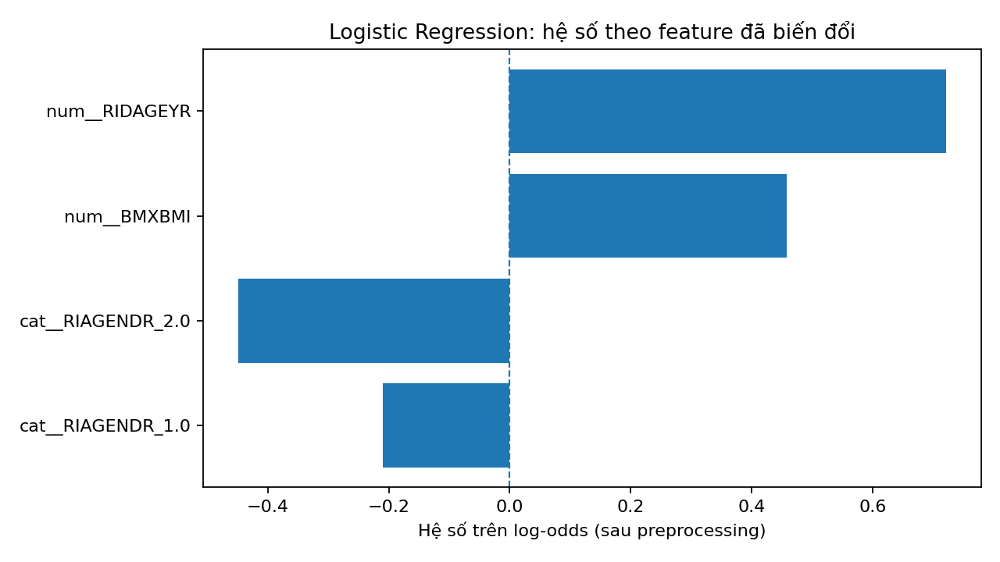
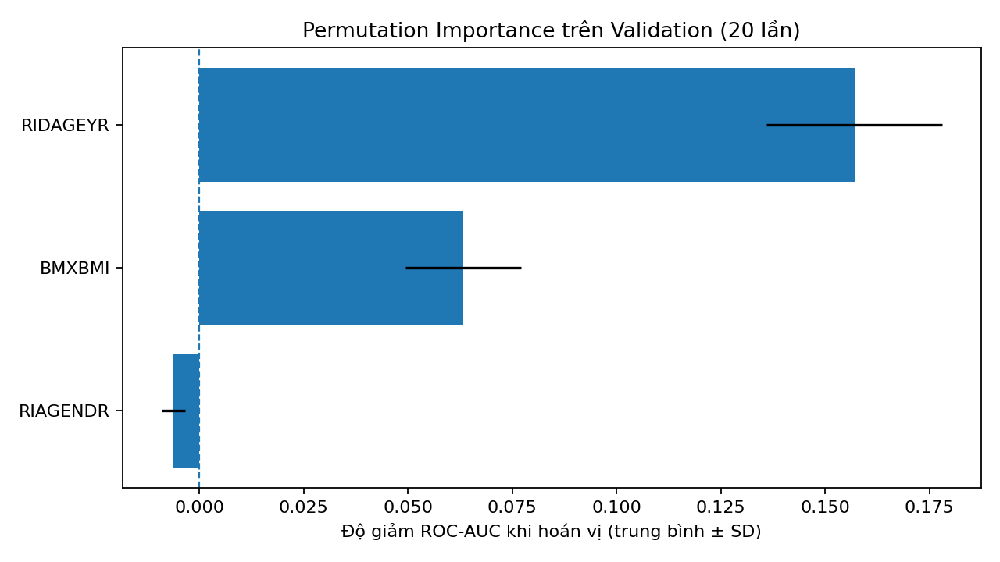

# GIAI ĐOẠN 3 — BƯỚC 7: MODEL EXPLAINABILITY (KẾT QUẢ THỰC NGHIỆM)

**Trạng thái:** ĐÃ HOÀN THÀNH trên máy của người dùng (Jupyter Notebook). **Không `.fit()`, không mở Test, không sửa model.**  
**Bằng chứng:** Output và 2 hình người dùng gửi; bản sao trong `evidence/step7/`.  
**Mô hình:** LogisticRegression pipeline, SHA256 `31e9c94b0f14369be7920b9315b026d0c4afedb9f7b2885d120d631d930582b1`.  
**Nhiệm vụ:** Phân loại dấu hiệu `HbA1c >= 5.7%` trên nhóm NHANES `screening_candidate`, không phải dự báo mắc tiểu đường type 2 trong tương lai hoặc chẩn đoán.

## 1. Điều kiện đánh giá

- Validation: **705 người, 208 nhãn dương tính**; ROC-AUC tái hiện **0,7173**.
- Threshold đã khóa Bước 6A: **0,225**.
- Chỉ dùng Validation; Test 705 người đã đánh giá một lần ở Bước 6B, không được dùng thêm để lựa chọn/điều chỉnh mô hình.
- Dữ liệu chưa áp dụng trọng số và cấu trúc khảo sát phức tạp NHANES, chưa có đánh giá ngoài mẫu/dân số.

## 2. Logistic Regression — hệ số theo đặc trưng đã biến đổi

| Transformed feature | Coefficient (log-odds) | exp(coef) |
|---|---:|---:|
| `num__RIDAGEYR` | +0,7215 | 2,0575 |
| `num__BMXBMI` | +0,4583 | 1,5813 |
| `cat__RIAGENDR_2.0` | −0,4484 | 0,6387 |
| `cat__RIAGENDR_1.0` | −0,2102 | 0,8104 |

**Giải thích:** `RIDAGEYR` và `BMXBMI` được StandardScaler chuẩn hóa. Odds ratio tương ứng **một đơn vị trên thang chuẩn hóa = một độ lệch chuẩn được ước tính trên Train**, không phải tăng 1 tuổi hay 1 BMI. Hai cột one-hot giới tính đều có mặt; không thể đọc `exp(coef)` riêng lẻ như odds ratio giữa hai nhóm vì không có nhóm chuẩn bị bỏ. Chênh lệch giữa mã 1 và mã 2 là `−0,2102 - (−0,4484) = +0,2382` log-odds, hay OR ~**1,269** khi các biến khác không đổi. Đây chỉ là hành vi học được của mô hình, không phải hiệu ứng nhân quả, không suy ra kết luận lâm sàng.

## 3. Permutation Importance (20 lần, ROC-AUC drop trên Validation)

| Feature gốc | Mean AUC drop | SD |
|---|---:|---:|
| `RIDAGEYR` | +0,1570 | 0,0211 |
| `BMXBMI` | +0,0633 | 0,0139 |
| `RIAGENDR` | −0,0063 | 0,0029 |

**Diễn giải:** Tuổi quan trọng nhất đối với ROC-AUC của baseline, BMI thứ hai. Giá trị âm nhẹ với giới tính nghĩa là việc xáo cột này *trong Validation* không làm ROC-AUC giảm; không chứng minh biến đó có tác động bảo vệ hoặc không liên quan bệnh học. Importance chịu ảnh hưởng phân bố, tương quan và sai số lấy mẫu.

## 4. Ba ví dụ local explanation trên Validation

| Ví dụ | Điểm số mô hình | Dự đoán ở ngưỡng 0,225 | Nhãn HbA1c quan sát |
|---|---:|---:|---:|
| `lowest_score` | 0,03941 | 0 | 0 |
| `near_threshold` | 0,22488 | 0 | 0 |
| `highest_score` | 0,80025 | 1 | 0 |

Đối với ví dụ thứ ba: **False Positive dù điểm cao**. Các con số là **model score**, không phải xác suất mắc bệnh tương lai. Phân rã local dựa vào `intercept + Σ(z_i × coefficient_i)`, không phải SHAP, không phải quan hệ nhân quả. Không công bố SEQN hay dữ liệu cá nhân.

## 5. Kết luận và quyết định

- [x] Kiểm tra model SHA256 khớp Bước 6B.
- [x] Phân tích hệ số và permutation importance từ Validation.
- [x] Kiểm tra local examples và phân loại tại threshold đã khóa.
- [x] **Không fit; không đổi threshold; không mở Test ở Bước 7.**
- [x] Lưu kết quả do người dùng chạy vào báo cáo.
- [ ] Chưa thực hiện kiểm định có trọng số NHANES, đánh giá fairness có độ tin cậy, external/clinical validation.

**Quyết định:** Không dùng Bước 7 để lựa chọn lại feature hoặc mô hình dựa trên Test đã sử dụng. Chuyển Bước 8A kiểm tra và đóng gói **artifact hiện có** cho suy luận thử nghiệm cục bộ, rồi mới phát triển FastAPI ở Bước 8B. Không triển khai sử dụng y tế thực tế.

**Tài liệu kỹ thuật:** [scikit-learn permutation importance](https://scikit-learn.org/stable/modules/permutation_importance.html) · [model persistence](https://scikit-learn.org/stable/model_persistence.html).
