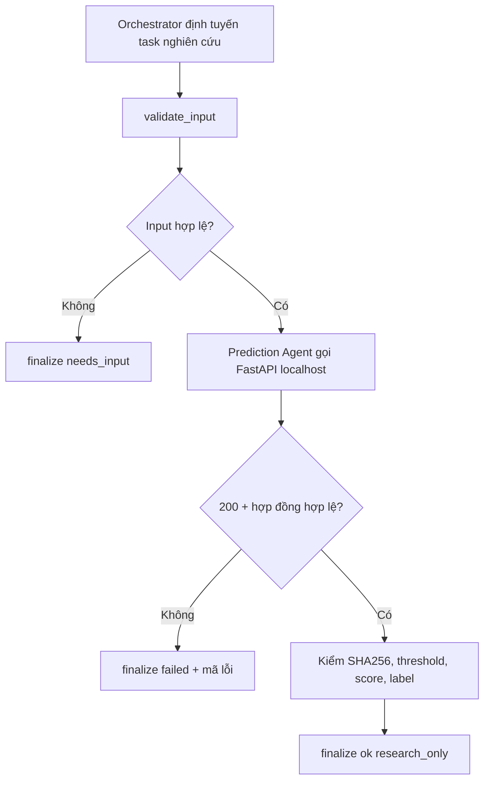

# GIAI ĐOẠN 3 — BƯỚC 8C: TÍCH HỢP PREDICTION AGENT VỚI LANGGRAPH

**Trạng thái:** Đã xác nhận Bước 8B qua output người dùng; Bước 8C mới chuẩn bị, CHƯA chạy trên máy người dùng.

## 1. Mục tiêu và phạm vi

- Kết nối một workflow LangGraph tối giản với FastAPI Prediction Service do bạn tự triển khai ở Bước 8B.
- Đường xử lý: input → `validate_input` → `prediction_agent` gọi API → `finalize`.
- Không thay model, threshold, feature schema, không `.fit()`, không mở lại Test.
- **Chưa phải Multi-Agent đầy đủ**: chưa có Data Analysis/Knowledge/Consultation Agent, LLM, RAG hay ghi PostgreSQL.
- Chỉ trên máy cá nhân với localhost, dùng **hai bộ dữ liệu giả lập**, không dùng dữ liệu bệnh nhân thật.

## 2. Kết quả Bước 8B đã xác nhận (do người dùng chạy)

- `Server ready: True`; `health/live` và `health/ready`: OK.
- `synthetic_valid_cases_passed`: **2/2**.
- `invalid_cases_rejected`: **6/6**.
- SHA256 model: `31e9c94b0f14369be7920b9315b026d0c4afedb9f7b2885d120d631d930582b1`.
- Threshold cố định 0.225; `FIT: NO | TEST OPENED: NO | MODEL MODIFIED: NO | PUBLIC API: NO`.
- Mô hình và API chỉ phân loại **nhãn chỉ dấu HbA1c >= 5.7%**; không phải xác suất mắc type 2 trong tương lai hoặc chẩn đoán.

## 3. Cấu trúc thư mục khi giải nén

```text
03-ML-Research/
├── backend/app/main.py                 # do bạn đã tự tạo ở Bước 8B; KHÔNG ghi đè
├── models/baseline/*.joblib            # đã train, giữ nguyên; KHÔNG đụng
├── agent_integration/
│   ├── __init__.py
│   └── nhanes_prediction_graph.py     # ví dụ để bạn tự đọc/viết/chạy
├── notebooks/
│   └── 08C_NHANES_LangGraph_Prediction_Agent.ipynb
├── 08-Model-Deployment.md
└── 09-Experiment-Log.md
```

## 4. Kiến trúc luồng kỹ thuật



**Các node dùng Python và LangGraph, không dùng LLM.** Chỉ Orchestrator/router tối giản và Prediction Agent được tích hợp ở 8C.

## 5. Hợp đồng dữ liệu giữa LangGraph và FastAPI

**Đầu vào graph** (dữ liệu giả lập):

```json
{
  "request_id": "synthetic-example-001",
  "task_type": "classify_hba1c_ge_5_7_indicator",
  "features": {"RIDAGEYR": 45, "RIAGENDR": 1, "BMXBMI": 28.5}
}
```

**Yêu cầu gọi API Bước 8B:** `POST http://127.0.0.1:8000/api/v1/research/nhanes/hba1c/predict`

**Response OK của graph** có `final_response.status="ok"`, `task`, `model_score`, `predicted_label`, `threshold=0.225`, `model_name=LogisticRegression`, `model_sha256` và cảnh báo research-only. Không gửi toàn bộ input sức khỏe trở lại nếu không cần.

**Khi lỗi**: `final_response.status="needs_input"` hoặc `"failed"` với `error_code`; **không** có `model_score`, không tạo kết quả dự đoán thay thế.

**Các mã lỗi:** `UNSUPPORTED_TASK`, `INVALID_FEATURES`, `PREDICTION_SERVICE_UNAVAILABLE`, `PREDICTION_SERVICE_ERROR`, `UPSTREAM_HTTP_ERROR`, `INVALID_UPSTREAM_RESPONSE`, `UPSTREAM_CONTRACT_MISMATCH`.

## 6. Bạn tự thực hành từng bước

**Bước 6.1:** Giữ nguyên 8B server ở `127.0.0.1:8000`; bật bằng PowerShell từ thư mục dự án:

```powershell
$env:NHANES_MODEL_PATH = (Resolve-Path ".\models\baseline\nhanes_hba1c_baseline_step5.joblib").Path
.\.venv\Scripts\python.exe -m uvicorn app.main:app --app-dir backend --host 127.0.0.1 --port 8000
```

**Bước 6.2:** Cài LangGraph trong kernel Jupyter:

```python
%pip install langgraph requests pydantic
```

**Bước 6.3:** Đọc `agent_integration/nhanes_prediction_graph.py`, chú ý `FeatureInput`, `UpstreamOutput`, ba node và `add_conditional_edges`. Đây là mã mẫu có thể chỉnh sửa trong VS Code. Không thay schema, hash hoặc threshold.

**Bước 6.4:** Mở `notebooks/08C_NHANES_LangGraph_Prediction_Agent.ipynb`, chạy các ô tuần tự. Các ô đầu chỉ dùng mock (không gọi API thật). Kiểm tra 2 mock valid, 6 input invalid, 2 upstream errors.

**Bước 6.5:** Khi API 8B vẫn đang hoạt động, chủ động chạy ô **Live local API**. Chỉ thử 2 synthetic inputs. Không sử dụng dữ liệu người thật.

**Bước 6.6:** Chạy ô cuối để tạo `data/outputs/model_deployment/langgraph_8c/08c_prediction_agent_smoke_results.json` chỉ chứa kết quả tổng hợp kỹ thuật.

## 7. Tiêu chí nghiệm thu 8C

- [ ] Đúng SHA256/threshold, không cần load `joblib` ở Agent (8B sở hữu inference).
- [ ] Graph compile và 2/2 mock valid qua `final_response`.
- [ ] 6/6 invalid bị chặn tại node validate trước HTTP; số cuộc gọi = 0.
- [ ] Lỗi offline & model SHA mismatch bị từ chối với trạng thái failed; không hallucinate.
- [ ] 2/2 synthetic request qua FastAPI cục bộ thành công; output khớp schema.
- [ ] Chưa `.fit()`, chưa mở lại Test, không sửa artifact, không LLM, không API công khai.
- [ ] Có report JSON, không chứa thông tin sức khỏe cá thể.

## 8. Các bước sau 8C

- Tích hợp module vào Backend có auth/RBAC, logging không chứa PII, timeout/metrics, tests tự động và contract versioning.
- Giai đoạn 4 xây Knowledge Base + RAG; Giai đoạn 5 hoàn thiện đủ 5 Agent qua LangGraph.
- Cần đánh giá quần thể và xác thực ngoài mẫu/lâm sàng trước mọi cân nhắc sử dụng trong y tế.

## 9. Nguồn kỹ thuật

- LangGraph Python StateGraph: https://reference.langchain.com/python/langgraph/graph/state/StateGraph
- LangGraph Graph API: https://docs.langchain.com/oss/python/langgraph/graph-api
- FastAPI Request Body: https://fastapi.tiangolo.com/tutorial/body/
