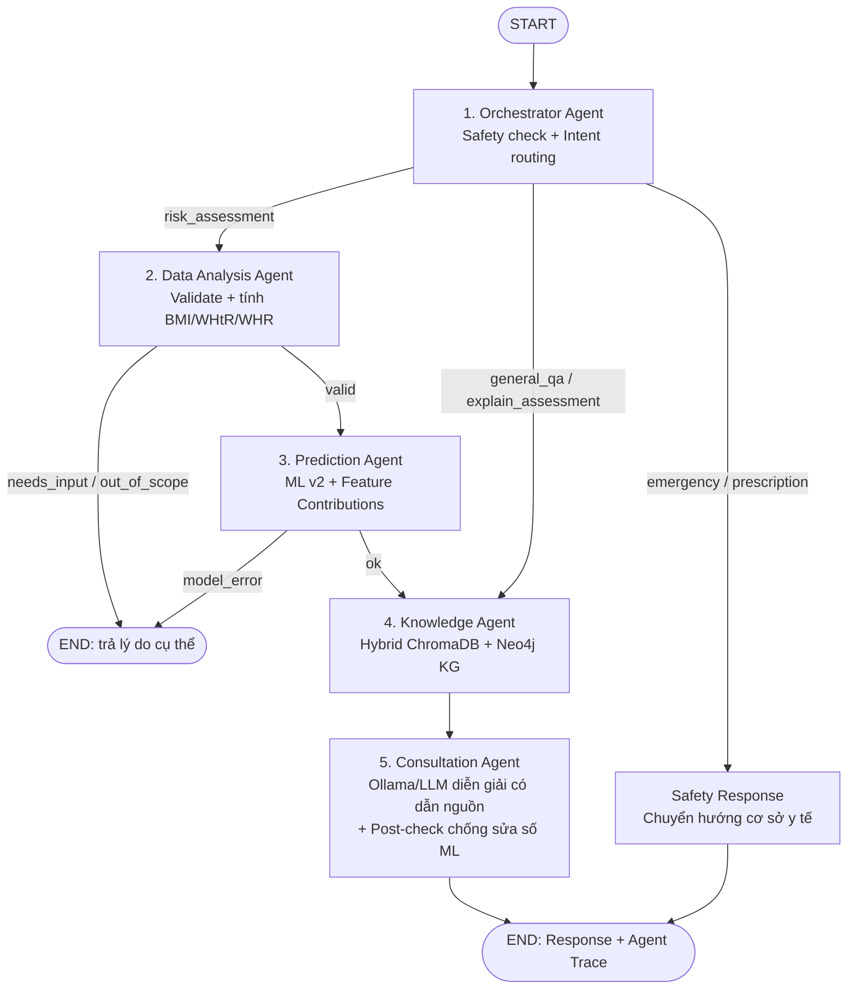

# Design Document: Hệ Thống Đa Agent AI Hỗ Trợ Sàng Lọc & Tư Vấn Nguy Cơ Tiểu Đường (MVP Đồ Án / Sản Phẩm)

**Ngày:** 2026-11-23  
**Trạng thái:** Draft — chờ kiểm tra và phê duyệt trước khi lập kế hoạch triển khai  
**Phạm vi tài liệu:** Kiến trúc ứng dụng mới theo **Hướng A – Phương án 1 (Monorepo Modular Monolith)**, xây dựng trên nền thiết kế GĐ1–GĐ2 và tài sản dữ liệu/nghiên cứu GĐ3–GĐ5.

---

## 1. Mục tiêu và Lý do (Intent & Why)

Dự án đã hoàn thành rất tốt phần phân tích yêu cầu (GĐ1), thiết kế hệ thống (GĐ2) và các thí nghiệm kiểm soát an toàn ở mức nghiên cứu (GĐ3–GĐ5). Tuy nhiên, ở GĐ4–GĐ5 hệ thống bị khóa quá chặt ở chế độ sandbox (`BLOCKED_RESEARCH_ONLY`, chỉ nhận mã cố định `Q01–Q03` và dùng bộ dữ liệu hư cấu phần mềm "Atlas" cho `S01–S06`), dẫn đến chưa thể chạy hay demo như một ứng dụng Multi-Agent về bệnh tiểu đường thực thụ.

**Mục tiêu đợt xây dựng này:** Chuyển hóa dự án thành một **hệ thống Website Multi-Agent AI hỗ trợ sàng lọc nguy cơ & tư vấn kiến thức tiểu đường chạy end-to-end, ổn định và thuyết phục khi trình diễn/bảo vệ đồ án**, đồng thời **bảo toàn toàn bộ nguyên tắc an toàn y khoa cốt lõi** đã thiết lập ở GĐ1–GĐ2.

### Goals (Mục tiêu phải đạt)
1. **5 Agent phối hợp thực sự trong LangGraph**: `Orchestrator`, `Data Analysis`, `Prediction`, `Knowledge`, `Consultation` nối liền nhau theo luồng nghiệp vụ, có dấu vết thực thi (`agent_runs`, `agent_steps`) hiển thị được trên giao diện để chứng minh cơ chế Multi-Agent.
2. **Mô hình ML độc lập + Explainability (NHANES v2)**: Nâng cấp mô hình trên chính dữ liệu gốc NHANES 2021–2023 sẵn có (bổ sung các chỉ số nhân trắc tự đo tại nhà như vòng eo, vòng hông, tỷ lệ eo/chiều cao) và trả đóng góp từng đặc trưng ngay trong kết quả dự đoán. Giữ nguyên nguyên tắc *LLM tuyệt đối không tạo hay sửa điểm số ML*.
3. **RAG + Knowledge Graph tiểu đường thật (bỏ hẳn "Atlas")**: Mở khóa 7 nguồn tiểu đường hiện có (CDC, NIDDK, WHO, Nhà thuốc Long Châu) vào ChromaDB và xây dựng đồ thị tri thức tiểu đường trên Neo4j (kèm bản sao cục bộ dự phòng khi Neo4j Aura tạm ngủ). Mọi câu trả lời tư vấn đều có nguồn trích dẫn.
4. **LLM chạy thuần Ollama local mặc định + dễ đổi sang Cloud API**: Thiết kế giao diện `LLMProvider` chuẩn (`ollama` mặc định; hỗ trợ sẵn `gemini` và `openai` chỉ bằng thay đổi biến `.env`), có fallback an toàn nếu Ollama chưa bật hoặc quá tải.
5. **Website React + TypeScript hoàn chỉnh (responsive)**: Đăng nhập/Đăng ký (JWT), Dashboard tổng quan, Đánh giá nguy cơ + biểu đồ giải thích đặc trưng, Chatbot tư vấn tự nhiên (hỏi kiến thức chung hoặc hỏi về kết quả đánh giá gần nhất), Lịch sử đánh giá cá nhân, và Trang Quản trị (Admin nạp/quản lý tài liệu tri thức & giám sát Agent).
6. **Bảo toàn hồ sơ nghiên cứu cũ**: Không xóa hay phá hỏng các thư mục `GĐ2/`, `GĐ3/`, `Giai-doan-4-.../`, `Giai-doan-5-.../` để người dùng vẫn có đầy đủ bằng chứng đối chiếu trong báo cáo đồ án.

### Non-Goals (Ngoài phạm vi đợt này)
- Ứng dụng Mobile native/Flutter riêng (Website sẽ thiết kế responsive dùng tốt trên màn hình di động; Backend giữ chuẩn REST API để gắn Mobile về sau).
- Chẩn đoán xác định bệnh lý, kê đơn, điều chỉnh liều thuốc, hoặc tích hợp bệnh án điện tử bệnh viện (EMR/EHR).
- Tách 5 Agent thành 5 microservice độc lập hay triển khai Kubernetes/Cloud production có chứng chỉ y tế lâm sàng.
- Huấn luyện lại mô hình từ dữ liệu sức khỏe do người dùng nhập trên ứng dụng (tuân thủ BR12).

### Anti-Goals (Những điều làm dự án thất bại dù code chạy được)
- **LLM tự bịa điểm nguy cơ hoặc mâu thuẫn với kết quả ML**: Mọi số liệu nguy cơ phải đi trực tiếp từ artifact ML đã khóa SHA256.
- **Chatbot trả lời kiến thức y khoa không có trích dẫn hoặc chẩn đoán/kê đơn**: Phải có guardrail chặn yêu cầu kê đơn/cấp cứu và bắt buộc hiển thị nguồn tham chiếu + disclaimer sàng lọc.
- **Chết demo khi thiếu Internet hoặc dịch vụ ngoài tạm dừng**: Nếu Neo4j Aura sleep hoặc Ollama chưa khởi động, hệ thống phải xuống cấp êm (graceful fallback) thay vì trả lỗi 500 trắng trang.
- **Hardcode đường dẫn máy cá nhân hoặc lộ secret**: Không chứa đường dẫn tuyệt đối kiểu `C:/Users/...` trong code hay commit mật khẩu/API key vào Git.

---

## 2. Các phương án kiến trúc đã cân nhắc (Approaches)

| Tiêu chí | Phương án 1: Clean Monorepo Modular Monolith *(Đã chọn)* | Phương án 2: Vá trực tiếp lên mã GĐ5 | Phương án 3: Microservices tách rời |
|---|---|---|---|
| **Cấu trúc** | Tạo `backend/`, `ai_services/`, `ml_pipeline/`, `frontend/`, `infrastructure/` mới sạch chuẩn GĐ2; giữ nguyên GĐ2–GĐ5 làm hồ sơ đối chiếu. | Chỉnh sửa trực tiếp trong `Giai-doan-5-.../phase5/`, giữ server ML `:8000` và Multi-Agent `:8001` chạy rời. | Tách 4–5 container (Auth/App, Multi-Agent, ML, Worker, Web) giao tiếp mạng nội bộ. |
| **Vận hành & Demo** | 1 Backend FastAPI (tích hợp LangGraph + ML) + 1 Frontend + Ollama. Hỗ trợ Docker Compose (PostgreSQL) lẫn dev nhanh (SQLite). | Phải chạy nhiều terminal cùng lúc, đường dẫn tiếng Việt giữa các thư mục dễ lỗi. | Nặng RAM khi chạy cùng Ollama trên laptop cá nhân, dễ lỗi mạng giữa container khi demo. |
| **Độ khớp thiết kế GĐ2** | Khớp trực tiếp ADR-01 (`06-Technical-Design.md`). | Lệch kiến trúc GĐ2, chắp vá Auth/DB/Admin vào khung sandbox. | Trái ngược ADR-01 (*không tách 5 microservice ở MVP*). |
| **Đánh đổi** | Xây dựng cấu trúc mã ứng dụng mới sạch sẽ từ đầu dựa trên các contract đã kiểm chứng. | Bảo trì khó, làm hỏng hồ sơ nghiệm thu GĐ5 cũ. | Quá phức tạp cho đồ án/MVP. |

**Quyết định đã chốt cùng người dùng:** Chọn **Phương án 1**, chạy **thuần Ollama** trước (dễ chuyển sang Cloud API key qua `.env`), và làm **Website hoàn chỉnh** (chưa làm Mobile App).

---

## 3. Ràng buộc kỹ thuật & An toàn (Constraints)

1. **Môi trường phát triển thực tế trên máy người dùng**: Windows, Python `3.13.9`, Node `22.21`, npm `10.9.4`, Docker `28.5`, Ollama `0.40.17`.
2. **Bảo vệ dữ liệu sức khỏe & phân quyền**:
   - Người dùng thường (`user`) chỉ xem được hồ sơ, lịch sử đánh giá và lịch sử chat của chính mình (BR02).
   - Quản trị viên (`admin`) quản lý tài liệu tri thức, trạng thái người dùng và xem log giám sát Agent (BR09).
   - Không ghi dữ liệu sức khỏe thô (raw features) hoặc thông tin nhạy cảm vào log hệ thống.
3. **Bất biến dự đoán ML (BR05, BR10)**:
   - Model artifact được kiểm tra SHA256 khi nạp.
   - Kết quả ML (`model_score`, `risk_band`, `predicted_label`, `threshold`, `model_version`, `feature_contributions`) lưu riêng trong bảng `prediction_results` và truyền ở dạng chỉ đọc cho `Consultation Agent`.
4. **Cảnh báo y khoa & Guardrails (BR06, BR07)**:
   - Mọi kết quả đánh giá phải ghi rõ nhãn phân loại chỉ báo sàng lọc `HbA1c >= 5.7%` trên dữ liệu khảo sát NHANES, không phải chẩn đoán lâm sàng.
   - Yêu cầu liên quan cấp cứu (ngất, hôn mê, đau ngực dữ dội, hạ đường huyết nặng) hoặc kê đơn/chỉnh liều thuốc (insulin, metformin...) phải kích hoạt nhánh phản hồi an toàn ngay lập tức, không để LLM tự tư vấn điều trị.

---

## 4. Kiến trúc hệ thống chi tiết

### 4.1. Cấu trúc thư mục Monorepo

```text
Multi_Agent_Project1/
├── GĐ2/                                # [Giữ nguyên] Hồ sơ thiết kế GĐ2
├── GĐ3/                                # [Giữ nguyên] Dữ liệu gốc NHANES (.xpt) & baseline GĐ3
├── Giai-doan-4-Bo-sung-Nha-thuoc-Long-Chau/  # [Giữ nguyên] 7 tài liệu gốc & hồ sơ GĐ4
├── Giai-doan-5-Buoc-1-Contracts-Environment-Audit/ # [Giữ nguyên] Hồ sơ sandbox GĐ5
├── docs/superpowers/specs/             # Tài liệu thiết kế này & kế hoạch triển khai
├── ml_pipeline/                        # Pipeline huấn luyện, đánh giá & xuất artifact NHANES v2
│   ├── train_nhanes_v2.py              # Script tái lập huấn luyện (Train/Val/Test không leakage)
│   ├── explain.py                      # Tính đóng góp từng đặc trưng (local feature contributions)
│   └── artifacts/                      # Model joblib v2, model_manifest.json, comparison_report.json
├── ai_services/                        # Tầng AI độc lập (có thể tách service về sau)
│   ├── llm/                            # LLMProvider interface + OllamaProvider, OpenAIProvider, GeminiProvider
│   ├── ml/                             # ModelLoader (SHA256 check) + Predictor + Explainer
│   ├── knowledge/                      # ChromaDB RAG store + Neo4j KG client + Local KG JSON mirror + Ingestion
│   ├── safety/                         # Guardrails (emergency, prescription, prompt-injection sanitization)
│   └── orchestration/                  # LangGraph 5-Agent state, nodes, routing, trace collector
├── backend/                            # FastAPI Modular Monolith
│   ├── app/
│   │   ├── main.py                     # App factory, CORS localhost, lifespan (nạp ML/KB/seed demo)
│   │   ├── core/                       # Settings (.env), security (JWT + bcrypt), logging
│   │   ├── db/                         # SQLAlchemy 2.x models, session (Postgres / SQLite), seed
│   │   ├── schemas/                    # Pydantic v2 DTOs (Auth, Assessment, Chat, Knowledge, Admin)
│   │   ├── services/                   # Business logic & ownership checks
│   │   └── api/v1/                     # Routers: auth, assessments, chat, knowledge, admin, health
│   ├── requirements.txt
│   └── tests/                          # Unit, contract, API & safety guardrail tests
├── frontend/                           # React 18 + Vite + TypeScript + Tailwind CSS + Recharts
│   └── src/
│       ├── api/                        # Typed API client + JWT interceptor
│       ├── context/                    # AuthContext
│       ├── components/                 # Layout, RiskBadge, FactorChart, CitationCard, AgentTracePanel, DisclaimerBanner
│       └── pages/                      # Login/Register, Dashboard, Assessment, Chat, History, Admin
├── data/                               # Dữ liệu runtime cục bộ (ignored trong Git ngoại trừ seed)
│   ├── chroma_kb/                      # Vector store ChromaDB cho kiến thức tiểu đường thật
│   ├── knowledge_graph/                # diabetes_kg.json (đồ thị tri thức chuẩn + mirror cho Neo4j)
│   └── uploads/                        # File Admin tải lên (PDF/TXT/MD)
├── infrastructure/
│   └── docker-compose.yml              # PostgreSQL 16 (+ optional backend/frontend services)
├── .env.example                        # Mẫu cấu hình đầy đủ (Ollama, Gemini/OpenAI, DB, Neo4j)
└── README.md                           # Hướng dẫn chạy 1 bước (local & Docker)
```

> **Quyết định kỹ thuật của người thiết kế (Builder call):** Giữ nguyên toàn bộ 4 thư mục GĐ2–GĐ5 tại chỗ (không di chuyển đường dẫn cũ) để tránh gãy các notebook/báo cáo cũ, và đặt toàn bộ ứng dụng mới vào các thư mục chuẩn tiếng Anh không dấu (`ml_pipeline/`, `ai_services/`, `backend/`, `frontend/`, `infrastructure/`).

### 4.2. Kiến trúc dữ liệu & Cơ sở dữ liệu

**Hỗ trợ kép PostgreSQL + SQLite (Builder call):**
- Biến môi trường `DATABASE_URL` mặc định trỏ tới SQLite cục bộ (`sqlite:///./data/diabetes_app.db`) để người dùng có thể chạy thử ngay bằng 1 lệnh mà không bị chặn nếu Docker Desktop chưa bật.
- Khi chạy với `infrastructure/docker-compose.yml`, `DATABASE_URL` trỏ tới **PostgreSQL 16** (`postgresql+psycopg://...`). Toàn bộ model SQLAlchemy viết tương thích cả hai engine (UUID dưới dạng `String(36)`, JSON chuẩn SQLAlchemy).

**10 bảng cốt lõi (tinh gọn từ ERD 19 bảng ở GĐ2, giữ trọn toàn bộ yêu cầu nghiệp vụ & truy vết):**
1. `users`: `id`, `email` (unique), `password_hash`, `full_name`, `role` (`user` | `admin`), `is_active`, `created_at`.
2. `user_profiles`: `user_id` (PK/FK), `birth_year`, `gender` (`1`=Nam, `2`=Nữ), `preferred_language` (`vi`), `updated_at`.
3. `health_assessments`: `id`, `user_id` (FK), `request_id` (unique), `status` (`completed` | `needs_input` | `out_of_scope` | `failed`), `raw_inputs_json` (age, gender, height_cm, weight_kg, waist_cm, hip_cm), `derived_features_json` (bmi, whtr, whr), `summary_text` (diễn giải từ Consultation Agent), `recommendations_json`, `citations_json`, `limitations_json`, `created_at`.
4. `prediction_results`: `id`, `assessment_id` (unique FK), `model_version`, `model_name`, `model_sha256`, `threshold`, `model_score`, `predicted_label` (`0` | `1`), `risk_band` (`low` | `moderate` | `elevated`), `factors_json` (danh sách đóng góp từng đặc trưng), `created_at`. *(Tách biệt hoàn toàn khỏi `summary_text` để bảo đảm tính bất biến của đầu ra ML.)*
5. `chat_sessions`: `id`, `user_id` (FK), `title`, `linked_assessment_id` (nullable FK), `created_at`, `updated_at`.
6. `chat_messages`: `id`, `session_id` (FK), `role` (`user` | `assistant`), `content`, `intent`, `citations_json`, `kg_relations_json`, `agent_run_id` (nullable FK), `safety_flag` (nullable), `created_at`.
7. `knowledge_documents`: `id`, `source_id` (unique), `title`, `publisher`, `source_url`, `language`, `file_path`, `status` (`active` | `inactive` | `failed`), `chunk_count`, `uploaded_by` (nullable FK), `created_at`, `updated_at`.
8. `knowledge_chunks`: `id`, `document_id` (FK), `chunk_index`, `chroma_id` (unique), `content_preview`, `token_estimate`, `created_at`.
9. `agent_runs`: `id`, `request_id`, `user_id` (nullable FK), `task_type` (`risk_assessment` | `general_qa` | `explain_assessment` | `safety_guardrail`), `status` (`completed` | `fallback` | `blocked` | `failed`), `total_latency_ms`, `llm_provider`, `llm_model`, `error_code`, `created_at`.
10. `agent_steps`: `id`, `agent_run_id` (FK), `step_order`, `agent_name` (`orchestrator` | `data_analysis` | `prediction` | `knowledge` | `consultation`), `status`, `latency_ms`, `summary` (mô tả không chứa dữ liệu sức khỏe thô), `error_code`.

**Tài khoản mẫu tự động seed khi khởi động lần đầu (Builder call):**
- User mẫu: `user@demo.local` / `DemoUser123!`
- Admin mẫu: `admin@demo.local` / `DemoAdmin123!`
*(Chỉ seed khi bảng `users` rỗng; hiển thị ghi chú tài khoản demo ở trang Login để dễ trình diễn.)*

---

### 4.3. Mô hình Machine Learning v2 & Explainability (`ml_pipeline/`)

- **Nguồn dữ liệu**: Đọc trực tiếp 4 file NHANES August 2021–August 2023 đã có tại `GĐ3/03-ML-Research/data/raw/` (`DEMO_L.xpt`, `BMX_L.xpt`, `DIQ_L.xpt`, `GHB_L.xpt`).
- **Cohort & Nhãn (giữ chuẩn GĐ3)**: Người trưởng thành `RIDAGEYR >= 20`, chưa từng được bác sĩ chẩn đoán tiểu đường (`DIQ010 == 2`), loại thai kỳ xác định (`RIDEXPRG != 1`), có đo `LBXGH` (n ≈ 4.698). Nhãn nhị phân: `LBXGH >= 5.7%` (chỉ báo tiền tiểu đường / tăng HbA1c).
- **Tập đặc trưng v2 (6 đầu vào nhân trắc tự đo + 2 câu hỏi điều kiện phạm vi NHANES → 6 đặc trưng mô hình)**:
  - **Điều kiện phạm vi sàng lọc (khớp chính xác cohort NHANES GĐ3 & AT03 GĐ2 — *Builder call*)**:
    - `previously_diagnosed_diabetes: bool = False` (*"Bạn đã từng được bác sĩ chẩn đoán mắc tiểu đường chưa?"*)
    - `is_pregnant: bool | None = None` (hiển thị khi `gender == 2` — *"Bạn có đang mang thai không?"*)
    - Nếu `previously_diagnosed_diabetes == True` hoặc `is_pregnant == True` hoặc `age < 20`: `Data Analysis Agent` trả trạng thái `out_of_scope` kèm giải thích phạm vi mô hình và khuyến nghị trao đổi trực tiếp với bác sĩ (không chấm điểm ML).
  - **Đầu vào nhân trắc người dùng**: `age` (tuổi, 20–80; giá trị > 80 được cảnh báo top-coded 80+ hoặc `out_of_scope`), `gender` (`1`=Nam, `2`=Nữ), `height_cm` (120–230), `weight_kg` (30–250), `waist_cm` (50–180, vòng eo), `hip_cm` (60–180, vòng hông — tùy chọn, có thể để trống).
  - **Đặc trưng đưa vào Pipeline**: `RIDAGEYR` (tuổi), `RIAGENDR` (giới tính), `BMXBMI` (tính từ cân nặng/chiều cao²), `BMXWAIST` (vòng eo), `WHtR` (`BMXWAIST / BMXHT` — tỷ lệ vòng eo/chiều cao, chỉ dấu mỡ nội tạng rất mạnh cho tiểu đường type 2), `WHR` (`BMXWAIST / BMXHIP` — tỷ lệ eo/hông, có median imputation trong pipeline nếu người dùng bỏ trống `hip_cm`).
- **Quy trình huấn luyện & kiểm định không rò rỉ**:
  - Chia stratified Train / Validation / Test = `70% / 15% / 15%` (`random_state=42`). Mọi bước `SimpleImputer`, `StandardScaler`, `OneHotEncoder` đặt bên trong `sklearn.pipeline.Pipeline`.
  - So sánh 3 ứng viên trên Validation: `LogisticRegression`, `RandomForestClassifier`, `HistGradientBoostingClassifier` (kèm hiệu chỉnh xác suất `CalibratedClassifierCV` nếu cải thiện Brier score) và đối chiếu trực tiếp với baseline 3 biến của GĐ3 (`ROC-AUC = 0.7406`).
  - Khóa mô hình thắng & ngưỡng phân loại (`threshold`) trên Validation, đánh giá đúng 1 lần trên Test holdout, xuất:
    - `ml_pipeline/artifacts/nhanes_hba1c_v2.joblib`
    - `ml_pipeline/artifacts/model_manifest.json` (chứa `model_version`, `sha256`, `features`, `thresholds` cho 3 mức `low` / `moderate` / `elevated`, `validation_metrics`, `test_metrics`, `baseline_comparison`, `limitations`).
- **Phân tầng nguy cơ tham khảo (3 mức hiển thị trực quan)**:
  - `low`: `score < t_low` (dưới ngưỡng sàng lọc khóa trên Validation).
  - `moderate`: `t_low <= score < t_high` (nguy cơ trung bình / cần chú ý theo dõi & xét nghiệm HbA1c định kỳ).
  - `elevated`: `score >= t_high` (nguy cơ cao theo chỉ dấu khảo sát, khuyến nghị đi xét nghiệm đường huyết/HbA1c tại cơ sở y tế).
  - *(Builder call: chọn `t_low` là ngưỡng ưu tiên Recall ≥ 0.80 trên Validation tương tự GĐ3, và `t_high` là ngưỡng cân bằng Precision/F1 hoặc phân vị top trên Validation; ghi rõ vào `model_manifest.json`.)*
- **Explainability tại runtime (`explain.py`)**:
  - Tính đóng góp cục bộ của từng đặc trưng cho đúng hồ sơ người dùng đang nhập:
    - Nếu model thắng là `LogisticRegression`: tính đóng góp chính xác từng đặc trưng vào log-odds `w_i * (x_i - mean_i)` (tương đương Linear SHAP chính xác, cực nhanh < 5ms).
    - Nếu model thắng là cây (`RandomForest` / `HistGradientBoosting`): tính đóng góp cục bộ bằng `shap.TreeExplainer` (hoặc baseline perturbation nếu cần) để trả danh sách `[{feature, label_vi, value, contribution, direction: "increase" | "decrease"}]`.
  - Mọi giải thích đều gắn chú thích: *"Đóng góp thống kê vào điểm số mô hình, không phải kết luận nguyên nhân gây bệnh."*

---

### 4.4. Kho Tri Thức Hybrid: ChromaDB + Neo4j Knowledge Graph (`ai_services/knowledge/`)

1. **Nguồn dữ liệu tiểu đường thật (7 tài liệu sẵn có, nạp mặc định khi khởi tạo)**:
   - Đọc trực tiếp 7 file trong `Giai-doan-4-Bo-sung-Nha-thuoc-Long-Chau/Giai-doan-4-Buoc-2-Jupyter-Document-Preparation/data/raw_approved/`:
     `CDC-T2D-001`, `CDC-RISK-002`, `NIDDK-DIAG-003`, `NIDDK-T2D-004`, `WHO-DIAB-005`, `LC-HBA1C-006`, `LC-STAGES-007`.
   - Chia đoạn (chunk ~500–700 ký tự, overlap ~100 ký tự, giữ tiêu đề mục), embed bằng `intfloat/multilingual-e5-small` (dùng local cache HuggingFace sẵn có trên máy, prefix `passage: ` khi index và `query: ` khi truy vấn) lưu vào `data/chroma_kb/`.
   - Chỉ truy xuất các chunk có metadata `status = "active"`.
2. **Đồ thị tri thức y khoa (Diabetes Knowledge Graph)**:
   - Xây dựng đồ thị khái niệm có cấu trúc rõ ràng từ đúng kiến thức trong 7 tài liệu đã nạp (không bịa số liệu y khoa), lưu chuẩn tại `data/knowledge_graph/diabetes_kg.json` và tự động đồng bộ lên **Neo4j** khi có thông tin kết nối (`NEO4J_URI`, `NEO4J_USERNAME`, `NEO4J_PASSWORD`):
     - **Node labels**: `Condition` (Tiền tiểu đường, Tiểu đường type 2, Tiểu đường type 1, Tiểu đường thai kỳ), `RiskFactor` (Thừa cân/Béo phì BMI cao, Béo bụng/Vòng eo lớn, Tuổi ≥ 45, Tiền sử gia đình, Ít vận động, Gan nhiễm mỡ không do rượu), `Biomarker` (HbA1c, Đường huyết lúc đói FPG, Nghiệm pháp dung nạp glucose OGTT), `Symptom` (Khát nhiều, Tiểu nhiều, Mệt mỏi, Mờ mắt, Sụt cân), `Complication` (Bệnh tim mạch, Bệnh thận, Tổn thương mắt/võng mạc, Tổn thương thần kinh), `LifestyleRecommendation` (Chế độ ăn nhiều chất xơ/tinh bột phức, Vận động ≥ 150 phút/tuần, Kiểm soát cân nặng, Khám & xét nghiệm HbA1c định kỳ), `SourceDocument`.
     - **Relationships**: `INCREASES_RISK_OF`, `MEASURED_BY`, `HAS_THRESHOLD`, `MAY_PRESENT_WITH`, `CAN_LEAD_TO`, `HELPS_REDUCE`, `SUPPORTED_BY`.
   - **Cơ chế hoạt động bền bỉ (Resilient KG)**: Khi truy vấn, `Knowledge Agent` ưu tiên truy vấn **Neo4j** (read-only Cypher). Nếu Neo4j chưa cấu hình hoặc Neo4j Aura tạm dừng/lỗi mạng, tự động chuyển sang truy vấn cùng đồ thị trên **Local KG Mirror** (`diabetes_kg.json`) và gắn cờ `kg_source = "neo4j" | "local_mirror"` trong trace để demo không bao giờ bị gián đoạn.
3. **Admin Document Ingestion & Đồng bộ tắt/xóa (FR14–FR15 — *Builder call*)**:
   - Admin có thể tải lên tài liệu mới (`.txt`, `.md`, `.pdf` bằng `pypdf`) qua UI Admin.
   - Tài liệu tải lên mới được trích xuất văn bản, làm sạch, chia đoạn, embed vào **ChromaDB** và lưu vào `knowledge_documents` & `knowledge_chunks` (**chỉ nạp vào lớp RAG ChromaDB, không tự động dùng LLM nhỏ sinh cạnh vào Knowledge Graph** nhằm tránh ảo giác quan hệ y khoa).
   - **Đồng bộ trạng thái `active` / `inactive` / xóa trên cả RAG lẫn KG**: Khi Admin tắt (`inactive`) hoặc xóa một tài liệu (kể cả một trong 7 nguồn gốc), hệ thống:
     1. Loại bỏ/lọc ngay toàn bộ chunk của tài liệu đó khỏi kết quả truy vấn ChromaDB.
     2. Lọc theo tập `active_source_ids` khi truy vấn Knowledge Graph (cả Neo4j lẫn Local KG Mirror): ẩn node `SourceDocument` và mọi quan hệ mà **tất cả** nguồn hậu thuẫn (`SUPPORTED_BY`) đều không còn `active`.

---

### 4.5. Lớp LLM Provider linh hoạt (`ai_services/llm/`)

- Giao diện thống nhất `LLMProvider.generate(messages, temperature=0.1, json_mode=False) -> LLMResponse`.
- Cấu hình qua `.env`:
  - `LLM_PROVIDER=ollama` *(mặc định theo yêu cầu người dùng)*
  - `OLLAMA_BASE_URL=http://127.0.0.1:11434`
  - `OLLAMA_MODEL=qwen2.5:1.5b` *(dễ đổi sang `qwen2.5:7b` hoặc model khác qua `.env`)*
  - Sẵn sàng chuyển sang Cloud chỉ bằng đổi `.env`:
    - `LLM_PROVIDER=gemini`, `GEMINI_API_KEY=...`, `GEMINI_MODEL=gemini-2.5-flash`
    - `LLM_PROVIDER=openai`, `OPENAI_API_KEY=...`, `OPENAI_MODEL=gpt-4o-mini` (hỗ trợ cả `OPENAI_BASE_URL` cho các API tương thích OpenAI).
- **Graceful Fallback khi Ollama tắt/timeout**: Nếu gọi Ollama lỗi hoặc quá timeout (mặc định 45s), `Consultation Agent` không làm crash API mà chuyển sang chế độ `template_fallback`: sinh phản hồi tiếng Việt có cấu trúc rõ ràng từ chính kết quả ML + bảng yếu tố ảnh hưởng + trích đoạn tài liệu RAG + quan hệ KG tìm được, kèm nhãn trạng thái `llm_fallback` để người dùng biết Ollama đang ngoại tuyến.

---

### 4.6. Kiến trúc 5-Agent LangGraph thống nhất (`ai_services/orchestration/`)



**Vai trò chi tiết của 5 Agent:**
1. **Orchestrator Agent**:
   - Kiểm tra an toàn đầu vào trước tiên (`ai_services/safety/`): phát hiện từ khóa cấp cứu (hôn mê, ngất, đau ngực, khó thở, đường huyết quá cao/thấp nguy hiểm) hoặc yêu cầu kê đơn/chỉnh liều thuốc → rẽ thẳng nhánh `safety_guardrail`.
   - Định tuyến các luồng nghiệp vụ rõ ràng (*Builder call: tách rạch ròi form đánh giá và chat tự do để tránh lỗi trích xuất số từ model nhỏ*):
     - `risk_assessment`: **chỉ thực thi qua `POST /api/v1/assessments`** (từ trang `/assessment`) với schema số học nghiêm ngặt. Nếu trong `/chat` người dùng nhập các chỉ số và nhờ chấm điểm nguy cơ, `Orchestrator` nhận diện ý định và trả hướng dẫn chuyển sang trang `/assessment` (kèm nút điều hướng trực tiếp trên UI), không trích xuất số tự do bằng LLM để chấm điểm.
     - `explain_assessment`: khi user hỏi trong `/chat` về kết quả đánh giá gần nhất của họ (Backend đã xác thực quyền sở hữu và đính kèm bản sao chỉ đọc kết quả đánh giá gần nhất thông qua `linked_assessment_id`).
     - `general_qa`: câu hỏi kiến thức tiểu đường tự do bằng tiếng Việt hoặc tiếng Anh.
2. **Data Analysis Agent** *(không dùng LLM)*:
   - Xác thực kiểu số, dải giá trị sinh học hợp lệ, tính `bmi`, `whtr`, `whr`.
   - Kiểm tra điều kiện thuộc phạm vi cohort NHANES: nếu `previously_diagnosed_diabetes == True`, `is_pregnant == True`, `age < 20` hoặc `age > 80` → trả `out_of_scope` với lý do rõ ràng, **không** gọi `Prediction Agent`. Nếu thiếu/sai định dạng → trả `needs_input`.
3. **Prediction Agent** *(không dùng LLM)*:
   - Gọi `nhanes_hba1c_v2.joblib` đã xác thực SHA256.
   - Trả `model_score`, `predicted_label`, `risk_band`, `threshold`, `model_version`, `feature_contributions` (từ `explain.py`).
4. **Knowledge Agent** *(không dùng LLM)*:
   - Trong luồng `risk_assessment`: tự động tạo truy vấn tri thức dựa trên các yếu tố nổi bật của người dùng (ví dụ: BMI cao / vòng eo lớn / tuổi ≥ 45 / chỉ báo HbA1c ≥ 5.7%) để tìm tài liệu liên quan nhất từ ChromaDB + các mối quan hệ trong Neo4j/Local KG.
   - Trong luồng `general_qa` / `explain_assessment`: truy vấn ChromaDB (top-4 chunks có ngưỡng độ tương đồng) + truy vấn KG matching các khái niệm trong câu hỏi.
   - Trả `EvidenceBundle` gồm danh sách trích dẫn có `source_id`, `title`, `publisher`, `url`, `snippet`, `score` và `kg_relations`. Nếu không có bằng chứng đủ liên quan (câu hỏi ngoài chủ đề tiểu đường như thời tiết/tỷ giá) → đánh dấu `no_relevant_evidence`.
5. **Consultation Agent** *(dùng `LLMProvider` — mặc định Ollama)*:
   - Nhận bản sao **chỉ đọc** của `PredictionResult` (nếu có) và `EvidenceBundle`.
   - Nếu `no_relevant_evidence` trong `general_qa`: lịch sự từ chối và thông báo hệ thống chỉ trả lời dựa trên kho tài liệu tiểu đường đã được nạp, không bịa thông tin.
   - Nếu có dữ liệu/bằng chứng: prompt chặt yêu cầu LLM trả lời bằng tiếng Việt dễ hiểu, giữ nguyên chính xác điểm/mức nguy cơ từ ML, giải thích ý nghĩa các yếu tố đóng góp (phân biệt đóng góp thống kê vs nguyên nhân bệnh), lồng ghép trích dẫn `[1]`, `[2]`, đưa khuyến nghị lối sống mang tính tham khảo từ nguồn, và kết thúc bằng lưu ý đây không phải chẩn đoán y khoa.
   - **Post-check guardrail**: Kiểm tra phản hồi không chứa cụm từ kê đơn/chẩn đoán khẳng định; luôn đính kèm đối tượng `prediction` gốc từ `Prediction Agent` riêng biệt trong JSON response để Frontend hiển thị số liệu ML độc lập khỏi văn bản LLM.

---

### 4.7. Bề mặt REST API (`backend/app/api/v1/`)

Tất cả API nghiệp vụ dùng chung prefix `/api/v1`, trả JSON thống nhất:

| Nhóm | Endpoint | Quyền | Mô tả |
|---|---|---|---|
| **Health** | `GET /api/v1/health` | Public | Trạng thái Backend, DB, ML model SHA256, ChromaDB chunks, Neo4j/Mirror, Ollama connectivity |
| **Auth** | `POST /api/v1/auth/register` | Public | Đăng ký tài khoản mới (`role="user"`) |
| | `POST /api/v1/auth/login` | Public | Đăng nhập, trả JWT `access_token` + user info |
| | `GET /api/v1/auth/me` & `PUT /api/v1/auth/me` | User | Xem và cập nhật hồ sơ cá nhân |
| **Assessments** | `POST /api/v1/assessments` | User | Chạy full luồng 5-Agent (`Data Analysis → Prediction → Knowledge → Consultation`), lưu DB và trả kết quả + explainability + citations + agent_trace |
| | `GET /api/v1/assessments` | User | Danh sách lịch sử đánh giá của chính user hiện tại |
| | `GET /api/v1/assessments/{id}` | User (owner) | Chi tiết 1 lần đánh giá (từ chối 403/404 nếu không phải chủ sở hữu) |
| **Chat** | `GET /api/v1/chat/sessions` | User | Danh sách phiên hội thoại của user |
| | `POST /api/v1/chat/sessions` | User | Tạo phiên chat mới (có thể gắn `linked_assessment_id`) |
| | `GET /api/v1/chat/sessions/{id}/messages` | User (owner) | Lịch sử tin nhắn trong phiên |
| | `POST /api/v1/chat/sessions/{id}/messages` | User (owner) | Gửi câu hỏi tự nhiên → Orchestrator → Knowledge + Consultation → lưu & trả câu trả lời + citations + kg_relations + agent_trace |
| **Knowledge (Public Read)** | `GET /api/v1/knowledge/sources` | User | Danh sách tài liệu y khoa đang `active` |
| | `GET /api/v1/knowledge/graph` | User | Dữ liệu node/edge của Diabetes Knowledge Graph để trực quan hóa/tra cứu |
| **Admin** | `GET /api/v1/admin/stats` | Admin | Thống kê người dùng, lượt đánh giá, tài liệu, chunks, tỷ lệ thành công & độ trễ trung bình từng Agent |
| | `GET /api/v1/admin/agent-runs` | Admin | Nhật ký chạy Multi-Agent gần đây (không lộ dữ liệu sức khỏe thô) |
| | `GET /api/v1/admin/documents` | Admin | Danh sách toàn bộ tài liệu tri thức |
| | `POST /api/v1/admin/documents/upload` | Admin | Tải lên file `.txt` / `.md` / `.pdf`, tự động chunk + embed vào ChromaDB |
| | `PATCH /api/v1/admin/documents/{id}/status` | Admin | Bật/tắt trạng thái `active` / `inactive` (đồng bộ ChromaDB) |
| | `DELETE /api/v1/admin/documents/{id}` | Admin | Xóa tài liệu và toàn bộ vector chunks liên quan |
| | `GET /api/v1/admin/users` & `PATCH /api/v1/admin/users/{id}` | Admin | Xem danh sách tài khoản, khóa/mở khóa tài khoản |

---

### 4.8. Thiết kế Giao diện Website (`frontend/`)

- **Stack**: React 18 + TypeScript + Vite + Tailwind CSS + Lucide Icons + Recharts.
- **Phong cách thị giác**: Y tế hiện đại, sạch, tin cậy (tông màu xanh ngọc lâm sàng / trắng sáng / chữ xám đậm rõ ràng), thanh điều hướng responsive hoạt động tốt trên cả laptop và màn hình điện thoại.
- **Banner an toàn cố định (tinh tế)**: Nhắc rõ ứng dụng phục vụ mục đích sàng lọc tham khảo & học tập, không thay thế bác sĩ.
- **7 màn hình chính (khớp GĐ1 SRS mục 6.1)**:
  1. **Đăng nhập / Đăng ký (`/login`, `/register`)**: Có nút điền nhanh tài khoản demo User / Admin để tiện trình diễn.
  2. **Tổng quan (`/dashboard`)**: Thẻ trạng thái lần đánh giá gần nhất, biểu đồ xu hướng điểm nguy cơ qua các lần đánh giá, trạng thái kết nối AI (ML / ChromaDB / KG / Ollama), lối tắt sang Đánh giá mới & Chatbot.
  3. **Đánh giá nguy cơ (`/assessment`)**:
     - Cột trái: Form nhập liệu thân thiện có thanh trượt/gợi ý đơn vị (2 câu hỏi phạm vi sàng lọc: từng chẩn đoán tiểu đường chưa, đang mang thai không nếu chọn Nữ; cùng Tuổi, Giới tính, Chiều cao cm, Cân nặng kg → tự hiển thị BMI theo thời gian thực, Vòng eo cm, Vòng hông cm tùy chọn) + nút điền nhanh 3 hồ sơ mẫu (Nguy cơ thấp / Nguy cơ cao / Ngoài phạm vi sàng lọc) để demo mượt.
     - Cột phải:
       - **Agent Execution Trace**: hiển thị trực quan 5 Agent (`Orchestrator → Data Analysis → Prediction → Knowledge → Consultation`) kèm trạng thái và thời gian ms từng bước.
       - **Risk Card**: điểm số mô hình, phân tầng nguy cơ (`Thấp / Trung bình / Cao`), phiên bản model, cảnh báo phạm vi NHANES (hoặc thẻ giải thích `out_of_scope` nếu không thuộc phạm vi sàng lọc).
       - **Biểu đồ giải thích đặc trưng (Recharts Horizontal Bar)**: trực quan hóa yếu tố nào đẩy nguy cơ tăng (đỏ/cam) và yếu tố nào giúp giảm (xanh).
       - **Giải thích & Khuyến nghị AI**: câu trả lời tiếng Việt từ Consultation Agent kèm thẻ **Nguồn tham khảo (CDC/NIDDK/WHO/Long Châu)** có link gốc và nút *"Hỏi tiếp Chatbot về kết quả này"*.
  4. **Chatbot Tư vấn (`/chat`)**:
     - Cột trái: Danh sách phiên chat + nút tạo mới + tùy chọn gắn kết quả đánh giá gần nhất làm ngữ cảnh.
     - Khung chat chính: Câu hỏi gợi ý mẫu về tiểu đường, bong bóng trả lời có thẻ **Trích dẫn nguồn `[1][2]`**, thẻ **Quan hệ tri thức (Knowledge Graph)** liên quan, nút điều hướng sang `/assessment` khi người dùng muốn chấm điểm nguy cơ, và mục thu gọn **"Xem luồng 5-Agent"** để giám khảo kiểm tra hệ thống thực sự gọi agent nào.
  5. **Tra cứu Tri thức & Đồ thị Y khoa (`/knowledge` — *Builder call, khớp FR10*)**:
     - Hiển thị danh sách tài liệu y khoa đang `active` (CDC, NIDDK, WHO, Long Châu và tài liệu Admin nạp thêm) kèm link nguồn.
     - Trực quan hóa **Diabetes Knowledge Graph** (từ `GET /api/v1/knowledge/graph`) bằng giao diện SVG/thẻ tương tác gọn nhẹ (không phụ thuộc thư viện đồ họa nặng): chọn từng nhóm (`Yếu tố nguy cơ`, `Chỉ số xét nghiệm`, `Triệu chứng`, `Biến chứng`, `Lối sống`) để xem các mối liên hệ và nguồn trích dẫn hậu thuẫn.
  6. **Lịch sử đánh giá (`/history`)**: Bảng lịch sử cá nhân, bấm vào từng dòng để mở lại đầy đủ biểu đồ đặc trưng, giải thích và nguồn trích dẫn đã lưu.
  7. **Quản trị (`/admin` — chỉ hiện với role `admin`)**:
     - Tab **Tài liệu Tri thức**: Upload PDF/TXT/MD, bật/tắt `active`, xóa tài liệu, xem số lượng chunks.
     - Tab **Giám sát Multi-Agent**: Biểu đồ/thống kê độ trễ và danh sách `agent_runs` + chi tiết từng `agent_steps`.
     - Tab **Quản lý Người dùng**: Danh sách user và nút khóa/mở khóa.

---

## 5. Những phần để ngỏ cho bước lập kế hoạch & triển khai (Left to the Builder)

- Chi tiết bố cục CSS/Tailwind cụ thể của từng card, spacing, animation chuyển trạng thái loading.
- Lựa chọn chính xác tham số siêu tham số (hyperparameters) trong vòng so sánh 3 thuật toán ML v2 (`LogisticRegression`, `RandomForest`, `HistGradientBoosting`) miễn tuân thủ nguyên tắc chia tách Train/Val/Test không rò rỉ và ghi log đầy đủ.
- Chi tiết câu prompt tiếng Việt của `Consultation Agent` (miễn giữ đủ yêu cầu groundedness, citation `[1][2]`, không sửa số ML, không chẩn đoán/kê đơn).
- Chiến lược tách chunk cụ thể (số ký tự/overlap) miễn giữ được ngữ nghĩa mục tiêu đề của 7 tài liệu hiện có.

---

## 6. Tiêu chí kiểm thử & Nghiệm thu (Verification Criteria)

1. **ML Pipeline**: Chạy tái lập tạo `nhanes_hba1c_v2.joblib` + `model_manifest.json`, chứng minh không leakage và có bảng so sánh định lượng với baseline 3 biến GĐ3.
2. **Backend & Multi-Agent Tests (`pytest`)**:
   - Đăng ký/đăng nhập JWT, kiểm tra cách ly sở hữu (User A không xem được assessment/chat của User B — HTTP 403/404).
   - Data Analysis từ chối input sai/ngoài phạm vi (`age=10`, `previously_diagnosed_diabetes=True`, `is_pregnant=True`, `bmi` bất hợp lý) mà không gọi Prediction.
   - Prediction trả đúng kết quả từ model SHA256 + feature contributions; LLM không sửa được điểm số.
   - Knowledge Agent truy xuất đúng tài liệu tiểu đường thật (ChromaDB) + quan hệ KG (Neo4j hoặc local mirror); tài liệu bị tắt `inactive`/xóa không còn xuất hiện trong cả kết quả ChromaDB lẫn KG.
   - Safety guardrail chặn yêu cầu kê đơn thuốc/cấp cứu mà không gọi LLM tư vấn liều.
   - Graceful fallback hoạt động khi giả lập Ollama không phản hồi.
3. **Frontend Build & E2E Smoke**:
   - `npm run build` (TypeScript + Vite) không lỗi.
   - Kiểm tra trực tiếp trên trình duyệt toàn bộ 7 màn hình/luồng (Login → Dashboard → Đánh giá nguy cơ có biểu đồ giải thích + trích dẫn → Chat tự nhiên + hỏi về kết quả → Tra cứu Tri thức & Đồ thị Y khoa → Lịch sử → Admin upload & tắt tài liệu).
